# 🏗️ System Analysis: VASTA Field Service & Work Order Management

> Dokumen analisis sistem (System Architect + Business Analyst + System Analyst) untuk POC.
> Sumber: `docs/01_PRD.md`, `docs/02_business_analysis_technical_logic.md`, `docs/03_api_design.md`, `docs/04_database_schema.sql`, `docs/05_rls_and_security.md`, dan PDF kebutuhan awal.
> Penanda: **[S]** dari dokumen sumber, **[A]** asumsi analis, **[P]** parameter yang belum ditetapkan.
> Dokumen ini meringkas dan menstrukturkan ulang; detail aturan bisnis, state machine penuh, dan skema ada di `docs/`.

---

## 1. 🎯 Executive Summary

VASTA adalah aplikasi **Field Service & Work Order Management** untuk perusahaan jasa servis dan pemeliharaan skala menengah (AC, genset, lift, mesin industri, CCTV, fasilitas). Sistem menghubungkan satu siklus penuh: *permintaan → validasi → penugasan → kunjungan teknisi → bukti kerja → persetujuan → laporan → penagihan → servis berkala berikutnya*. Teknisi dan pelanggan memakai **PWA** (teknisi harus bisa bekerja offline), sedangkan admin, dispatcher, supervisor, gudang, finance, dan manajemen memakai **web desktop**. Nilai utamanya: semua pekerjaan punya status terlacak, SLA terpantau, stok suku cadang terkontrol, dan bukti kerja dapat ditunjukkan ke pelanggan. Ini proyek **portofolio/POC tanpa AI**, dengan data fiktif, bukan sistem untuk klien nyata [S].

---

## 2. 📌 Asumsi & Scope

### 2.1 Asumsi

| # | Asumsi | Asal |
|---|---|---|
| AS-01 | Sistem **berdiri sendiri** (skenario auth **A**): pengguna, peran, dan hak akses dikelola sendiri lewat **Supabase Auth** + tabel `profiles`, `user_roles`, `customer_users`. Tidak ada portal/ERP induk. | [A] |
| AS-02 | Peran dibaca dari tabel (bukan hanya JWT claim) agar penonaktifan pengguna berlaku seketika. | 05 (D-deviasi) |
| AS-03 | Semua master (pelanggan, lokasi, aset, teknisi, barang, kontrak) **dimiliki sistem ini** (CRUD penuh). Tidak ada master hasil sinkronisasi, jadi tidak ada entitas `[SYNC · read-only]`. Impor Excel hanya pemuatan data awal, bukan sinkronisasi berkelanjutan. | [A] |
| AS-04 | Stack: **Next.js fullstack + Supabase** (Postgres, Auth, Storage, Realtime, RLS, `pg_cron`). | Keputusan user |
| AS-05 | Belum ada tooling tim (error tracking, log terpusat, CI/CD, design system). Untuk POC dipilih layanan terkelola yang ringan (lihat §10). | [A] |
| AS-06 | Pembayaran hanya **dicatat manual**, bukan payment gateway. | [S] |
| AS-07 | Nilai SLA, ambang, retensi, batas laju, dan ukuran foto adalah parameter **[P]** yang diisi lewat konfigurasi, bukan diperkirakan. | 02/04 |
| AS-08 | Keputusan terbuka diserahkan ke agent dan disesuaikan dulu karena ini POC; perubahan dilakukan atas permintaan user. | Instruksi user |
| AS-09 | WhatsApp: default tautan `wa.me`/ditunda; integrasi WhatsApp Business API butuh keputusan lanjutan. | 02 OQ-09 |

### 2.2 In-scope / Out-of-scope

| In-scope | Out-of-scope [S] |
|---|---|
| Siklus WO korektif dan preventif, PWA teknisi (offline-first), PWA pelanggan, web internal, suku cadang & stok, SLA & eskalasi, persetujuan, laporan PDF, invoice & ekspor CSV, dashboard, audit | Optimasi rute otomatis, pelacakan GPS kontinu, pengadaan penuh, penggajian/absensi, aplikasi native iOS/Android, payment gateway, fitur AI |

### 2.3 Stakeholder (8 peran)

| Peran | Kanal | Kepentingan utama |
|---|---|---|
| Pelanggan (+ Admin Pelanggan, Lapis 3) | PWA | Pesan servis, pantau status, setujui biaya, tanda tangan, unduh laporan |
| Admin / Customer Service | Web | Validasi permintaan, master data, kontrak |
| Dispatcher | Web | Penugasan, jadwal, pantauan hari ini |
| Teknisi | PWA (offline) | Tugas, checklist, foto, suku cadang, tanda tangan |
| Supervisor | Web | Review laporan, eskalasi, override |
| Gudang | Web | Stok, serah-terima, selisih |
| Finance | Web | Invoice dan ekspor |
| Pemilik / Manajer | Web | Dashboard SLA, produktivitas, profit |

### 2.4 Prioritas Modul & Jalur Kritis

P0 = wajib agar demo Lapis 1 jalan; P1 = penting (Lapis 2); P2 = dapat menyusul (Lapis 3).

| Kode | Modul | Lapis | Prioritas | Jalur kritis |
|---|---|---|---|---|
| M01 | Platform & Akses (auth, pengguna, peran, RLS, audit dasar, sinkron offline) | 1 (+2) | **P0** | ✅ |
| M02 | Master Data | 1 | **P0** | ✅ |
| M03 | Permintaan Servis | 1 | **P0** | ✅ |
| M04 | Work Order (status, riwayat, penutupan) | 1 | **P0** | ✅ |
| M05 | Penugasan & Jadwal | 1 (+2 papan) | **P0** | ✅ |
| M06 | PWA Teknisi | 1 | **P0** | ✅ |
| M07 | PWA Pelanggan | 1 (+2, +3) | **P0** | ✅ |
| M08 | Laporan Servis (PDF) | 1 | **P0** | ✅ |
| M09 | SLA & Eskalasi | 2 | P1 | |
| M10 | Kontrak & Servis Berkala | 2 | P1 | |
| M11 | Persetujuan (biaya tambahan, review SPV) | 2 | P1 | |
| M12 | Suku Cadang & Stok | 2 | P1 | |
| M13 | Notifikasi | 2 | P1 | |
| M14 | Audit & Log Akses (lengkap) | 2 | P1 | |
| M15 | Invoice & Ekspor | 3 | P2 | |
| M16 | Dashboard & Laporan | 3 | P2 | |
| M17 | Impor Excel | 3 (usulan maju) | P2 | |

> Catatan dekomposisi (aturan D-01 s.d. D-03): checklist, foto, tanda tangan, temuan, jasa, dan pemakaian suku cadang adalah **entitas anak WO** (`wo_checklist_items`, `wo_attachments`, `wo_signatures`, `wo_findings`, `wo_labor_lines`, `wo_part_usages`), bukan modul. Integrasi (email, push, WhatsApp, storage, ekspor CSV) ditempel ke modul pemakainya; **tidak ada modul bernama "Integrasi"**. Fondasi lintas modul (retry, log notifikasi/job, rate limit) ada di M01.

---

## 3. 🗺️ Mindmap Aplikasi

```mermaid
mindmap
  root((VASTA Field Service))
    🔐 M01 Platform & Akses
      Login staf & pelanggan
      Peran & hak akses RLS
      Sinkron offline & antrean
      Rate limit & log
    📇 M02 Master Data
      Pelanggan & lokasi
      Aset & QR
      Teknisi & keahlian
      Jenis layanan & checklist
    📥 M03 Permintaan Servis
      Pesan dari PWA
      Input oleh admin
      Validasi / tolak / minta info
      Deteksi ganda
    🧾 M04 Work Order
      Nomor unik
      State machine & riwayat
      Batal & tugas ulang
      Syarat penutupan
    🗓️ M05 Penugasan & Jadwal
      Tugaskan manual
      Papan jadwal
      Monitor hari ini
    📱 M06 PWA Teknisi
      Tugas hari ini
      Check-in/out GPS
      Checklist foto catatan
      Tanda tangan
      Offline & sinkron
    🙋 M07 PWA Pelanggan
      Aset & pesan servis
      Status 6 tahap
      Setujui biaya
      Tanda tangan & unduh laporan
      Nilai & komplain
    📄 M08 Laporan Servis PDF
    ⏱️ M09 SLA & Eskalasi
    📑 M10 Kontrak & Berkala
    ✅ M11 Persetujuan
    📦 M12 Suku Cadang & Stok
    🔔 M13 Notifikasi
    🕵️ M14 Audit & Log Akses
    💰 M15 Invoice & Ekspor
    📊 M16 Dashboard & Laporan
    📥 M17 Impor Excel
```

---

## 4. 🔄 General Flow Process

### 4.1 Alur Work Order Korektif

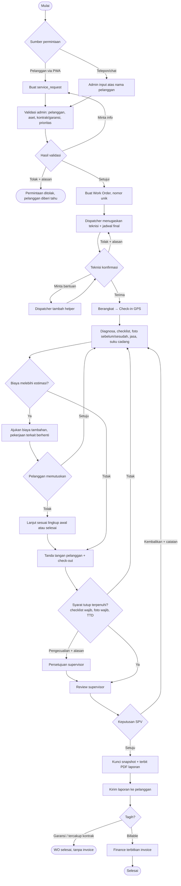

### 4.2 Alur Servis Berkala (Preventive Maintenance)

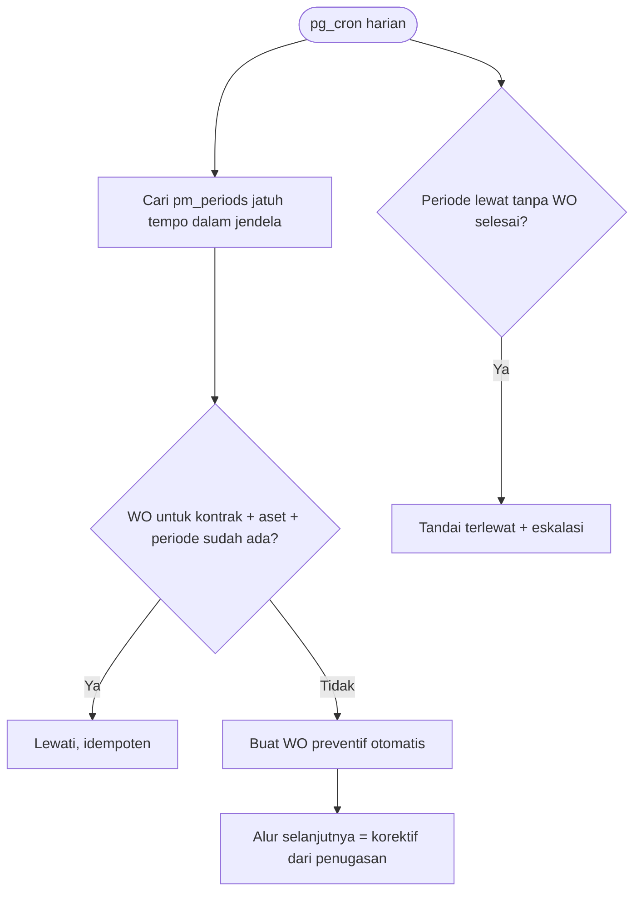

### 4.3 Alur Suku Cadang

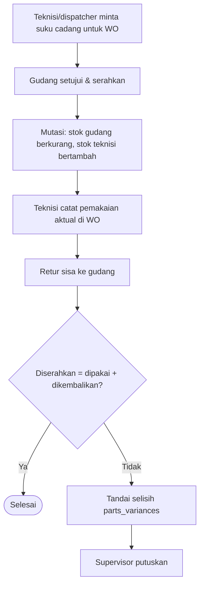

---

## 5. 👥 Use Case Diagram

| ID | Use Case | Aktor | Deskripsi | Prioritas | Lapis |
|---|---|---|---|---|---|
| UC-01 | Masuk / daftar / pulihkan akun | Semua | Staf: email+sandi. Pelanggan: undangan atau OTP | P0 | 1 |
| UC-02 | Pesan servis | Pelanggan | Aset (atau scan QR), jenis masalah, foto, jadwal diinginkan | P0 | 1 |
| UC-03 | Input permintaan atas nama pelanggan | Admin | Dari telepon/chat, kanal tercatat | P0 | 1 |
| UC-04 | Validasi permintaan | Admin | Setujui → WO, minta info, atau tolak | P0 | 1 |
| UC-05 | Kelola master data | Admin | Pelanggan, lokasi, aset, teknisi, layanan, template checklist | P0 | 1 |
| UC-06 | Tugaskan / tugaskan ulang teknisi | Dispatcher | Berdasar keahlian, lokasi, beban, jadwal | P0 | 1 |
| UC-07 | Terima / tolak / minta bantuan | Teknisi | Konfirmasi tugas | P0 | 1 |
| UC-08 | Berangkat, check-in, check-out | Teknisi | GPS hanya saat check-in/out | P0 | 1 |
| UC-09 | Isi checklist, foto, catatan, jasa | Teknisi | Bisa offline | P0 | 1 |
| UC-10 | Tanda tangan & tutup WO | Teknisi, Pelanggan | Dengan syarat penutupan | P0 | 1 |
| UC-11 | Pantau status & riwayat | Pelanggan | 6 status ringkas | P0 | 1 |
| UC-12 | Terbitkan PDF laporan | Sistem / Admin | Dari snapshot terkunci | P0 | 1 |
| UC-13 | Kelola pengguna & peran | Admin | Aktivasi/nonaktif, peran | P0 | 1 |
| UC-14 | Kelola kebijakan SLA & kalender | Pemilik/Admin | Konfigurasi [P] | P1 | 2 |
| UC-15 | Kelola kontrak & jadwal berkala | Admin | Aset tercakup, frekuensi | P1 | 2 |
| UC-16 | Ajukan & putuskan biaya tambahan | Teknisi, Pelanggan | Pekerjaan berhenti sampai diputuskan | P1 | 2 |
| UC-17 | Review laporan | Supervisor | Setujui / kembalikan | P1 | 2 |
| UC-18 | Minta, serahkan, pakai, retur suku cadang | Teknisi, Gudang | Ledger stok | P1 | 2 |
| UC-19 | Tangani selisih stok | Gudang, Supervisor | Tandai & putuskan | P1 | 2 |
| UC-20 | Terima notifikasi | Pelanggan, Staf | In-app, email, push opsional | P1 | 2 |
| UC-21 | Nilai layanan / komplain | Pelanggan | Komplain → WO REWORK oleh admin | P1 | 2 |
| UC-22 | Papan penjadwalan | Dispatcher | Drag-and-drop | P1 | 2 |
| UC-23 | Telusuri log audit | Pemilik, Supervisor | Append-only | P1 | 2 |
| UC-24 | Terbitkan invoice & ekspor CSV | Finance | WO disetujui & billable | P2 | 3 |
| UC-25 | Dashboard manajemen | Pemilik | SLA, produktivitas, profit kontrak | P2 | 3 |
| UC-26 | Impor Excel | Admin, Gudang | Dengan validasi baris | P2 | 3 |

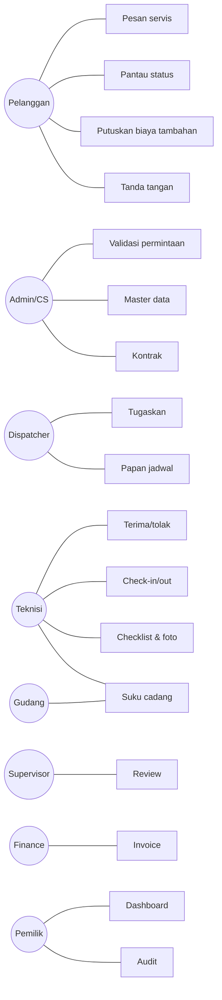

---

## 6. 🔁 Sequence Diagram

### 6.1 Autentikasi (skenario A: berdiri sendiri, Supabase Auth)

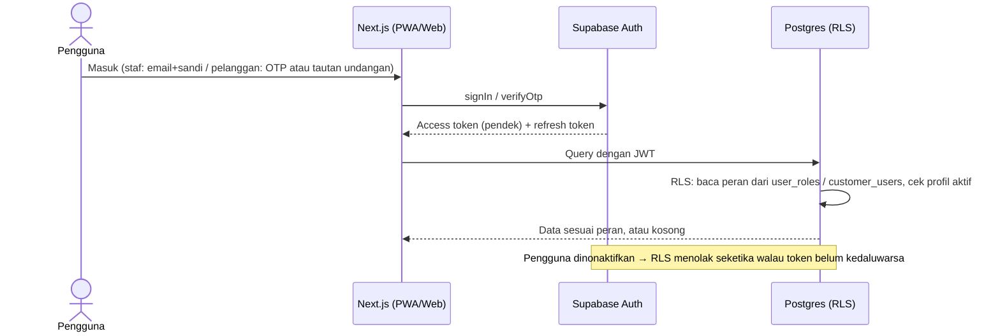

### 6.2 Pesan servis → WO (proses bisnis utama)

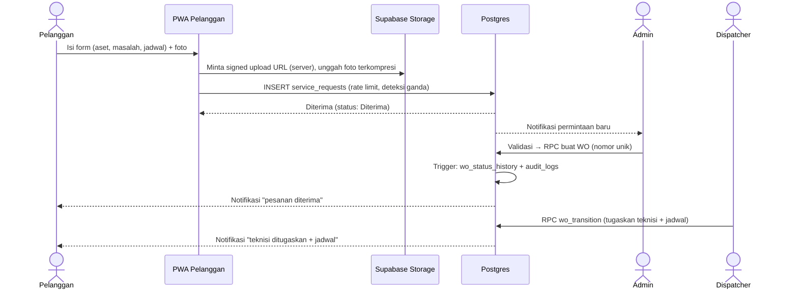

### 6.3 Sinkron offline teknisi

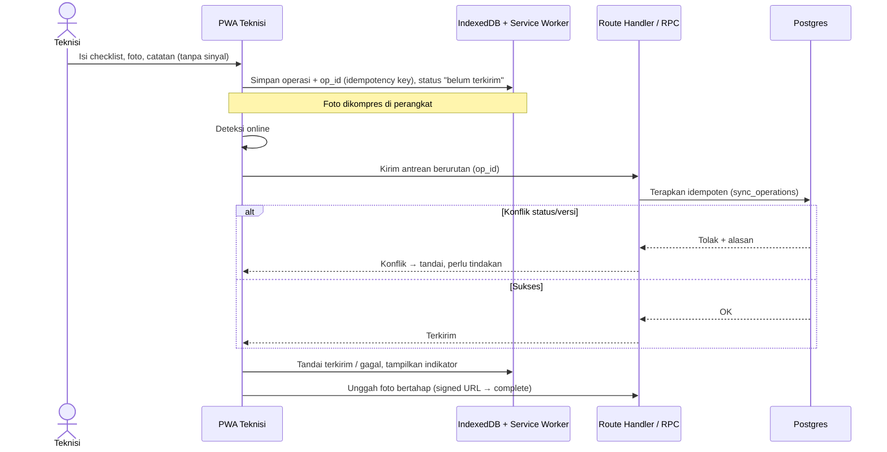

### 6.4 Persetujuan biaya tambahan

```mermaid
sequenceDiagram
    actor T as Teknisi
    participant DB as Postgres
    actor P as Pelanggan (PWA)
    T->>DB: Ajukan biaya tambahan (item katalog, alasan, foto)
    DB->>DB: Harga dihitung server; pekerjaan terkait diblokir
    DB-->>P: Notifikasi "menunggu persetujuan Anda"
    P->>DB: RPC extra_cost_decide (setuju / tolak)
    DB->>DB: Catat keputusan + audit, buka blokir
    DB-->>T: Notifikasi hasil
```

---

## 7. 🗄️ ERD / Data Model

Nama tabel mengikuti `docs/04_database_schema.sql` (sekitar 70 tabel). Di bawah ini inti saja. Semua entitas **dimiliki sistem ini** (tidak ada `[SYNC · read-only]`).

```mermaid
erDiagram
    CUSTOMERS ||--o{ CUSTOMER_USERS : "punya pengguna"
    CUSTOMERS ||--o{ CUSTOMER_SITES : "punya lokasi"
    CUSTOMER_SITES ||--o{ ASSETS : "berisi"
    ASSET_CATEGORIES ||--o{ ASSETS : "mengelompokkan"
    CUSTOMERS ||--o{ CONTRACTS : "terikat"
    CONTRACTS ||--o{ CONTRACT_ASSETS : "mencakup"
    ASSETS ||--o{ CONTRACT_ASSETS : "tercakup"
    CONTRACTS ||--o{ PM_PERIODS : "menjadwalkan"
    CONTRACTS }o--|| SLA_POLICY_SETS : "memakai"
    SLA_POLICY_SETS ||--o{ SLA_POLICIES : "per prioritas"
    CUSTOMERS ||--o{ SERVICE_REQUESTS : "memesan"
    ASSETS ||--o{ SERVICE_REQUESTS : "untuk"
    SERVICE_REQUESTS ||--o{ REQUEST_ATTACHMENTS : "lampiran"
    SERVICE_REQUESTS ||--o| WORK_ORDERS : "menjadi"
    ASSETS ||--o{ WORK_ORDERS : "dikerjakan"
    PM_PERIODS ||--o| WORK_ORDERS : "menghasilkan"
    WORK_ORDERS ||--o{ WO_STATUS_HISTORY : "riwayat"
    WORK_ORDERS ||--o{ WO_ASSIGNMENTS : "penugasan"
    TECHNICIANS ||--o{ WO_ASSIGNMENTS : "ditugaskan"
    WORK_ORDERS ||--o{ WO_VISITS : "kunjungan"
    WORK_ORDERS ||--o{ WO_CHECKLIST_ITEMS : "checklist"
    WORK_ORDERS ||--o{ WO_ATTACHMENTS : "foto"
    WORK_ORDERS ||--o{ WO_FINDINGS : "temuan"
    WORK_ORDERS ||--o{ WO_SIGNATURES : "tanda tangan"
    WORK_ORDERS ||--o{ WO_LABOR_LINES : "jasa"
    WORK_ORDERS ||--o{ WO_PART_USAGES : "pemakaian"
    WORK_ORDERS ||--o{ EXTRA_COST_APPROVALS : "biaya tambahan"
    EXTRA_COST_APPROVALS ||--o{ EXTRA_COST_APPROVAL_ITEMS : "item"
    WORK_ORDERS ||--o{ SLA_EVENTS : "SLA"
    WORK_ORDERS ||--o| SERVICE_REPORTS : "laporan PDF"
    WORK_ORDERS ||--o{ RATINGS : "penilaian"
    WORK_ORDERS ||--o{ COMPLAINTS : "komplain"
    WORK_ORDERS ||--o{ PART_REQUESTS : "permintaan barang"
    PART_REQUESTS ||--o{ PART_REQUEST_LINES : "baris"
    ITEMS ||--o{ STOCK_BALANCES : "saldo"
    STOCK_LOCATIONS ||--o{ STOCK_BALANCES : "lokasi"
    ITEMS ||--o{ STOCK_MOVEMENTS : "mutasi"
    WO_PART_USAGES ||--o| PARTS_VARIANCES : "selisih"
    WORK_ORDERS ||--o{ INVOICE_LINES : "ditagih"
    INVOICES ||--o{ INVOICE_LINES : "baris"
    INVOICES ||--o{ PAYMENTS : "pembayaran"
    PROFILES ||--o{ USER_ROLES : "peran"
    PROFILES ||--o{ NOTIFICATIONS : "menerima"
    WORK_ORDERS ||--o{ AUDIT_LOGS : "dicatat"
```

**Kepemilikan data**: semua master dimiliki sistem ini (CRUD penuh). Tabel pendukung lintas modul: `app_settings`, `document_counters`, `wo_transitions` (tabel transisi sah), `sync_operations`, `rate_limits`, `job_runs`, `access_logs`.

**Pemisahan yang sengaja dipertahankan** (jangan dipangkas salah): `audit_logs` (jejak perubahan bisnis untuk auditor) ≠ error monitoring; `sync_operations` (retry/idempotensi) ≠ alerting; `notifications` (status kirim) ≠ log kesalahan teknis.

---

## 8. 🧩 Component Architecture

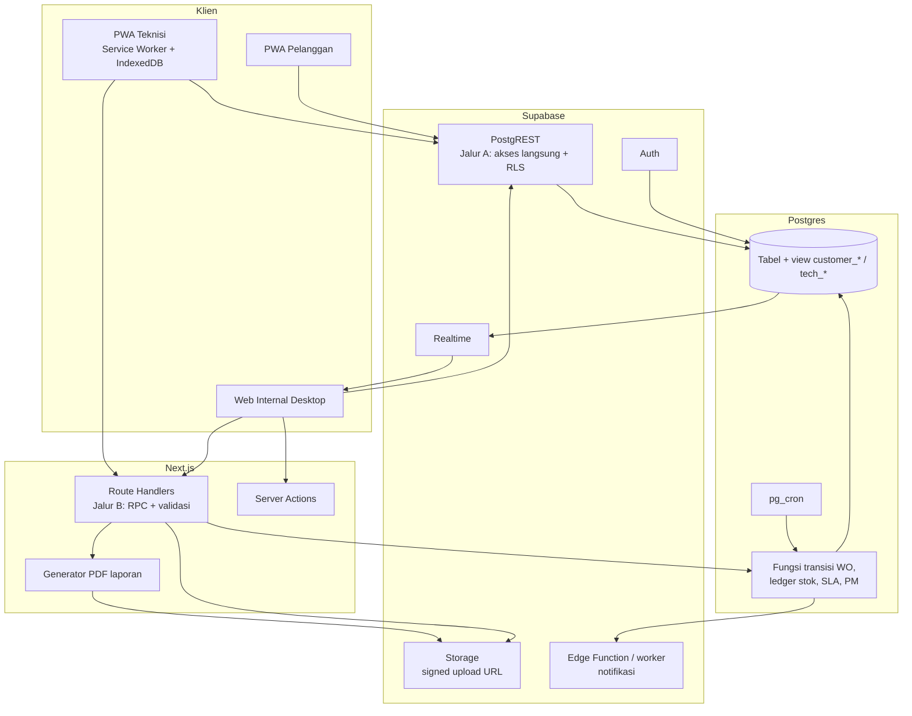

**Prinsip arsitektur** (dari 03/05):
- **Jalur A**: akses langsung Supabase (PostgREST + RLS) untuk baca dan tulis sederhana (pemesanan, rating, data lapangan teknisi dengan `Prefer: return=minimal`).
- **Jalur B**: Route Handler memanggil RPC dengan **JWT pengguna** (bukan `service_role`) untuk logika kritis: transisi status WO, penutupan, persetujuan biaya, stok, penerbitan laporan.
- Pelanggan **tidak** membaca tabel `work_orders`/`wo_*` langsung, hanya view `customer_*`. Teknisi membaca lewat view `tech_*` (tanpa harga).
- Unggahan foto hanya lewat **signed upload URL** dari server; hanya server yang menandai `UPLOADED`.
- Logika kritis (status, penutupan, stok) di server/Postgres, bukan di klien.

---

## 9. 🔌 Integration Map

Prinsip D-02: integrasi ditempel ke modul pemakainya.

| Integrasi | Arah | Dibangun di modul | Protokol / sistem | Prioritas | Catatan |
|---|---|---|---|---|---|
| Autentikasi, OTP/email, undangan | dua arah | M01 | Supabase Auth | P0 | Skenario A |
| Penyimpanan foto & PDF | KIRIM | M03/M06/M08 | Supabase Storage (signed URL) | P0 | Isolasi per pelanggan wajib diuji |
| Email transaksional | KIRIM | M13 | SMTP/Resend/SendGrid [P] | P1 | Kanal utama pelanggan |
| Notifikasi in-app | KIRIM | M13 | Realtime + tabel `notifications` | P1 | |
| Web Push | KIRIM | M13 | Web Push/VAPID | P1 (C) | iPhone hanya bila PWA terpasang |
| WhatsApp | KIRIM | M13 | `wa.me` (default) / WhatsApp Business API [P] | P1 (S) | Butuh keputusan kebijakan & template |
| Ekspor invoice | KIRIM | M15 | CSV / format impor akuntansi [P] | P2 | Format target belum diketahui |
| Impor data awal | AMBIL | M17 | Excel/CSV | P2 | Sekali pakai, bukan sinkronisasi |
| Pemindai QR | lokal | M06/M07 | Pustaka web + kamera | P1 (C) | |
| GPS saat check-in/out | lokal | M06 | Geolocation API | P0 (S) | Atas izin pengguna |
| Penjadwal job (PM, SLA) | internal | M09/M10 | `pg_cron` | P1 | Belum teruji di Supabase nyata |
| Error tracking | KIRIM | M01 | Sentry [A] | P1 | Terpisah dari audit |

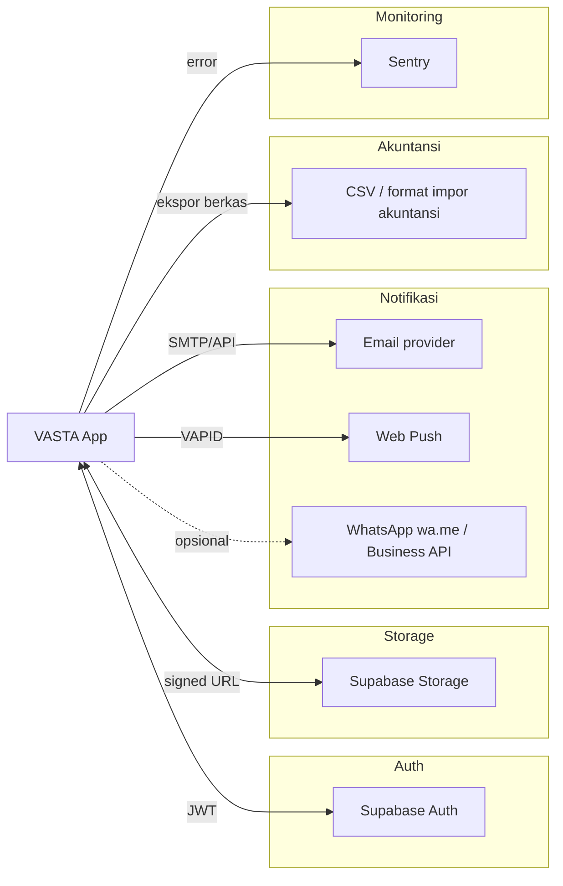

Tidak ada integrasi ke ERP, payment gateway, atau SSO korporat pada POC [S/A].

---

## 10. 🛠️ Technical Stack Recommendation

| Lapisan | Pilihan | Alasan |
|---|---|---|
| Frontend | **Next.js (App Router) + TypeScript**, Tailwind, shadcn/ui; PWA lewat service worker (mis. Serwist/Workbox) | Satu basis kode untuk 3 permukaan; keputusan user |
| Offline | **IndexedDB** (mis. Dexie) + antrean sinkron dengan `op_id` idempoten | Risiko teknis terbesar; dirancang sejak Lapis 1 |
| Backend | Route Handlers + Server Actions + RPC Postgres | Cukup untuk skala ini; tidak perlu backend terpisah |
| Database | **PostgreSQL (Supabase)** dengan RLS, view terbatas per peran, trigger histori/audit | Isolasi data pelanggan dipaksa di DB |
| Auth | Supabase Auth (email+sandi staf, OTP/undangan pelanggan) + RBAC lewat tabel | Skenario A |
| Storage | Supabase Storage, bucket privat, signed URL | |
| Realtime | Supabase Realtime (status WO, papan dispatcher) | |
| Job | `pg_cron` untuk WO berkala dan SLA; worker/Edge Function untuk notifikasi | |
| PDF | Pembuatan server-side dari snapshot terkunci (mis. `@react-pdf/renderer` atau headless render) [P] | |
| Hosting | Vercel (Next.js) + Supabase Cloud | Ringan untuk POC |
| Monitoring | Sentry (error), log Supabase; tanpa modul monitoring sendiri | Aturan: jangan duplikasi |
| CI/CD | GitHub Actions: lint, tipe, tes, secret scan, dependency audit | Quality gate PRD |
| Pengujian | Vitest/Playwright, pgTAP untuk isolasi RLS, uji perangkat nyata | |

---

## 11. 📋 Mini BRD

**Tujuan bisnis [S]**: menyatukan siklus permintaan sampai penagihan sehingga semua WO terlacak, SLA terukur, stok terkontrol, dan bukti kerja tersedia.

**Metrik keberhasilan [S]** (target [P], menunggu baseline wawancara): waktu permintaan→penugasan; % WO dalam SLA; waktu selesai→invoice; % servis berkala tepat waktu; jam administrasi dihemat; selisih stok; adopsi teknisi (% WO via aplikasi).

### Functional requirement (ringkas; lengkap di 02 §2)

| Modul | Rentang FR | Contoh kritikal (K) |
|---|---|---|
| M01 Platform & Akses | FR-001..007, FR-170..173 | FR-006 isolasi pelanggan |
| M02 Master Data | FR-010..015 | |
| M03 Permintaan | FR-020..029 | FR-020, FR-022 |
| M04 WO | FR-030..039 | FR-030, 031, 032, 037 |
| M05 Penugasan | FR-040..045 | |
| M06 PWA Teknisi | FR-050..063 | FR-051, 053, 055, 056 |
| M07 PWA Pelanggan | FR-070..081 | FR-074 |
| M08 Laporan | FR-140..142 | |
| M09 SLA | FR-090..094 | FR-091, 093 |
| M10 Kontrak & PM | FR-100..104 | FR-101 |
| M11 Persetujuan | FR-110..112 | FR-110 |
| M12 Stok | FR-120..127 | FR-123, 125 |
| M13 Notifikasi | FR-130..134 | |
| M15 Invoice | FR-150..153 | |
| M16 Dashboard | FR-160..163 | |

### Non-functional requirement

| ID | Requirement | Metrik |
|---|---|---|
| NFR-01 | Offline-first teknisi: buka tugas, isi checklist/foto tanpa sinyal, sinkron otomatis tanpa kehilangan | Lulus uji perangkat nyata Android & iPhone |
| NFR-02 | Isolasi data pelanggan di setiap query, Storage, dan view | 100% kasus uji isolasi lulus |
| NFR-03 | Kepatuhan UU PDP (inventaris data, retensi, akses) | Interpretasi analis, perlu verifikasi hukum |
| NFR-04 | Foto dikompresi di perangkat, unggah bertahap | Ukuran target [P] |
| NFR-05 | Audit append-only untuk perubahan penting | Setiap perubahan penting tercatat |
| NFR-06 | Keamanan dasar | OWASP Top 10, secret scan, dependency audit |
| NFR-07 | Kinerja dashboard pada data besar | Ambang [P] |
| NFR-08 | Dukungan perangkat & browser | Matriks ditetapkan di awal |

### Asumsi, kendala, dependensi
- **Asumsi**: lihat §2.1.
- **Kendala**: push iPhone hanya bila PWA terpasang; lokasi latar belakang tidak andal; penyimpanan offline dapat dibersihkan sistem [S].
- **Dependensi**: skema belum diuji di Supabase nyata (Storage, Realtime, `pg_cron`, PostgREST); nilai SLA dan retensi dari wawancara; format ekspor akuntansi.

---

## 12. ⚠️ Risiko & Catatan

| # | Risiko | Mitigasi |
|---|---|---|
| R1 | Sinkron offline gagal / data hilang | Antrean idempoten, indikator "belum terkirim", uji perangkat nyata, rancang di Lapis 1 |
| R2 | Kebocoran data antar pelanggan | RLS, view khusus, pgTAP, uji akses langsung & Storage |
| R3 | Definisi SLA ambigu (kapan timer berhenti/jeda) | Parameter di konfigurasi, validasi wawancara |
| R4 | Skema belum teruji di Supabase nyata | Uji awal (WP-002) sebelum bergantung pada RLS |
| R5 | Cakupan membengkak | Pegang Lapis, daftar tunggu |
| R6 | Push iPhone tidak andal | Email/in-app sebagai kanal utama |
| R7 | Terlihat meniru proyek lain | Data fiktif dan struktur sendiri |
| R8 | Data awal berantakan | Impor Excel dengan validasi (usulan maju ke Lapis 1/2) |

---

## 13. ✅ Checklist Dekomposisi

- [x] Skenario auth ditetapkan (A, berdiri sendiri) dan tertulis di Asumsi
- [x] Tidak ada rancangan yang menumpang auth induk
- [x] Setiap master punya pemilik identitas: sistem ini
- [x] Tidak ada entitas `[SYNC · read-only]` (tidak ada sinkronisasi master)
- [x] Tidak ada modul "Integrasi"; tiap integrasi ditempel ke modul pemakainya
- [x] Fondasi lintas modul (rate limit, sinkron, job log) disebut sekali di M01
- [x] Entitas anak WO tidak dijadikan modul terpisah
- [x] Peta integrasi mencantumkan modul tempat integrasi dibangun
- [ ] Format field per aliran data untuk integrasi ekspor/impor: **belum**, menunggu format target (§9)

---

## 14. 🚀 Rekomendasi Langkah Selanjutnya

1. **Menu & sub menu** per peran: sudah ada di `analysis/MENU-SUBMENU-SPESIFIKASI.md` (app-blueprint), diturunkan ke `analysis/Breakdown-VASTA-Field-Service.xlsx`.
2. **Timeline & effort**: sudah ada di `analysis/Estimasi-Timeline-Effort-VASTA-Field-Service.xlsx` (project-estimator), memakai pola di `referensi-timeline/`.
3. Uji skema di Supabase nyata sebelum bergantung pada RLS, Storage, dan `pg_cron`.
4. Masukkan **offline sync** ke Lapis 1 (usulan BA RK-01) dan majukan **impor Excel** bila dibutuhkan pilot.
5. Tawaran lanjutan: SRS lengkap, daftar endpoint rinci (sudah ada di `docs/03_api_design.md`), test case dari acceptance criteria.
