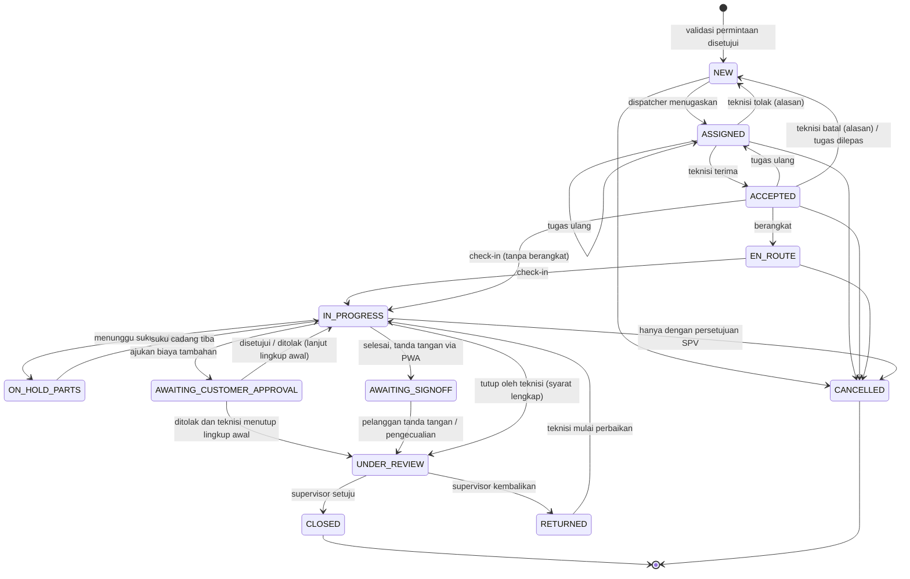
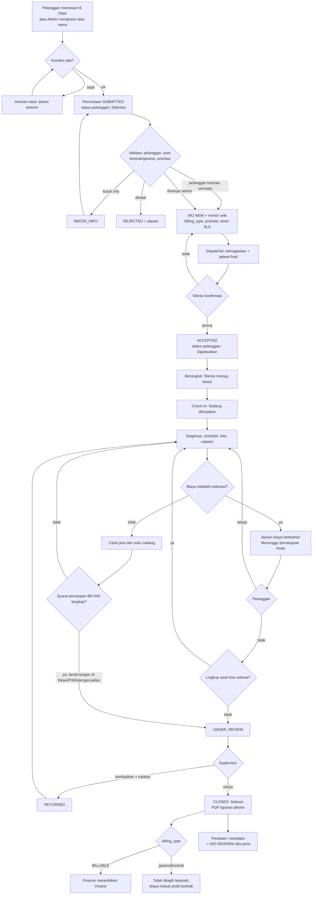
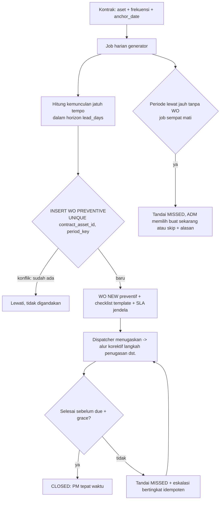
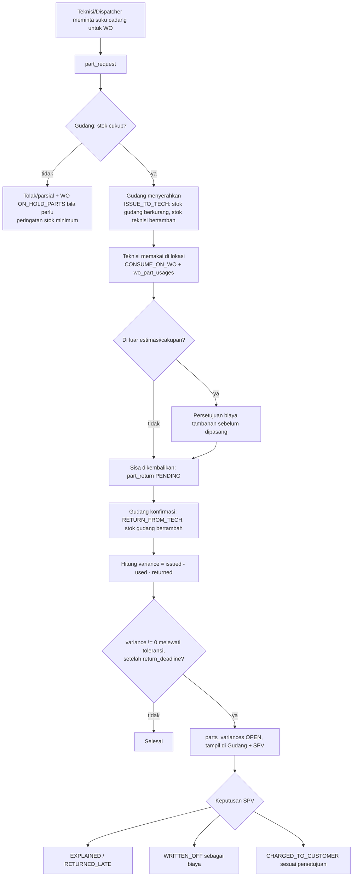

# Analisis Bisnis & Logika Teknis: Field Service & Work Order Management

Versi: 0.1 (draf) | Tanggal: 2026-10-11 | Status: belum divalidasi dengan perusahaan servis nyata

## 0. Cara Membaca Dokumen Ini

Sumber utama: dokumen kebutuhan "Field Service & Work Order Management" (revisi 2, pelanggan memesan langsung lewat PWA). Dokumen sumber sendiri berstatus draf dan harus divalidasi lewat wawancara.

Penanda asal informasi (dipakai di seluruh dokumen):

| Penanda | Arti |
|---|---|
| **[S]** | Berasal langsung dari dokumen sumber (boleh dikutip/dirujuk sebagai kebutuhan). |
| **[A]** | Asumsi analis. Harus divalidasi. Bukan fakta bisnis. |
| **[P]** | Parameter yang bisa dikonfigurasi. Nilai pastinya tidak ditetapkan di sini; nilai di seed demo hanya contoh. |

Prinsip: tidak ada angka bisnis (durasi SLA, toleransi, tarif, retensi) yang dianggap benar di dokumen ini. Semua angka dijadikan parameter [P] dan diisi setelah wawancara atau, untuk demo, memakai data fiktif.

Asumsi stack [A]: Next.js fullstack (App Router, Route Handlers/Server Actions), Supabase (Postgres, Auth, Storage, RLS, Realtime), PWA dengan service worker + IndexedDB untuk teknisi dan pelanggan. Aplikasi back-office (admin, dispatcher, supervisor, gudang, finance, manajemen) berupa web desktop biasa [S].

Catatan selisih: pesan tugas menyebut "7 peran", sedangkan tabel pengguna di dokumen sumber (bagian 3) memuat **8 peran**: Pelanggan, Admin/CS, Dispatcher, Teknisi, Supervisor, Gudang, Finance, Pemilik/Manajer. Dokumen ini memakai 8 peran sesuai sumber. Jika memang ingin 7, kandidat penggabungan adalah Admin/CS + Dispatcher (lihat pertanyaan terbuka OQ-01).

---

## 1. Stakeholder, Persona, dan Hak Akses

### 1.1 Persona

| # | Peran | Kanal | Tujuan utama [S] | Persona fiktif [A] | Titik nyeri yang diharapkan [A] |
|---|---|---|---|---|---|
| 1 | Pelanggan | PWA (ponsel) | Pesan servis, pantau status, setujui biaya tambahan, tanda tangan, unduh laporan/invoice | "Bu Sari", pengelola kantor kecil; "Pak Dedi", FM sebuah gedung dengan banyak aset | Tidak tahu teknisi kapan datang; takut biaya membengkak |
| 2 | Admin / Customer Service | Web desktop | Validasi permintaan, kelola pelanggan, aset, kontrak | "Rina", admin kantor | Input ganda, pesanan ganda/palsu |
| 3 | Dispatcher | Web desktop (papan jadwal) | Menugaskan teknisi berdasarkan keahlian, lokasi, ketersediaan | "Bayu" | Tidak tahu teknisi mana kosong |
| 4 | Teknisi | PWA (ponsel, sinyal buruk) | Lihat tugas, checklist, foto, suku cadang, tanda tangan | "Anto" | Aplikasi dianggap menambah kerja; offline |
| 5 | Supervisor | Web desktop | Review laporan, eskalasi, kualitas | "Ibu Lina" | Laporan tidak lengkap, bukti lemah |
| 6 | Gudang | Web desktop | Stok, permintaan, serah-terima ke teknisi | "Joko" | Selisih stok, barang tidak kembali |
| 7 | Finance | Web desktop | Invoice dari WO yang disetujui, tagih kontrak berkala | "Maya" | Invoice terlambat, pekerjaan tidak tertagih |
| 8 | Pemilik / Manajer | Web desktop | Dashboard SLA, produktivitas, biaya, profit | "Pak Hendra" | Tidak ada visibilitas real-time |

Sub-peran sisi pelanggan [A]: **Admin Pelanggan** (kelola pengguna perusahaannya) dan **Anggota Pelanggan** (memesan/melihat). Sumber hanya menyebut "peran admin pelanggan" dan "akun multi-pengguna per perusahaan pelanggan" [S, Lapis 3]. Pada Lapis 1, 1 akun = 1 pelanggan.

### 1.2 Prinsip Akses

- AP-1 [S]: Pelanggan hanya melihat aset, pesanan, dan dokumen miliknya sendiri (isolasi per `customer_id` di setiap query).
- AP-2 [A]: Teknisi hanya melihat WO yang ditugaskan kepadanya (sebagai lead atau helper) plus riwayat aset terkait WO tersebut. Tidak melihat harga/margin.
- AP-3 [A]: Data biaya internal (HPP, margin, catatan internal, alasan eskalasi) tidak pernah dikirim ke pelanggan. Pelanggan membaca lewat view/RPC khusus, bukan tabel mentah.
- AP-4 [A]: Perubahan hak akses hanya oleh Admin (peran staf) dan tercatat di audit.

### 1.3 Matriks Peran x Resource x Aksi [A]

Seluruh matriks adalah asumsi analis (sumber hanya menyebut "peran dan hak akses dasar"). Legenda: **C**=buat, **R**=baca, **U**=ubah, **D**=hapus/nonaktifkan, **A**=setujui/putuskan, **X**=eksekusi aksi khusus, `*`=hanya milik sendiri / yang ditugaskan, `-`=tidak ada akses. Penghapusan fisik tidak ada; "D" berarti nonaktifkan (soft delete).

Kolom: PLG=Pelanggan, ADM=Admin/CS, DSP=Dispatcher, TEK=Teknisi, SPV=Supervisor, GDG=Gudang, FIN=Finance, OWN=Pemilik/Manajer.

| Resource | PLG | ADM | DSP | TEK | SPV | GDG | FIN | OWN |
|---|---|---|---|---|---|---|---|---|
| Pelanggan (customers) | R* (profil sendiri), U* terbatas | C R U D | R | R* (nama, kontak lokasi WO) | R | - | R | R |
| Pengguna pelanggan (customer_users) | C R U D* (hanya Admin Pelanggan, Lapis 3) | C R U D | - | - | - | - | - | R |
| Lokasi (sites) | R* | C R U D | R | R* | R | - | R | R |
| Aset | R* | C R U D | R | R* (+ U catatan lapangan terbatas) | R | - | R | R |
| Kontrak | R* (ringkasan) | C R U D | R | - | R | - | R | R, A (persetujuan kontrak, opsional) |
| Teknisi & keahlian | - | C R U D | R | R* (profil sendiri) | R | - | R | R |
| Permintaan servis (service_requests) | C R* (U sebelum divalidasi, batal) | C R U A (validasi/tolak) | R | - | R | - | R | R |
| Work Order | R* (view pelanggan) | C R U, X (batal) | R, U (jadwal, prioritas), X (tugaskan, tugas ulang, batal) | R*, X (terima/tolak, berangkat, check-in/out, tutup) | R, A (setujui/kembalikan), X (override) | R (hanya bagian suku cadang) | R | R |
| Penugasan (assignment) | R* (nama teknisi + jadwal) | R | C R U | R*, U* (terima/tolak) | R | - | - | R |
| Checklist, catatan, temuan | - | R | R | C R U* | R, U (komentar) | - | - | R |
| Foto | C R* (foto pesanan) ; R* (foto laporan) | R | R | C R* (tidak bisa hapus setelah sinkron) | R | - | - | R |
| Tanda tangan | C* (tanda tangan penerimaan) | R | R | C* (merekam tanda tangan di lokasi) | R | - | R | R |
| Persetujuan biaya tambahan | R* A* | R, X (atas nama pelanggan dengan bukti) | R | C* (mengajukan) | R, A (override dengan alasan) | - | R | R |
| Master barang (items) | - | R | R | R | R | C R U D | R | R |
| Stok & mutasi | - | - | R | R* (stok yang dipegang) | R | C R U (mutasi), A (penyesuaian) | R | R |
| Permintaan suku cadang | - | R | C R | C R* | R | R, A (setujui, serahkan) | R | R |
| Pemakaian suku cadang di WO | - | R | R | C R U* (sebelum tutup) | R, U (koreksi dengan alasan) | R | R | R |
| Selisih suku cadang (variance) | - | - | R | R* (penjelasan) | R, A (putuskan) | R, U | R | R |
| Laporan servis (PDF) | R* (unduh) | R | R | R* | R, X (terbitkan ulang) | - | R | R |
| Invoice / pembayaran | R* (Lapis 3) | R | - | - | R | - | C R U X (terbit, ekspor) | R |
| Penilaian & komplain | C R* | R, U (tindak lanjut) | R | R* (penilaian atas dirinya, tanpa identitas pelanggan [A]) | R, A | - | - | R |
| Konfigurasi SLA / kalender | - | R | R | - | R | - | - | C R U D (atau Admin; lihat OQ-12) |
| Notifikasi (preferensi sendiri) | C R U* | C R U* | C R U* | C R U* | C R U* | C R U* | C R U* | C R U* |
| Dashboard manajemen | - | - | R (operasional) | R* (kinerja sendiri) | R | - | R (keuangan) | R |
| Log audit | - | - | - | - | R (terbatas) | - | - | R |
| Pengguna & peran staf | - | C R U D | - | - | - | - | - | R |
| Impor data awal | - | X | - | - | - | X (stok) | - | - |

---

## 2. Functional Requirements

Lapis mengikuti dokumen sumber [S]. Penomoran FR dan pemecahan modul adalah turunan analis. Prioritas MoSCoW tidak dicantumkan karena prioritas sudah dikendalikan oleh Lapis. Tanda "(K)" = kritikal, punya acceptance criteria di 2.18.

### 2.1 Modul AUTH: Akun & Akses

| ID | Requirement | Lapis |
|---|---|---|
| FR-001 | Staf masuk dengan email + kata sandi; peran disimpan di `user_roles` dan dimasukkan ke JWT claim lewat Auth Hook. [A teknis] | 1 |
| FR-002 | Pelanggan registrasi mandiri dengan verifikasi email/OTP dan/atau menerima undangan sekali pakai dari admin. Model mana yang dipakai ditentukan wawancara [S]. | 1 |
| FR-003 | Pemulihan akun (lupa kata sandi). [S] | 1 |
| FR-004 | Admin Pelanggan mengundang/menonaktifkan pengguna di perusahaannya. [S] | 3 |
| FR-005 | Rate limit pendaftaran dan perlindungan pendaftaran palsu (captcha atau setara). [S] | 1 |
| FR-006 (K) | Setiap query data pelanggan dibatasi `customer_id` lewat RLS; pengguna tanpa pemetaan pelanggan tidak melihat apa pun. [S] | 1 |
| FR-007 | Pembatalan sesi/penonaktifan pengguna berlaku segera (token pendek + cek status pengguna di RLS/endpoint sensitif). [A] | 1 |

### 2.2 Modul MD: Master Data

| ID | Requirement | Lapis |
|---|---|---|
| FR-010 | CRUD pelanggan, lokasi (site), aset, teknisi, jenis layanan. [S] | 1 |
| FR-011 | Aset memiliki kode unik dan kode QR yang dapat dicetak; mencakup kategori, serial, tanggal garansi mulai/akhir. [A rinci; QR [S]] | 1 |
| FR-012 | Teknisi memiliki daftar keahlian (skill) dan wilayah kerja. [S: keahlian, lokasi] | 1 |
| FR-013 | Template checklist per jenis layanan/kategori aset, dengan penanda item wajib dan syarat foto. [A] | 1 |
| FR-014 | Impor Excel (aset, pelanggan, stok) dengan validasi baris dan laporan galat sebelum commit. [S] | 3 |
| FR-015 | Penonaktifan (soft delete) alih-alih penghapusan untuk data yang sudah dipakai WO. [A] | 1 |

### 2.3 Modul REQ: Permintaan Servis

| ID | Requirement | Lapis |
|---|---|---|
| FR-020 (K) | Pelanggan membuat permintaan: aset (atau scan QR), jenis masalah, foto, jadwal diinginkan; kolom wajib minimum. [S] | 1 |
| FR-021 | Admin menginput permintaan atas nama pelanggan (telepon/chat); sumber (`channel`) dicatat. [S] | 1 |
| FR-022 (K) | Validasi oleh admin: cek pelanggan, aset, kontrak/garansi, prioritas; hasil: setujui (menjadi WO), minta info, tolak dengan alasan. [S] | 1 |
| FR-023 | Auto-validasi untuk pelanggan berkontrak aktif bila aset tercakup (aturan otomatis). [S, "atau aturan otomatis untuk pelanggan kontrak"] | 2 |
| FR-024 | Deteksi pesanan ganda: peringatan jika ada permintaan/WO terbuka untuk aset yang sama dengan jenis masalah serupa dalam jendela waktu [P]. [S: deteksi pesanan ganda] | 1 |
| FR-025 | Rate limit pemesanan per pelanggan/IP [P]. [S] | 1 |
| FR-026 | Validasi unggahan foto (tipe, ukuran, jumlah) di klien dan server. [S] | 1 |
| FR-027 | Jadwal dari pelanggan hanya preferensi; jadwal final ditetapkan dispatcher lalu pelanggan diberi tahu. [S] | 1 |
| FR-028 | Pesanan tanpa koneksi disimpan di antrean lokal dengan penanda "belum terkirim". [S] | 1 |
| FR-029 | Pelanggan melihat estimasi waktu respons sesuai SLA setelah memesan. [S] | 2 |

### 2.4 Modul WO: Work Order

| ID | Requirement | Lapis |
|---|---|---|
| FR-030 (K) | Pembuatan WO dengan nomor unik, berurutan, tidak bisa duplikat (lihat BR-001). [S: nomor unik] | 1 |
| FR-031 (K) | Setiap WO punya satu status aktif + riwayat perubahan status (siapa, kapan, dari, ke, alasan). [S] | 1 |
| FR-032 (K) | Perpindahan status hanya lewat fungsi transisi server-side sesuai tabel di bagian 4; klien tidak mengubah kolom status langsung. [A teknis] | 1 |
| FR-033 | Pembatalan WO dengan alasan wajib, mengikuti guard per status. [S: kasus tepi] | 1 |
| FR-034 | Penugasan ulang (reassign) dengan alasan dan histori penugasan. [S: kasus tepi] | 1 |
| FR-035 | Tipe WO: korektif, preventif, ulang/rework (terhubung ke WO induk). [A, rework dari "pengajuan ulang atau komplain" [S]] | 1 |
| FR-036 | Tampilan status untuk pelanggan dipetakan dari status internal (bagian 4.2), tanpa membocorkan status internal. [S] | 1 |
| FR-037 (K) | Penutupan WO tunduk pada syarat penutupan (BR-040). [S] | 1 |
| FR-038 | Review supervisor: setujui atau kembalikan dengan catatan; WO kembali ke teknisi. [S] | 2 |
| FR-039 | Pencarian/penyaringan WO berdasarkan status, prioritas, pelanggan, teknisi, tanggal. [A; "pencarian lanjutan" [S] Lapis 3] | 1 (dasar), 3 (lanjutan) |

### 2.5 Modul DSP: Penugasan & Penjadwalan

| ID | Requirement | Lapis |
|---|---|---|
| FR-040 | Penugasan manual teknisi oleh dispatcher; tampilan keahlian, lokasi, beban kerja, jadwal. [S] | 1 |
| FR-041 | Dispatcher menetapkan jadwal final (tanggal + jendela waktu). [S] | 1 |
| FR-042 | Papan penjadwalan kalender/papan kerja dengan drag-and-drop. [S] | 2 |
| FR-043 | Peringatan bentrok jadwal teknisi dan ketidakcocokan keahlian (peringatan lunak, dapat di-override dengan alasan). [A] | 2 |
| FR-044 | Penugasan teknisi tambahan (helper) saat teknisi minta bantuan. [S: "minta bantuan"] | 1 |
| FR-045 | Pantauan pekerjaan hari ini (daftar + status + terlambat). [S] | 1 |

### 2.6 Modul TEK: Aplikasi Teknisi (PWA)

| ID | Requirement | Lapis |
|---|---|---|
| FR-050 | Daftar tugas hari ini dan beberapa hari ke depan [P], tersedia offline. [S] | 1 |
| FR-051 (K) | Teknisi konfirmasi tugas: terima, tolak dengan alasan, atau minta bantuan. [S] | 1 |
| FR-052 | Tombol "Berangkat" (menuju lokasi) menghasilkan status yang terlihat pelanggan. [S, dari status pelanggan] | 1 |
| FR-053 (K) | Check-in di lokasi dengan GPS (atas izin) dan waktu; check-out serupa. GPS hanya saat check-in/out, bukan pelacakan kontinu. [S] | 1 |
| FR-054 | Detail aset + riwayat servis aset, tersedia offline untuk WO yang di-cache. [S] | 1 |
| FR-055 (K) | Pengisian checklist (item wajib), catatan, temuan/diagnosa. [S] | 1 |
| FR-056 (K) | Foto sebelum/sesudah, kompresi di perangkat, unggah bertahap (bagian 6). [S] | 1 |
| FR-057 | Pindai QR/barcode aset untuk membuka aset/WO yang benar. [S] | 1 |
| FR-058 | Tanda tangan pelanggan di kanvas, nama penandatangan, waktu. [S] | 1 |
| FR-059 | Pencatatan jasa/pekerjaan (labor) dan suku cadang dipakai di lapangan. [S] | 1 (jasa), 2 (suku cadang terhubung stok) |
| FR-060 | Indikator "belum terkirim/menunggu sinkron/terkirim/gagal" per item dan global. [S] | 1 |
| FR-061 | Minta suku cadang dari WO. [S] | 2 |
| FR-062 | Mengajukan biaya tambahan (item, alasan, foto) dan menghentikan pekerjaan terkait sampai ada jawaban. [S] | 2 |
| FR-063 | Layar sederhana: tombol besar, minim ketikan (kriteria desain). [S] | 1 |

### 2.7 Modul CUS: PWA Pelanggan

| ID | Requirement | Lapis |
|---|---|---|
| FR-070 | Daftar aset milik pelanggan. [S] | 1 |
| FR-071 | Status pesanan 6 tahap ringkas + riwayat pesanan. [S] | 1 |
| FR-072 | Dapat dipakai dari browser tanpa memasang PWA; pemasangan hanya ditawarkan. [S] | 1 |
| FR-073 | Riwayat dapat dibuka offline (baca saja). [S] | 1 |
| FR-074 (K) | Menyetujui/menolak biaya tambahan di PWA dengan rincian item dan total. [S] | 2 |
| FR-075 | Tanda tangan penerimaan hasil kerja di PWA (jika tidak dilakukan di perangkat teknisi). [S] | 2 |
| FR-076 | Unduh laporan servis (PDF). [S] | 2 |
| FR-077 | Penilaian layanan; pengajuan ulang/komplain atas pekerjaan. [S] | 2 |
| FR-078 | Dashboard aset dan jadwal servis berkala. [S] | 3 |
| FR-079 | Invoice dan pembayaran tercatat (bukan gateway pembayaran; pencatatan saja [A]). [S] | 3 |
| FR-080 | Pelacakan status lebih rinci (nama teknisi, perkiraan waktu tiba berbasis jadwal, bukan GPS real-time). [S; batas GPS [S]] | 3 |
| FR-081 | Bahasa Indonesia sederhana, huruf besar. [S] | 1 |

### 2.8 Modul SLA

| ID | Requirement | Lapis |
|---|---|---|
| FR-090 | Prioritas WO; kebijakan SLA (batas respons & penyelesaian) per prioritas/kontrak. [S] | 2 |
| FR-091 (K) | Perhitungan tenggat dengan jam kerja kontrak (BR-010 s.d. BR-013). [S] | 2 |
| FR-092 | Penanda mendekati batas (warning) dan terlambat (breach). [S] | 2 |
| FR-093 (K) | Eskalasi bertingkat otomatis (BR-014). [S] | 2 |
| FR-094 | Kalender kerja & hari libur dikelola (per kontrak atau default). [A] | 2 |

### 2.9 Modul PM & Kontrak

| ID | Requirement | Lapis |
|---|---|---|
| FR-100 | Kontrak pemeliharaan: pelanggan, periode, aset tercakup, frekuensi (bulanan, triwulan, tahunan), kebijakan SLA, aturan cakupan. [S] | 2 |
| FR-101 (K) | Pembuatan otomatis WO preventif sebelum jatuh tempo dan **tidak boleh digandakan** (BR-020 s.d. BR-024). [S] | 2 |
| FR-102 | Jadwal terlewat ditandai dan dieskalasi. [S] | 2 |
| FR-103 | Penagihan kontrak berkala (invoice periodik) terpisah dari WO. [S] | 3 |
| FR-104 | Biaya & profit per kontrak. [S] | 3 |

### 2.10 Modul APR: Persetujuan

| ID | Requirement | Lapis |
|---|---|---|
| FR-110 (K) | Persetujuan biaya tambahan sebelum dikerjakan (BR-050 s.d. BR-054). [S] | 2 |
| FR-111 | Review supervisor (FR-038) dengan antrean persetujuan. [S] | 2 |
| FR-112 | Pengecualian penutupan (tanpa tanda tangan) wajib alasan + persetujuan supervisor. [S: "kecuali dengan alasan tercatat"; wajib persetujuan SPV [A]] | 2 |

### 2.11 Modul INV: Suku Cadang & Stok

| ID | Requirement | Lapis |
|---|---|---|
| FR-120 | Master barang (kode, nama, satuan, harga jual/biaya sebagai kolom, batas minimum stok). [S] | 2 |
| FR-121 | Stok per lokasi (gudang, teknisi/kendaraan) berbasis buku besar mutasi. [S: "tercatat ke teknisi atau kendaraan"] | 2 |
| FR-122 | Permintaan suku cadang oleh teknisi/dispatcher untuk WO. [S] | 2 |
| FR-123 (K) | Penyerahan oleh gudang mengurangi stok gudang dan menambah stok teknisi (BR-030). [S] | 2 |
| FR-124 | Pemakaian aktual per WO; pengembalian sisa. [S] | 2 |
| FR-125 (K) | Deteksi dan penandaan selisih (BR-031 s.d. BR-034). [S] | 2 |
| FR-126 | Peringatan stok di bawah minimum / habis. [S: "suku cadang mana yang habis"] | 2 |
| FR-127 | Penyesuaian stok (opname) oleh Gudang dengan alasan, perlu persetujuan SPV bila di atas ambang [P]. [A] | 2 |

### 2.12 Modul NOT: Notifikasi

| ID | Requirement | Lapis |
|---|---|---|
| FR-130 | Notifikasi dalam aplikasi dan email. [S] | 2 |
| FR-131 | Push web jika memungkinkan; email (dan WhatsApp) sebagai kanal utama pelanggan, push tambahan. [S] | 2 |
| FR-132 | Peristiwa pelanggan: pesanan diterima, teknisi ditugaskan + jadwal, teknisi menuju lokasi, pekerjaan selesai. [S] Tambahan [A]: butuh persetujuan, WO dibatalkan, permintaan info. | 2 |
| FR-133 | Kanal WhatsApp: dokumen sumber menyebutnya sebagai opsi; integrasi resmi (WhatsApp Business API) berbayar dan butuh template. Default: tautan `wa.me` / ditunda. [A, lihat OQ-09] | 2/3 |
| FR-134 | Preferensi kanal per pengguna; deduplikasi notifikasi dan pencatatan status kirim. [A] | 2 |

### 2.13 Modul RPT: Laporan Servis

| ID | Requirement | Lapis |
|---|---|---|
| FR-140 | Pembuatan PDF laporan servis: data WO, aset, temuan, checklist, foto, suku cadang/jasa (tanpa HPP), tanda tangan, waktu check-in/out. [S] | 1 |
| FR-141 | PDF dibuat server-side dari snapshot data yang dikunci saat WO ditutup/di-approve; versi ulang jika dikoreksi (nomor revisi). [A] | 1 |
| FR-142 | Pengiriman laporan ke pelanggan setelah approval SPV. [S] | 2 |

### 2.14 Modul BIL: Invoice

| ID | Requirement | Lapis |
|---|---|---|
| FR-150 | Finance menerbitkan invoice dari WO berstatus disetujui dan `billing_type = BILLABLE`. [S] | 3 |
| FR-151 | WO garansi/tercakup kontrak tidak ditagih terpisah (BR-060). [S] | 3 |
| FR-152 | Ekspor invoice ke CSV/format impor akuntansi. [S] | 3 |
| FR-153 | Metrik waktu dari selesai ke invoice. [S] | 3 |

### 2.15 Modul DSH: Dashboard & Laporan

| ID | Requirement | Lapis |
|---|---|---|
| FR-160 | Dashboard manajemen: % WO dalam SLA, waktu penyelesaian, produktivitas teknisi, perulangan kerusakan per aset, biaya & profit per kontrak. [S] | 3 |
| FR-161 | Riwayat dan statistik per aset. [S] | 3 |
| FR-162 | Laporan lanjutan dan ekspor. [S] | 3 |
| FR-163 | Ukuran keberhasilan studi kasus (dokumen sumber bagian 9) dapat dihitung dari data: waktu permintaan ke penugasan, % WO dalam SLA, selesai ke invoice, % PM tepat waktu, selisih stok, % WO diselesaikan lewat aplikasi. [S] | 3 |

### 2.16 Modul AUD: Audit & Keamanan

| ID | Requirement | Lapis |
|---|---|---|
| FR-170 (K) | Log audit append-only untuk perubahan penting (BR-070). [S] | 2 |
| FR-171 | Log akses atas data pelanggan (baca dokumen/foto oleh staf). [S: "log akses"] | 2 |
| FR-172 | Retensi dan penghapusan/anonimisasi data pribadi sesuai kebijakan (NFR-S6). [S: "kebijakan penyimpanan"] | 2/3 |
| FR-173 | Pengujian isolasi data pelanggan otomatis (lihat NFR-S2). [S: "harus diuji khusus"] | 1 |

### 2.17 Kebutuhan Lintas Lapis

Quality gate di tiap lapisan (tes, pemindaian keamanan, pemeriksaan data pribadi) [S]. Fitur di luar lapis masuk daftar tunggu [S]. Yang sengaja tidak dibuat: optimasi rute otomatis, pelacakan GPS kontinu, pengadaan penuh, penggajian/absensi, aplikasi native [S].

### 2.18 Acceptance Criteria (Given/When/Then) untuk FR Kritikal

**FR-006 Isolasi pelanggan**
- Given pelanggan A dan B masing-masing memiliki aset dan WO; When pengguna A memanggil API/RPC apa pun dengan ID WO milik B (termasuk lewat tebakan ID, URL foto, dan Storage path); Then respons 404/kosong dan tidak ada byte data B yang dikembalikan.
- Given pengguna dengan `customer_id` null; When mengakses tabel mana pun yang berisi data pelanggan; Then hasil kosong.

**FR-020 Pesan servis**
- Given pelanggan masuk dan memiliki aset X; When memilih aset X, jenis masalah, dan mengirim tanpa foto; Then permintaan tersimpan berstatus Diterima (foto opsional) dan nomor permintaan tampil.
- Given tidak ada koneksi; When pelanggan mengirim; Then permintaan tampil "belum terkirim" dan terkirim otomatis saat online tanpa membuat duplikat (idempotency key).
- Given pelanggan sudah mencapai batas laju [P]; When mengirim lagi; Then ditolak dengan pesan jelas.

**FR-022 Validasi**
- Given permintaan berstatus SUBMITTED; When admin menyetujui; Then WO terbentuk dengan nomor unik, `billing_type` dan prioritas terisi, permintaan menjadi CONVERTED, pelanggan menerima notifikasi.
- Given aset tidak milik pelanggan pemohon; When admin memvalidasi; Then sistem menolak pembuatan WO.

**FR-032 Transisi**
- Given WO berstatus CLOSED; When klien mengirim update langsung ke kolom status; Then ditolak oleh RLS/trigger, dan hanya fungsi transisi yang diizinkan.

**FR-051 Teknisi menolak**
- Given WO ASSIGNED ke teknisi T; When T menolak tanpa alasan; Then ditolak (alasan wajib). When T menolak dengan alasan; Then WO kembali ke NEW, dispatcher mendapat notifikasi, histori penugasan menyimpan penolakan.

**FR-053 Check-in**
- Given WO ACCEPTED/EN_ROUTE dan teknisi memberi izin GPS; When check-in; Then waktu, koordinat, dan akurasi tercatat dan status menjadi IN_PROGRESS.
- Given izin GPS ditolak atau tidak tersedia; When check-in; Then check-in tetap bisa dengan penanda "tanpa lokasi" dan alasan, terlihat oleh supervisor (tidak memblokir pekerjaan [A]).

**FR-056 Foto offline**
- Given offline; When teknisi mengambil 5 foto; Then foto dikompres, disimpan di IndexedDB, tampil "belum terkirim"; When online kembali; Then semua terunggah, status menjadi "terkirim", tanpa duplikat meski unggahan terputus di tengah.

**FR-074 / BR-050 Biaya tambahan**
- Given WO IN_PROGRESS dan teknisi mengajukan biaya tambahan; Then status menjadi AWAITING_CUSTOMER_APPROVAL, pelanggan melihat "Menunggu persetujuan Anda" dengan rincian, dan item tambahan tidak bisa dicatat sebagai dikerjakan.
- Given pelanggan menyetujui; Then persetujuan tercatat (siapa, kapan, nilai, versi) dan WO kembali IN_PROGRESS. Given menolak; Then lihat T-17.

**FR-101 PM tanpa duplikat**
- Given job generator dijalankan dua kali (atau dua instans bersamaan) untuk periode yang sama; Then hanya satu WO per (kontrak-aset, periode) yang ada.

**FR-123/125 Suku cadang**
- Given gudang menyerahkan 5 unit ke teknisi, 3 dipakai pada WO, 1 dikembalikan; When WO ditutup; Then selisih 1 unit ditandai terbuka dan terlihat oleh Gudang dan Supervisor.
- Given stok gudang 2; When gudang mencoba menyerahkan 3; Then ditolak (stok tidak boleh negatif).

**FR-037 / BR-040 Penutupan**
- Given checklist wajib belum lengkap; When teknisi menutup; Then penutupan ditolak dengan daftar kekurangan.
- Given pelanggan tidak ada di lokasi; When teknisi memilih "tanpa tanda tangan" dengan alasan; Then WO masuk review SPV dengan penanda pengecualian, dan SPV harus menyetujui pengecualian.

**FR-038 Dikembalikan**
- Given WO UNDER_REVIEW; When SPV mengembalikan dengan catatan; Then WO kembali ke teknisi (RETURNED), catatan tampil di aplikasi teknisi, dan tanda tangan sebelumnya tidak dianggap valid bila data bermakna berubah (lihat T-24).

**FR-093 Eskalasi**
- Given WO belum ditugaskan dan sisa waktu respons mencapai ambang warning; Then WO ditandai dan notifikasi ke dispatcher; When melewati tenggat; Then status SLA menjadi BREACHED_RESPONSE dan notifikasi ke supervisor; tiap tingkat dikirim sekali (idempotent).

**FR-170 Audit**
- Given SPV mengubah prioritas WO; Then baris audit berisi aktor, waktu, nilai lama/baru, dan tidak dapat diubah/dihapus oleh peran aplikasi mana pun.

---

## 3. Non-Functional Requirements

Target angka bersifat usulan [A][P] dan harus diuji; sumber tidak memuat angka kinerja.

### 3.1 Offline-first (NFR-O)

| ID | Requirement |
|---|---|
| NFR-O1 [S] | Teknisi bisa membuka tugas dan mengisi checklist tanpa sinyal; sinkron otomatis saat online. |
| NFR-O2 [S] | Antrean sinkron tahan gangguan; indikator "belum terkirim"; batas ukuran dan kompresi foto. |
| NFR-O3 [A] | Tidak ada kehilangan data yang sudah ditampilkan sebagai tersimpan. Item di antrean baru dihapus setelah konfirmasi server. |
| NFR-O4 [A] | Data tugas yang di-cache dibatasi pada WO yang ditugaskan + jendela hari [P]; data cache dibersihkan saat logout dan saat WO selesai tersinkron. |
| NFR-O5 [S] | Peramban dan perangkat yang didukung ditetapkan eksplisit; diuji di Android dan iPhone nyata. |
| NFR-O6 [A] | Minta `navigator.storage.persist()`; pantau `storage.estimate()`; tampilkan peringatan jika kuota menipis. |
| NFR-O7 [A] | Pelanggan: baca riwayat offline; kirim pesanan lewat antrean sederhana. |

### 3.2 Keamanan & Isolasi Data (NFR-S)

| ID | Requirement |
|---|---|
| NFR-S1 [S] | Akses berbasis peran; enkripsi (TLS dalam perjalanan; enkripsi saat diam disediakan platform [A]). |
| NFR-S2 [S] | Isolasi per pelanggan di setiap query; pengujian khusus otomatis (dua pelanggan, uji seluruh tabel, view, RPC, dan Storage). |
| NFR-S3 [A] | RLS aktif di semua tabel di skema publik; kebijakan default menolak. Tabel tanpa RLS gagal CI (pemeriksaan otomatis). |
| NFR-S4 [A] | Kunci `service_role` hanya di server; tidak pernah ke klien. Operasi berhak tinggi lewat fungsi server/`security definer` yang terbatas dan diaudit. |
| NFR-S5 [A] | Storage: bucket privat; path `{customer_id}/{wo_id}/{uuid}.jpg`; akses via signed URL berumur pendek; kebijakan Storage mengacu pada kepemilikan WO. |
| NFR-S6 [S] | Kebijakan penyimpanan data (retensi) ditetapkan; masa retensi = [P], menunggu keputusan hukum/bisnis. |
| NFR-S7 [S] | Validasi unggahan: tipe MIME + magic bytes, ukuran maksimum [P], jumlah per permintaan [P]; EXIF diproses (lihat NFR-D4). |
| NFR-S8 [S] | Rate limit pemesanan dan pendaftaran; perlindungan pendaftaran palsu. |
| NFR-S9 [A] | Pemindaian keamanan dan pemeriksaan data pribadi di setiap quality gate [S]; dependensi dipindai; header keamanan (CSP, dll.). |
| NFR-S10 [A] | Pesan galat ke klien tidak membocorkan keberadaan data pelanggan lain (404 seragam). |

### 3.3 Kepatuhan UU PDP (NFR-D) [A: interpretasi, perlu verifikasi hukum]

Sumber hanya menyatakan "selaras UU PDP". Butir di bawah adalah interpretasi analis atas UU No. 27 Tahun 2022 dan **bukan nasihat hukum**.

| ID | Requirement |
|---|---|
| NFR-D1 | Inventarisasi data pribadi: nama, telepon, email, alamat lokasi, foto lokasi (dapat memuat wajah/dokumen), tanda tangan, koordinat GPS teknisi saat check-in. |
| NFR-D2 | Dasar pemrosesan dan persetujuan: persetujuan eksplisit saat registrasi untuk pemrosesan data, dengan catatan versi kebijakan dan waktu persetujuan. |
| NFR-D3 | Hak subjek data: akses, perbaikan, penghapusan/penarikan persetujuan sesuai batas hukum; prosedur dan SLA internal [P]. |
| NFR-D4 | Minimisasi: hapus metadata EXIF lokasi dari foto pelanggan di sisi klien sebelum unggah (kecuali foto teknisi yang butuh waktu/tempat, dengan jejak terpisah [A]); kolom wajib seminimal mungkin [S]. |
| NFR-D5 | Retensi & anonimisasi: setelah masa retensi [P], data pribadi dianonimkan sementara data operasional/keuangan yang wajib disimpan tetap (bergantung aturan perpajakan/hukum, diverifikasi). |
| NFR-D6 | Prosedur insiden kebocoran: deteksi, penilaian, dan pemberitahuan sesuai tenggat undang-undang (pada pemahaman analis: pemberitahuan tertulis dalam 3x24 jam; verifikasi). |
| NFR-D7 | Teknisi (pihak yang memproses) terikat kewajiban kerahasiaan; akses data pelanggan dicatat (FR-171). |
| NFR-D8 | Data portofolio memakai data fiktif [S: hanya data fiktif]; tidak ada data pribadi sungguhan di lingkungan demo. |

### 3.4 Performa, Foto, dan Ketersediaan (NFR-P)

Semua angka adalah titik awal [A][P] untuk disetel lewat uji perangkat nyata.

| ID | Requirement |
|---|---|
| NFR-P1 | Foto dikompres di perangkat sebelum unggah: sisi terpanjang dan kualitas JPEG [P] (titik awal usulan: sisi terpanjang sekitar 1600 px, kualitas sekitar 0,7, sasaran di bawah sekitar 500 KB). Foto asli tidak dikirim. |
| NFR-P2 | Unggah bertahap/dapat dilanjutkan (resumable); data terstruktur dikirim lebih dulu daripada foto. |
| NFR-P3 | Maksimum foto per WO dan per permintaan [P]. |
| NFR-P4 | Waktu muat daftar tugas dari cache terasa instan; muat awal di jaringan lambat dioptimalkan (target [P], diuji dengan throttling). |
| NFR-P5 | Thumbnail dibuat di server/transform Storage untuk daftar; gambar penuh dimuat sesuai kebutuhan. |
| NFR-P6 | PDF laporan dibuat asinkron untuk laporan berfoto banyak; status "sedang dibuat". |
| NFR-P7 | Pekerjaan terjadwal (SLA, PM) berjalan idempoten dan aman bila terlambat/berulang. |
| NFR-P8 | Skala data yang dirancang: skala menengah-besar [S]; volume spesifik (WO/hari, jumlah teknisi) tidak diketahui, ditanya di wawancara (OQ-02). |

### 3.5 Audit & Keterlacakan (NFR-A)

| ID | Requirement |
|---|---|
| NFR-A1 [S] | Semua perubahan penting masuk log audit. Definisi "penting" lihat BR-070. |
| NFR-A2 [A] | Audit append-only, diisi trigger di database (bukan oleh klien); UPDATE/DELETE dicabut dari semua peran aplikasi. |
| NFR-A3 [A] | Riwayat status WO, penugasan, mutasi stok, dan persetujuan juga append-only. |
| NFR-A4 [A] | Setiap baris audit menyimpan aktor, peran, waktu server, IP/perangkat bila ada, entitas, nilai lama/baru, dan `request_id`. |
| NFR-A5 [A] | Persetujuan pelanggan dan tanda tangan menyimpan hash snapshot isi yang disetujui (bukti tidak berubah). |

---

## 4. State Machine Work Order

### 4.1 Status Internal

Satu status aktif per WO [S]. Daftar status internal adalah rancangan analis [A], dengan keselarasan terhadap enam status pelanggan [S].

| Kode internal | Arti | Aktif? |
|---|---|---|
| `NEW` | WO terbentuk, belum ada penugasan | ya |
| `ASSIGNED` | Teknisi + jadwal final ditetapkan, menunggu konfirmasi teknisi | ya |
| `ACCEPTED` | Teknisi menerima | ya |
| `EN_ROUTE` | Teknisi menekan "Berangkat" | ya |
| `IN_PROGRESS` | Check-in dilakukan, pekerjaan berlangsung | ya |
| `ON_HOLD_PARTS` | Menunggu suku cadang [A] (opsional, bisa ditunda ke Lapis 2) | ya |
| `AWAITING_CUSTOMER_APPROVAL` | Menunggu persetujuan biaya tambahan | ya |
| `AWAITING_SIGNOFF` | Pekerjaan selesai, menunggu tanda tangan penerimaan di PWA pelanggan (hanya bila tanda tangan tidak diambil di lokasi) [A] | ya |
| `UNDER_REVIEW` | Teknisi sudah menutup, menunggu review SPV | ya |
| `RETURNED` | Dikembalikan SPV ke teknisi dengan catatan | ya |
| `CLOSED` | Disetujui SPV; laporan terbit; status akhir pekerjaan | final |
| `CANCELLED` | Dibatalkan | final |

Status penagihan **bukan** bagian state WO; dipisah di `billing_status` (`NOT_BILLABLE`, `PENDING`, `INVOICED`, `PAID`) [A], agar WO tidak macet karena keuangan.

Status tingkat permintaan (service_requests) [A]: `SUBMITTED`, `NEEDS_INFO`, `REJECTED`, `CONVERTED`, `CANCELLED_BY_CUSTOMER`. Dokumen sumber menempatkan "Diterima" sebelum WO sehingga permintaan dan WO dipisah (keputusan desain DEC-01, lihat bagian 9).

### 4.2 Pemetaan ke Status Pelanggan [S: enam status; pemetaan [A]]

| Status pelanggan (tampil) | Status internal / kondisi | Catatan |
|---|---|---|
| **Diterima** | request `SUBMITTED`, `NEEDS_INFO` (dengan catatan "kami butuh info tambahan"); WO `NEW`; WO `ASSIGNED` yang belum dikonfirmasi teknisi | Teknisi belum pasti. |
| **Dijadwalkan** | WO `ACCEPTED` (jadwal final tampil) | Pada `ASSIGNED` dengan penerimaan lambat tetap "Diterima" supaya pelanggan tidak mendapat janji yang bisa ditolak teknisi (DEC-02, [A]). |
| **Teknisi menuju lokasi** | WO `EN_ROUTE` | |
| **Sedang dikerjakan** | `IN_PROGRESS`, `ON_HOLD_PARTS`, `UNDER_REVIEW`, `RETURNED` | Sub-label opsional: "Pekerjaan sedang diperiksa" untuk `UNDER_REVIEW`/`RETURNED`. Menampilkan "Selesai" sebelum SPV setuju berisiko ditarik kembali. |
| **Menunggu persetujuan Anda** | `AWAITING_CUSTOMER_APPROVAL`, `AWAITING_SIGNOFF` | Hanya muncul bila ada tindakan di sisi pelanggan. |
| **Selesai** | `CLOSED` | |
| *(di luar enam, [A])* **Dibatalkan** | `CANCELLED` | Dengan alasan yang boleh ditampilkan. |
| *(di luar enam, [A])* **Tidak dapat diproses** | request `REJECTED` | Dengan alasan dari admin. |

Aturan: status pelanggan adalah fungsi murni dari (status internal, flag) dan dihitung di database (view), bukan di klien. Status pelanggan tidak boleh mundur secara membingungkan; jika status internal mundur (mis. `RETURNED`), label tetap "Sedang dikerjakan" sehingga tidak ada kemunduran terlihat.

### 4.3 Diagram State



### 4.4 Tabel Transisi

Kolom aktor: PLG, ADM, DSP, TEK, SPV, SYS (sistem/job terjadwal). Semua transisi: (a) divalidasi server, (b) menulis `wo_status_history`, (c) menulis audit, (d) idempoten terhadap `op_id` (jika transisi yang sama sudah diterapkan dari operasi yang sama, kembalikan hasil lama).

| ID | Dari | Ke | Pelaku | Guard / syarat | Efek samping |
|---|---|---|---|---|---|
| T-01 | (request SUBMITTED) | `NEW` | ADM / SYS (auto-validasi kontrak) | Pelanggan aktif; aset milik pelanggan; `billing_type` dan prioritas terisi | Nomor WO dibuat; request jadi CONVERTED; mulai timer SLA (BR-010); notifikasi "pesanan diterima" |
| T-02 | `NEW` | `ASSIGNED` | DSP | Teknisi aktif; jadwal final diisi; (lunak) keahlian cocok & tidak bentrok, override dengan alasan | Catat penugasan; notifikasi ke teknisi; notifikasi ke pelanggan hanya setelah T-03 |
| T-03 | `ASSIGNED` | `ACCEPTED` | TEK (yang ditugaskan) | Hanya teknisi penerima; WO belum berubah penugasan (cek versi penugasan) | Notifikasi pelanggan "teknisi ditugaskan + jadwal"; menandai respons SLA bila definisinya begitu (BR-013) |
| T-04 | `ASSIGNED` | `NEW` | TEK | Alasan wajib (kode alasan + teks) | Penugasan ditutup `REJECTED`; notifikasi DSP; timer SLA tetap berjalan; hitung penolakan per WO untuk eskalasi bila >= [P] |
| T-05 | `ASSIGNED`/`ACCEPTED` | `ASSIGNED` (teknisi baru) | DSP | Alasan wajib; teknisi baru memenuhi guard T-02 | Penugasan lama ditutup `REASSIGNED`; teknisi lama diberi tahu dan data cache dihapus saat sinkron; pelanggan diberi tahu perubahan teknisi/jadwal |
| T-06 | `ACCEPTED` | `NEW` | TEK (batal dengan alasan) atau DSP (lepas tugas) | Alasan wajib; belum check-in | Seperti T-04 |
| T-07 | `ACCEPTED` | `EN_ROUTE` | TEK | Tanggal jadwal hari ini (+/- toleransi [P]) | Notifikasi pelanggan "teknisi menuju lokasi" |
| T-08 | `ACCEPTED`/`EN_ROUTE` | `IN_PROGRESS` | TEK | Check-in tercatat (waktu; GPS bila izin; jika tanpa GPS alasan) | `started_at` terisi; kirim ke SLA (hentikan timer respons bila definisi demikian) |
| T-09 | `IN_PROGRESS` | `ON_HOLD_PARTS` | TEK | Permintaan suku cadang terbuka terkait WO | Jeda timer penyelesaian sesuai kebijakan (BR-012); notifikasi gudang/DSP |
| T-10 | `ON_HOLD_PARTS` | `IN_PROGRESS` | TEK / DSP | Suku cadang diterima atau dibatalkan | Lanjutkan timer |
| T-11 | `IN_PROGRESS` | `AWAITING_CUSTOMER_APPROVAL` | TEK | Ada pengajuan biaya tambahan dengan item, alasan, total, bukti foto | Buat `extra_cost_approvals` PENDING; jeda timer SLA; notifikasi pelanggan; tetapkan kedaluwarsa [P] |
| T-12 | `AWAITING_CUSTOMER_APPROVAL` | `IN_PROGRESS` | PLG, atau ADM atas nama pelanggan (dengan bukti) | Pengajuan masih PENDING dan versi sesuai | Item tambahan menjadi `APPROVED` dan boleh dikerjakan; lanjutkan timer; audit dengan hash snapshot |
| T-13 | `AWAITING_CUSTOMER_APPROVAL` | `IN_PROGRESS` | PLG menolak (pilihan "lanjutkan lingkup awal") | Lingkup awal masih bisa dikerjakan | Item tambahan `REJECTED`; teknisi diberi tahu; tidak boleh ditagihkan |
| T-14 | `AWAITING_CUSTOMER_APPROVAL` | `UNDER_REVIEW` | TEK setelah penolakan | Lingkup awal tidak bisa diselesaikan tanpa item ditolak; wajib alasan dan temuan "tidak tuntas" | WO ditandai `outcome = PARTIAL/UNRESOLVED`; SPV memutuskan tindak lanjut (WO baru, kunjungan ulang, atau tutup) |
| T-15 | `AWAITING_CUSTOMER_APPROVAL` | `IN_PROGRESS` | SYS (kedaluwarsa) | Melewati batas waktu [P] tanpa jawaban | Perlakuan seperti penolakan [A] (default aman: tidak dikerjakan, tidak ditagih); eskalasi ke DSP/ADM untuk menghubungi pelanggan |
| T-16 | `IN_PROGRESS` | `UNDER_REVIEW` | TEK | Semua syarat BR-040 terpenuhi (termasuk tanda tangan, atau pengecualian beralasan); semua antrean sinkron untuk WO ini sudah diterima server | Check-out (waktu/GPS); `submitted_at`; notifikasi SPV |
| T-17 | `IN_PROGRESS` | `AWAITING_SIGNOFF` | TEK | Syarat BR-040 selain tanda tangan terpenuhi; pelanggan memilih menandatangani lewat PWA | Notifikasi "Menunggu persetujuan Anda"; kedaluwarsa [P] |
| T-18 | `AWAITING_SIGNOFF` | `UNDER_REVIEW` | PLG (tanda tangan) atau SYS (kedaluwarsa, jadi pengecualian "tidak ada respons") | Tanda tangan sah atau alasan tercatat | Seperti T-16; pengecualian ditandai untuk SPV |
| T-19 | `UNDER_REVIEW` | `CLOSED` | SPV | Tidak ada pengajuan biaya tambahan PENDING; pengecualian (jika ada) disetujui eksplisit; selisih suku cadang tidak wajib selesai (hanya ditandai) | `closed_at`; PDF laporan dibuat dari snapshot terkunci; notifikasi "pekerjaan selesai" + laporan; `billing_status` ditentukan (BR-060); stop timer SLA; picu penjadwalan PM berikutnya bila WO preventif (BR-023) |
| T-20 | `UNDER_REVIEW` | `RETURNED` | SPV | Catatan wajib | Notifikasi teknisi (penugasan tetap pada teknisi yang sama kecuali DSP menugaskan ulang); jumlah pengembalian +1, eskalasi bila >= [P] |
| T-21 | `RETURNED` | `IN_PROGRESS` | TEK | Teknisi membuka dan mengerjakan catatan | Jika perbaikan mengubah data yang sudah ditandatangani, tanda tangan lama ditandai `SUPERSEDED` dan perlu tanda tangan baru atau pengecualian (BR-043) |
| T-22 | `NEW`, `ASSIGNED`, `ACCEPTED`, `EN_ROUTE` | `CANCELLED` | ADM, DSP; PLG (hanya sebelum `EN_ROUTE`, melalui permintaan batal yang dikonfirmasi ADM atau otomatis sebelum penugasan [A]) | Alasan wajib; kode alasan | Penugasan aktif ditutup; teknisi diberi tahu; stok yang sudah diserahkan ditandai harus dikembalikan; stop timer SLA dan ditandai "dibatalkan" (dikecualikan dari statistik SLA kecuali dibatalkan oleh internal setelah breach [A]); notifikasi pelanggan |
| T-23 | `IN_PROGRESS`, `ON_HOLD_PARTS`, `AWAITING_*` | `CANCELLED` | SPV (atas usulan ADM/DSP/TEK) | Alasan wajib; hasil pekerjaan sebagian dicatat; biaya kunjungan (jika ada) mengikuti kebijakan [P, OQ-13] | Seperti T-22; WO yang sudah ada suku cadang terpakai: pemakaian tetap tercatat, dapat ditagih sesuai kebijakan |
| T-24 | request (apa pun sebelum CONVERTED) | `CANCELLED_BY_CUSTOMER` / `REJECTED` | PLG / ADM | Alasan penolakan wajib untuk ADM | Notifikasi; tidak membuat WO |
| T-25 | `CLOSED` | WO baru bertipe REWORK (`parent_wo_id`) | PLG (komplain/ajukan ulang), ADM | Dalam jendela klaim [P]; WO induk `CLOSED` | WO induk **tidak dibuka kembali** (menjaga integritas laporan/invoice); WO baru membawa referensi, garansi pekerjaan ditentukan BR-061 |
| T-26 | Status mana pun | (tanpa perubahan status) flag `HELP_REQUESTED` | TEK | Teknisi minta bantuan | Notifikasi DSP; DSP dapat menambah helper (FR-044); status tidak berubah |

Transisi yang tidak tercantum **ditolak**. `CLOSED` dan `CANCELLED` final. Koreksi administratif pada WO `CLOSED` dilakukan oleh SPV lewat "koreksi" yang membuat revisi laporan dan baris audit, bukan lewat perubahan status [A].

### 4.5 Kasus Tepi Rinci

| Kasus | Perilaku yang ditetapkan [A] |
|---|---|
| **Batal** | Lihat T-22/T-23. Pelanggan tidak bisa membatalkan sepihak setelah teknisi berangkat; ia mengajukan permintaan batal yang diputuskan ADM/DSP. Pembatalan tidak menghapus data; WO final dan dapat dicari. |
| **Tugas ulang** | T-05. Riwayat penugasan lengkap. Jika teknisi lama offline dan sudah mengisi data, operasinya saat sinkron ditolak dengan `CONFLICT_REASSIGNED`, tetapi data disimpan sebagai "draf yang diselamatkan" untuk dilihat DSP/SPV (bagian 6.5). Setelah check-in, tugas ulang hanya lewat "serah-terima": DSP menugaskan teknisi baru dan teknisi lama melakukan check-out sebagian; data yang sudah ada tetap melekat ke WO. |
| **Teknisi menolak** | T-04, kembali ke `NEW` dan pelanggan tetap "Diterima". Penolakan berulang pada WO yang sama memicu eskalasi ke SPV [P]. |
| **Pelanggan menolak biaya tambahan** | T-13/T-14. Item ditolak tidak dikerjakan dan tidak ditagih. Teknisi memilih lanjut lingkup awal atau menutup sebagai tidak tuntas. |
| **Pelanggan tidak menjawab** | T-15/T-18 kedaluwarsa. |
| **Dikembalikan supervisor** | T-20/T-21. Kembali ke teknisi dengan catatan [S]. Pelanggan melihat "Sedang dikerjakan". Laporan PDF belum dikirim hingga T-19. |
| **Pelanggan tidak ada di lokasi** | Teknisi mencatat "kunjungan gagal" (alasan + foto bukti); WO kembali ke `NEW` atau `ASSIGNED` dengan jadwal baru lewat DSP; hitungan kunjungan gagal tersimpan [A]. Butuh transisi tambahan `IN_PROGRESS/EN_ROUTE -> NEW` (T-27, dicatat sebagai turunan dari wawancara OQ-14). |
| **Teknisi lupa check-out** | SYS menandai; SPV dapat mengisi dengan alasan; audit. |
| **Dua pelaku bersamaan** (DSP membatalkan saat TEK check-in) | Server memakai kolom `version` (optimistic lock); yang terlambat gagal dengan konflik dan klien menampilkan status terbaru. |
| **WO preventif dibatalkan** | Periode tetap "terpakai" (tidak dibuat ulang otomatis oleh job); ADM membuat penjadwalan ulang manual dengan alasan; periode tertandai terlewat bila tidak ada pengganti (BR-024). |

---

## 5. Aturan Bisnis (BR) yang Dapat Diimplementasikan

Setiap BR diberi asal. "[S]" berarti prinsipnya dari sumber; logika rinci hampir selalu [A].

### 5.1 Penomoran & Identitas

- **BR-001** [A] Nomor WO: `WO-{YYYY}-{seq}` dari sequence database per tahun (atau tabel counter dengan `SELECT ... FOR UPDATE`); kolom `wo_number` UNIQUE. Dibuat di dalam transaksi yang sama dengan insert WO. Nomor tidak dipakai ulang meskipun WO batal.
- **BR-002** [S] Satu WO memiliki tepat satu `status` aktif; perubahan hanya lewat fungsi transisi; setiap perubahan menambah baris `wo_status_history` dalam transaksi yang sama.

### 5.2 SLA

Sumber: "SLA dihitung dari prioritas dan jam kerja kontrak; WO yang mendekati batas ditandai dan dieskalasi" [S]. Semua durasi dan ambang = [P], dikonfigurasi di `sla_policies`.

- **BR-010** Penentuan kebijakan SLA saat WO dibuat: `policy = kontrak.sla_policy[priority]` bila WO tercakup kontrak; selain itu `default_policy[priority]`. Hasil disalin sebagai snapshot ke WO: `response_due_at`, `resolution_due_at`, `policy_snapshot` (agar perubahan kebijakan tidak mengubah WO yang berjalan).
- **BR-011** Jam kerja: setiap kontrak (atau default) punya `business_calendar` = jadwal mingguan (hari, jam mulai-selesai), zona waktu (default `Asia/Jakarta`; Indonesia punya tiga zona, maka disimpan per kalender [A]), dan daftar hari libur. Hitung:

```
function addBusinessMinutes(start, minutes, calendar):
    t = start; remaining = minutes
    loop:
        window = nextOpenWindow(t, calendar)   // mulai >= t, lewati libur & di luar jam kerja
        t = max(t, window.start)
        avail = window.end - t
        if remaining <= avail: return t + remaining
        remaining -= avail
        t = window.end
```
  Jika SLA 24x7 (kalender tanpa batasan), `minutes` ditambah langsung. Perhitungan "sisa waktu" memakai `businessMinutesBetween(now, due, calendar)`.
- **BR-012** Jeda timer (pause) [A, perlu validasi]: timer penyelesaian dijeda saat status `AWAITING_CUSTOMER_APPROVAL`, `AWAITING_SIGNOFF` (selama menunggu pelanggan), dan opsional `ON_HOLD_PARTS` (kebijakan kontrak [P]). Implementasi: tabel `sla_pauses (wo_id, reason, paused_at, resumed_at)`; saat resume, `resolution_due_at = addBusinessMinutes(resumed_at, remainingAtPause, calendar)`. `remainingAtPause = businessMinutesBetween(paused_at, due, calendar)`.
- **BR-013** Definisi "respons terpenuhi" [A, opsi]: (a) teknisi menerima (T-03); (b) teknisi berangkat (T-07); (c) check-in (T-08). Default demo: check-in. Dipilih lewat `sla_policies.response_met_event`. Penyelesaian terpenuhi saat T-16 (teknisi menutup) atau T-19 (setelah review)? Default demo: T-16, agar waktu review internal tidak membebani SLA pelanggan [A]; perlu keputusan (OQ-11).
- **BR-014** Warning & eskalasi: 
  - `warning` saat sisa waktu <= `warning_pct` dari total durasi [P] (mis. contoh seed 25%; tidak ditetapkan sebagai angka bisnis).
  - `breach` saat `now > due`.
  - Tingkat eskalasi (level, penerima, kanal) di `escalation_rules` [P]; titik usulan: L1 warning -> DSP; L2 breach -> SPV; L3 breach + durasi tertentu -> Pemilik/Manajer.
  - Job berjalan tiap menit [P] (pg_cron atau cron Next.js/Edge Function): pilih WO aktif dengan `next_check_at <= now`, hitung status, dan `INSERT INTO sla_events (wo_id, kind, level) ... ON CONFLICT DO NOTHING` (UNIQUE `(wo_id, kind, level)`), sehingga notifikasi tidak dikirim berulang. Notifikasi dikirim hanya jika baris baru benar-benar disisipkan.
  - Pendekatan hemat: simpan `next_sla_check_at` terhitung (min dari waktu warning/breach berikutnya) agar job tidak memindai semua WO.
- **BR-015** Prioritas dapat dinaikkan oleh ADM/DSP/SPV dengan alasan; timer dihitung ulang dari `created_at` dengan kebijakan baru (bukan dari saat prioritas diubah) [A], dengan jejak audit.
- **BR-016** WO preventif: SLA berbasis jendela jatuh tempo (`due_date` ± toleransi [P]), bukan respons menit.
- **BR-017** Pembatalan menghentikan timer; pembatalan oleh pihak internal setelah breach tetap dihitung sebagai breach [A].

### 5.3 Pemeliharaan Berkala (PM)

- **BR-020** Definisi jadwal: `contract_assets(contract_id, asset_id, frequency in {MONTHLY, QUARTERLY, YEARLY}, anchor_date, lead_days [P], active_from, active_to)`. Kunci periode `period_key` = tanggal jatuh tempo kemunculan (`due_date`) yang dinormalisasi (mis. `2026-11-15`).
- **BR-021** Perhitungan kemunculan: `due_n = anchor_date + n * interval`, dengan kliping akhir bulan (31 Jan + 1 bulan = 28/29 Feb; selalu dihitung dari anchor, bukan akumulasi dari kemunculan sebelumnya, agar tidak terjadi pergeseran hari). Hanya kemunculan dengan `active_from <= due <= active_to`.
- **BR-022** Generator (idempoten):
```
job harian (dan boleh dijalankan ulang kapan saja):
  untuk setiap contract_asset aktif:
    untuk setiap due di occurrences(anchor, freq) dengan
        due - lead_days <= hari_ini  AND  due <= horizon (mis. hari_ini + lead_days)
        AND due berada dalam masa kontrak:
      INSERT INTO work_orders (type='PREVENTIVE', contract_asset_id, pm_period_key=due, ...)
      ON CONFLICT (contract_asset_id, pm_period_key) DO NOTHING
```
  Kunci keunikan: `UNIQUE (contract_asset_id, pm_period_key)` pada `work_orders` (indeks parsial untuk tipe PREVENTIVE). Idempotensi dijamin oleh database, bukan oleh logika aplikasi, sehingga aman terhadap job ganda, dua instans, dan retry. Tidak ada "cek lalu insert" tanpa constraint.
- **BR-023** Kemunculan berikutnya tidak bergantung pada kapan WO sebelumnya selesai (jadwal tetap dari anchor) [A]. Alternatif "mulai hitung dari tanggal selesai" adalah pilihan kontrak (OQ-15).
- **BR-024** Terlewat: jika `due + grace [P] < hari_ini` dan WO periode itu belum `CLOSED` (atau WO tidak ada karena job mati), tandai `pm_status = MISSED` dan eskalasi (idempotent seperti BR-014). Pembatalan WO preventif tidak menyebabkan job membuat ulang; periode dicatat MISSED atau di-skip dengan alasan.
- **BR-025** Catch-up: bila job tidak berjalan beberapa hari, saat berjalan lagi sistem membuat WO yang jatuh tempo dalam horizon, tetapi untuk periode yang sudah lewat jauh dibuat sebagai `MISSED` tanpa WO baru, kecuali ADM memilih "buat sekarang" [A].
- **BR-026** Perubahan kontrak: memperpendek/mengakhiri kontrak membatalkan WO preventif masa depan yang berstatus `NEW` (belum ditugaskan) dengan alasan "kontrak berubah"; yang sudah ditugaskan dipertahankan sampai diputuskan DSP. Perubahan frekuensi tidak mengubah WO yang sudah ada.
- **BR-027** WO preventif memakai template checklist dari jenis layanan/kategori aset; tidak melalui validasi manual (auto `NEW`, tanpa permintaan pelanggan).
- **BR-028** Zona waktu: `due_date` bertipe `date` pada zona waktu lokasi/kontrak; job menghitung "hari ini" dalam zona itu.

### 5.4 Garansi / Kontrak vs Tagih

Sumber: "Pekerjaan dalam masa garansi atau tercakup kontrak tidak ditagihkan terpisah" [S]. Rinciannya [A].

- **BR-060** Penentuan `billing_type` saat WO dibuat (T-01), berdasarkan **tanggal permintaan** (`requested_at`), bukan tanggal selesai (agar pelanggan tidak dirugikan bila pekerjaan melewati batas garansi):
```
if exists kontrak aktif pada requested_at yang mencakup aset
   AND jenis layanan tercakup:
      billing_type = COVERED_CONTRACT
elif asset.warranty_start <= requested_at <= asset.warranty_end
   AND masalah bukan kategori pengecualian [A]:
      billing_type = WARRANTY
else:
      billing_type = BILLABLE
```
  Urutan prioritas: kontrak, lalu garansi, lalu tagih (OQ-16 jika keduanya berlaku).
- **BR-061** Cakupan bertingkat: kontrak/garansi memiliki aturan `covers_labor`, `covers_parts`, `covers_travel` (boolean) [A]. Baris WO (jasa/suku cadang) diberi `billable` per baris sesuai aturan. Contoh: kontrak tanpa suku cadang menjadikan baris suku cadang `billable = true` walau WO berstatus `COVERED_CONTRACT`. Dengan begitu invoice per WO dapat muncul untuk bagian tertentu saja.
- **BR-062** Override: SPV dapat mengubah `billing_type` dengan alasan; audit; tidak bisa setelah `INVOICED` (harus lewat nota koreksi di luar cakupan).
- **BR-063** Pengecualian garansi (kerusakan akibat kesalahan pemakaian, dll.) dinilai teknisi/SPV; dicatat sebagai `warranty_exception_reason`.
- **BR-064** Biaya tambahan melebihi cakupan tetap membutuhkan persetujuan (BR-050) walau WO `COVERED_CONTRACT`.
- **BR-065** Ketika `billing_type != BILLABLE` dan semua baris `billable = false`, `billing_status = NOT_BILLABLE`; WO tidak muncul di antrean Finance. Biaya tetap dihitung untuk profitabilitas kontrak (FR-104).
- **BR-066** WO REWORK akibat komplain: `billing_type` default `WARRANTY_WORK` ("garansi pekerjaan") kecuali SPV menyatakan penyebab di luar pekerjaan sebelumnya [A].
- **BR-067** Snapshot harga: harga jual per baris diambil saat dicatat dan tidak berubah meskipun harga master berubah.

### 5.5 Suku Cadang & Selisih

Sumber: alur 4.3 dan "diserahkan tapi tidak dipakai dan tidak dikembalikan ditandai sebagai selisih" [S].

- **BR-030** Buku besar stok bersifat append-only: `stock_movements(item_id, from_location, to_location, qty, type, ref_type, ref_id, actor, created_at)`. Saldo = jumlah mutasi (view atau tabel saldo yang diperbarui trigger). Tipe mutasi: `RECEIPT`, `ISSUE_TO_TECH`, `RETURN_FROM_TECH`, `CONSUME_ON_WO`, `ADJUSTMENT`, `TRANSFER`. Constraint: saldo per (item, lokasi) tidak boleh negatif (CHECK pada tabel saldo atau lock baris saat mutasi).
- **BR-031** Rumus per (WO, item, teknisi):
```
issued   = SUM(ISSUE_TO_TECH      terkait WO)
used     = SUM(CONSUME_ON_WO      terkait WO)
returned = SUM(RETURN_FROM_TECH   terkait WO, status dikonfirmasi Gudang)
variance = issued - used - returned
```
  `variance > 0`: barang hilang/belum kembali. `variance < 0`: pemakaian melebihi yang diserahkan (pemakaian dari stok pribadi/kendaraan yang belum tercatat, atau salah input). Keduanya ditandai.
- **BR-032** Kapan variance dihitung: (a) saat WO masuk `UNDER_REVIEW` (penanda awal "belum final"), dan (b) final setelah `return_deadline` [P] dari penutupan WO. Variance yang final dan > toleransi [P] per jenis barang membuat baris `parts_variances (status = OPEN)`. WO tidak diblokir oleh variance (agar penagihan tidak tertunda), tetapi SPV melihatnya di review.
- **BR-033** Penyelesaian variance: `EXPLAINED` (dengan alasan), `RETURNED_LATE`, `WRITTEN_OFF` (perlu persetujuan SPV; nilai tercatat sebagai biaya), `CHARGED_TO_CUSTOMER` (hanya bila pemakaian sebenarnya terjadi dan lupa dicatat; perlu persetujuan sesuai BR-050 bila di luar estimasi). Setiap penyelesaian membuat mutasi koreksi, bukan mengubah mutasi lama.
- **BR-034** Pengembalian harus dikonfirmasi Gudang (bukan hanya klaim teknisi) agar stok tidak bertambah palsu: teknisi mengajukan `RETURN` (PENDING), Gudang menerima (CONFIRMED) lalu mutasi dibuat.
- **BR-035** Pemakaian di WO tanpa serah-terima sebelumnya (mis. dari stok kendaraan teknisi) diizinkan hanya jika teknisi memiliki saldo di lokasi "kendaraan"; jika tidak, ditolak atau ditandai sebagai `UNSOURCED_USAGE` [A: keputusan OQ-17].
- **BR-036** Peringatan stok: saldo gudang <= `min_stock` memicu notifikasi satu kali per transisi (menggunakan flag `below_min_notified`, direset saat saldo naik di atas minimum).
- **BR-037** Permintaan yang pembatalan WO-nya terjadi: barang yang sudah diserahkan menjadi `variance` otomatis sampai dikembalikan (BR-031).
- **BR-038** Reservasi (opsional): permintaan yang disetujui mengurangi `available = on_hand - reserved`, sehingga dua WO tidak berebut stok sama [A].

### 5.6 Syarat Penutupan WO

Sumber: "WO tidak bisa ditutup tanpa checklist wajib, foto yang disyaratkan, dan tanda tangan atau persetujuan pelanggan (kecuali dengan alasan tercatat)" [S].

- **BR-040** Fungsi `can_submit_for_review(wo)` di server (bukan hanya klien) harus memenuhi semua hal berikut dan mengembalikan **daftar semua kekurangan** sekaligus:
  1. Semua item checklist `required = true` terisi (nilai valid; item "tidak berlaku" butuh alasan).
  2. Foto yang disyaratkan: tiap WO minimal ada foto "sebelum" dan "sesudah" sesuai `photo_requirements` dari template [A: jumlah per template], dan status unggahnya `UPLOADED` (bukan hanya di antrean lokal).
  3. Check-in dan check-out ada (check-out dibuat otomatis saat menutup).
  4. Tanda tangan pelanggan tercatat (nama penandatangan + gambar + waktu) **atau** persetujuan pelanggan di PWA **atau** pengecualian tercatat (alasan wajib dari daftar kode + teks).
  5. Tidak ada `extra_cost_approvals` berstatus PENDING.
  6. Pemakaian suku cadang telah dicatat atau ada pernyataan eksplisit "tidak ada suku cadang dipakai".
  7. Temuan/diagnosa dan tindakan (catatan) terisi (batas minimal karakter [P]).
  8. Semua `sync operations` WO ini dari perangkat teknisi sudah diterima server (cek `client_pending_ops = 0` yang dilaporkan klien dan konsistensi urutan `seq`).
- **BR-041** Pengecualian tanpa tanda tangan: kode alasan (`CUSTOMER_ABSENT`, `CUSTOMER_REFUSED`, `OTHER`) + teks; WO diberi `closure_exception = true`; SPV wajib menyetujui eksplisit di T-19 (checkbox + komentar); tampil di laporan PDF sebagai catatan.
- **BR-042** Penutupan oleh SPV (T-19) memvalidasi ulang BR-040 (data bisa berubah selama review).
- **BR-043** Tanda tangan terikat pada hash snapshot isi laporan saat ditandatangani. Jika setelah `RETURNED` data bermakna berubah (temuan, tindakan, suku cadang, biaya), tanda tangan lama menjadi `SUPERSEDED` dan BR-040 butir 4 berlaku lagi. Perubahan tidak bermakna (typo catatan internal) tidak membatalkan; definisi "bermakna" [P] (OQ-18).
- **BR-044** Setelah `CLOSED`, data inti WO immutable (RLS + trigger). Koreksi lewat mekanisme revisi (FR-141).

### 5.7 Persetujuan Biaya Tambahan

Sumber: "Biaya di luar estimasi memerlukan persetujuan pelanggan sebelum dikerjakan" [S]. Rincian [A].

- **BR-050** Definisi "di luar estimasi": `projected_total > estimate_total + tolerance`, dengan `tolerance` = [P] (nilai default 0, yaitu setiap kelebihan perlu persetujuan, sampai bisnis memutuskan). Estimasi awal disimpan pada WO (`estimate_total`, `estimate_version`). Untuk WO `COVERED_CONTRACT`, setiap baris yang `billable = true` di luar cakupan juga memerlukan persetujuan.
- **BR-051** Pengajuan berupa dokumen berversi: `extra_cost_approvals(id, wo_id, version, items[], total, reason, evidence_photos, status in PENDING/APPROVED/REJECTED/EXPIRED/SUPERSEDED, expires_at)`. Perubahan item atau total membuat versi baru dan menandai versi lama `SUPERSEDED`. Persetujuan pelanggan hanya sah untuk versi yang ditampilkan (cek `version` + hash).
- **BR-052** Larangan melanjutkan: baris biaya tambahan hanya dapat dicatat sebagai terpakai/dikerjakan bila terkait persetujuan `APPROVED`. Pengecualian darurat keselamatan (menghentikan kebocoran, bahaya) dicatat sebagai `emergency = true` dengan alasan dan perlu persetujuan SPV setelahnya [A, OQ-19].
- **BR-053** Sah-nya persetujuan: pelanggan terautentikasi milik pelanggan WO tersebut (atau penandatangan berwenang untuk pelanggan korporat [A]), atau ADM atas nama pelanggan dengan bukti (jenis kanal: telepon/WhatsApp, catatan, lampiran). Setiap persetujuan menyimpan: pengguna, waktu server, IP/perangkat, versi, total, hash.
- **BR-054** Penolakan: lihat T-13/T-14; item ditolak tidak boleh ditagihkan dan tidak boleh muncul sebagai terpakai.
- **BR-055** Kedaluwarsa [P]: tanpa jawaban hingga `expires_at`, status `EXPIRED`, diperlakukan seperti penolakan (T-15) dan dieskalasi untuk follow-up manual.
- **BR-056** Setiap persetujuan menjeda timer SLA (BR-012).

### 5.8 Permintaan, Anti-Penyalahgunaan, Audit

- **BR-070** Audit minimal: perubahan status WO, penugasan/tugas ulang, perubahan prioritas/jadwal/`billing_type`, persetujuan/penolakan, penutupan/pengecualian, mutasi stok & penyesuaian, perubahan master (aset, kontrak, harga), perubahan peran/pengguna, penerbitan/ubah invoice, akses dokumen oleh staf (log akses), login gagal berulang [A].
- **BR-071** Deteksi pesanan ganda: kunci kandidat `(customer_id, asset_id, problem_type)` dengan permintaan/WO terbuka dalam jendela [P]; hasil berupa peringatan bagi ADM dan konfirmasi bagi pelanggan ("sudah ada pesanan serupa"), bukan penolakan mutlak.
- **BR-072** Rate limit pemesanan per pelanggan dan per IP, ditegakkan di server (tabel penghitung atau limiter di edge), bukan hanya di klien.
- **BR-073** Idempotensi pemesanan: klien mengirim `client_request_id` (UUID) dengan `UNIQUE (customer_id, client_request_id)`.
- **BR-074** Penilaian layanan hanya dapat diberikan oleh pelanggan WO tersebut setelah `CLOSED`, satu kali per WO [A].

---

## 6. Logika Offline Sync Teknisi

Sumber menetapkan tujuan (offline-first, antrean tahan gangguan, indikator belum terkirim, kompresi foto, unggah bertahap) [S]. Mekanisme di bawah adalah rancangan [A].

### 6.1 Penyimpanan Lokal (IndexedDB)

| Store | Isi |
|---|---|
| `wo_cache` | WO yang ditugaskan + detail (checklist, aset, riwayat ringkas) dengan `server_version` |
| `drafts` | Perubahan lokal per WO (checklist, catatan, jasa, suku cadang) sebagai keadaan terkini |
| `outbox` | Antrean operasi: `{op_id, seq, wo_id, type, payload, base_version, client_ts, device_id, attempts, state}` |
| `blobs` | Foto terkompres + tanda tangan, dengan `upload_state`, `checksum`, `bytes_uploaded` |
| `meta` | Waktu sinkron terakhir, versi skema, informasi pengguna |

Aturan: UI selalu menulis ke `drafts` dan `outbox` secara atomik dalam satu transaksi IndexedDB (satu tulisan, dua hasil), sehingga UI optimistik dan antrean tidak pernah tidak sinkron.

### 6.2 Antrean & Idempotency Key

- Setiap operasi mendapat `op_id` UUID (v7 agar terurut waktu) dibuat **di klien saat aksi dilakukan**, bukan saat kirim. `seq` naik monoton per perangkat/WO.
- Server memiliki tabel `sync_operations(op_id PK, device_id, user_id, wo_id, type, status, result jsonb, received_at)`. Endpoint `POST /api/sync` menerima batch; untuk tiap operasi: `INSERT ... ON CONFLICT (op_id) DO NOTHING`; bila sudah ada, kembalikan `result` tersimpan (replay aman). Operasi dan efeknya terjadi dalam satu transaksi.
- Urutan: operasi untuk satu WO diproses berurutan menurut `seq`; antar WO boleh paralel. Bila `seq` terlewat (celah), operasi ditahan sampai yang hilang tiba atau klien mengirim ulang (server mengembalikan `expected_seq`).
- Retry: backoff eksponensial + jitter, batas maksimum [P]; operasi `state`: `PENDING` -> `SENDING` -> `ACKED` | `REJECTED` (permanen) | `RETRY`. Dibedakan galat sementara (jaringan, 5xx, 429) dari galat permanen (4xx validasi/konflik). Operasi `ACKED` dihapus dari `outbox` hanya setelah respons server diterima dan disimpan.
- Pemicu sinkron: event `online`, kembali ke latar depan, timer periodik, tombol manual; Background Sync API bila tersedia (tidak andal di iOS, tidak boleh jadi satu-satunya mekanisme [S, batasan]).
- Satu tab/pekerja yang mengirim: gunakan Web Locks API atau kunci di IndexedDB agar dua tab tidak mengirim antrean yang sama (idempotency sebagai jaring pengaman kedua).

### 6.3 Resolusi Konflik

Prinsip: **jangan pernah membuang data lapangan secara diam-diam**. Konflik diselesaikan berdasarkan kepemilikan data.

| Kelompok data | Pemilik | Aturan |
|---|---|---|
| Penugasan, jadwal, prioritas, pembatalan, `billing_type`, status approval SPV | Back-office | **Server menang.** Perubahan offline teknisi yang bergantung padanya ditolak dengan `CONFLICT_*`. |
| Isian lapangan: checklist, catatan, temuan, jasa, pemakaian suku cadang, foto, tanda tangan | Teknisi | **Klien menang per kolom/item**, karena hanya teknisi yang di lokasi; pembaruan per item (bukan seluruh dokumen) mengurangi tabrakan. Bila ada dua perangkat teknisi, last-writer-wins per item menurut `client_ts`, dengan penyimpanan versi lama di `*_history` untuk audit. |
| Daftar (foto, suku cadang, jasa) | Teknisi | Berbasis penambahan (append, `op_id` unik); penghapusan berupa tanda `deleted` (tombstone). Tidak ada penimpaan seluruh daftar. |
| Transisi status | Server | Divalidasi terhadap status server saat ini + `base_version`. Transisi yang mustahil -> ditolak. |

Kasus konflik utama:

| Kasus | Respons server | Perilaku klien |
|---|---|---|
| WO dibatalkan saat teknisi offline | `CONFLICT_CANCELLED` | Simpan semua data yang dikerjakan sebagai "draf diselamatkan"; tampilkan banner; DSP/SPV dapat menyalin/menautkan ke WO lain atau mengabaikan |
| WO ditugaskan ulang saat offline | `CONFLICT_REASSIGNED` | Sama; data teknisi lama tetap disimpan tertaut WO (sebagai catatan "diisi oleh X, tidak terverifikasi") untuk keputusan SPV |
| Teknisi menutup, tetapi biaya tambahan PENDING baru muncul | Ditolak sesuai BR-040 butir 5 | Tampilkan alasan |
| Item checklist berubah template | Versi template disimpan di WO (snapshot); tidak terpengaruh | - |
| Mutasi stok ditolak (saldo kurang) | `REJECTED_STOCK` | Tandai item "perlu verifikasi gudang"; jangan hapus |
| Dua operasi konflik pada item sama | Terima keduanya sebagai versi berurutan; tampilkan terbaru | Riwayat bisa dilihat SPV |

Waktu: simpan dua stempel `client_captured_at` (kapan terjadi) dan `server_received_at`. Bila selisih jam perangkat dengan server terdeteksi (server mengembalikan waktunya saat sinkron) lebih dari [P], tandai `clock_skew` pada operasi; pengurutan memakai `seq` dan bukan jam klien. Audit menampilkan keduanya.

### 6.4 Foto: Kompresi dan Unggah Bertahap

1. Ambil foto lewat `<input type="file" accept="image/*" capture>` [S: input file].
2. Dekode (orientasi EXIF dihormati), perkecil lewat canvas/`createImageBitmap` ke ukuran maksimum [P] dan kualitas JPEG [P] (titik awal NFR-P1); tolak jika bukan gambar atau terlalu besar sebelum kompresi (batas memori [P]).
3. Hitung `sha256` untuk deduplikasi dan verifikasi integritas; simpan blob + metadata di `blobs` dan operasi `ADD_PHOTO` (metadata saja: `photo_id`, `wo_id`, `kind` sebelum/sesudah/temuan, `checksum`, `bytes`) di `outbox`.
4. Tahap A (ringan): operasi metadata dikirim lebih dulu (sehingga WO terlihat lengkap oleh server sebagai "foto menunggu unggah", `upload_status = PENDING`).
5. Tahap B (berat): unggah biner terpisah, prioritas lebih rendah daripada operasi data, satu atau dua unggahan paralel [P] (batas untuk sinyal lemah). Gunakan signed upload URL dari server yang memverifikasi kepemilikan WO; atau unggah resumable (protokol TUS yang didukung Supabase Storage) untuk file besar. Path ditentukan server berdasarkan `photo_id` (idempoten: unggah ulang ke path sama menimpa objek yang sama).
6. Setelah selesai: server memverifikasi ukuran/checksum/MIME (magic bytes), memperbarui `upload_status = UPLOADED`; klien menghapus blob lokal setelah konfirmasi.
7. Gagal: coba ulang dengan backoff; setelah N kegagalan [P] tandai "gagal, ketuk untuk ulang"; WO tidak dapat ditutup (BR-040 butir 2) sampai foto wajib terunggah.
8. Opsi hemat data: unggah hanya pada Wi-Fi atau sinyal baik untuk foto non-wajib, bisa diatur teknisi [A].
9. Kuota: sebelum menyimpan, cek `navigator.storage.estimate()`; jika menipis, peringatkan dan percepat unggah; jangan menyimpan foto asli tak terkompres.

Tanda tangan: PNG/SVG hasil kanvas (kecil), diperlakukan seperti foto wajib tetapi dikirim di tahap A bersama operasi data karena kecil.

### 6.5 Siklus Sinkron & Indikator

```
saat online / trigger:
  1. refresh token; bila gagal -> minta login ulang (outbox TIDAK dihapus)
  2. push: kirim batch operasi (terurut seq) -> terima ACK/REJECT per operasi
  3. unggah blob (Tahap B) sesuai prioritas
  4. pull: ambil perubahan server sejak last_sync (WO baru, penugasan ulang, pembatalan, catatan SPV, status approval)
  5. rekonsiliasi: terapkan perubahan server milik back-office; pertahankan draf lokal teknisi yang belum ACK
```

Indikator per item: ikon "belum terkirim" (PENDING/RETRY), "mengirim" (SENDING), "terkirim" (ACKED), "gagal" (REJECTED, dengan alasan dan aksi). Indikator global: jumlah item dan ukuran antrean; lencana peringatan bila ada item tertunda lebih lama dari [P]. Saat logout, jika `outbox` tidak kosong, tampilkan peringatan keras; data tidak dihapus tanpa persetujuan.

### 6.6 Risiko Spesifik Platform [S: batasan, rincian [A]]

- Penyimpanan dapat dibersihkan peramban (terutama iOS Safari bila PWA tidak dipasang; kebijakan pembersihan berbasis tidak ada interaksi tertentu hari). Mitigasi: dorong pemasangan untuk teknisi, `persist()`, sinkron sesering mungkin, indikator belum terkirim.
- Background Sync dan push tidak seragam antar peramban; uji di perangkat nyata.
- Pelacakan latar belakang tidak andal: hanya GPS saat check-in/out [S].
- Versi aplikasi: operasi di `outbox` membawa `schema_version`; server menerima versi lama (kompatibilitas mundur) atau menolak dengan "perbarui aplikasi" tanpa menghapus antrean.

---

## 7. Draf Entitas Data & Relasi

Belum SQL penuh. Semua tabel memiliki `id uuid PK`, `created_at`, `updated_at`, dan `version int` (untuk optimistic lock) kecuali dicatat lain. Penghapusan = `deleted_at`/`is_active`. Asumsi [A]: satu perusahaan servis (single-tenant sisi penyedia); isolasi ditegakkan di sisi **pelanggan** (`customer_id`).

### 7.1 Identitas & Akses

| Tabel | Kolom kunci | Relasi / catatan |
|---|---|---|
| `profiles` | `user_id` (= `auth.users.id`), `full_name`, `phone`, `is_active`, `customer_id` null | 1:1 dengan auth.users; `customer_id` terisi untuk pengguna pelanggan |
| `user_roles` | `user_id`, `role` (enum 8 peran), `customer_role` (admin/member, null untuk staf) | Dimasukkan ke JWT claim |
| `technicians` | `user_id`, `employee_code`, `home_area`, `is_active` | 1:1 profil staf |
| `skills` | `code`, `name` | |
| `technician_skills` | `technician_id`, `skill_id`, `level` | N:M |

### 7.2 Master Data

| Tabel | Kolom kunci | Relasi |
|---|---|---|
| `customers` | `code`, `name`, `type` (corporate/individual), `contact_*`, `consent_version`, `consent_at` | |
| `customer_users` | `customer_id`, `user_id`, `customer_role` | N:M pengguna-pelanggan (Lapis 3 multi-pengguna) |
| `customer_sites` | `customer_id`, `name`, `address`, `lat`, `lng`, `pic_name`, `pic_phone` | N:1 customers |
| `asset_categories` | `code`, `name`, `default_checklist_template_id` | |
| `assets` | `customer_id`, `site_id`, `category_id`, `asset_code`, `qr_token`, `serial_no`, `brand`, `model`, `install_date`, `warranty_start`, `warranty_end`, `is_active` | `qr_token` acak tak tertebak |
| `service_types` | `code`, `name`, `skill_id`, `default_checklist_template_id`, `default_sla_priority` | |
| `checklist_templates` | `code`, `name`, `service_type_id`, `version` | |
| `checklist_template_items` | `template_id`, `seq`, `label`, `input_type`, `required`, `photo_required` | |
| `photo_requirements` | `template_id`, `kind`, `min_count` | |

### 7.3 Kontrak, SLA, Kalender

| Tabel | Kolom kunci | Relasi |
|---|---|---|
| `contracts` | `customer_id`, `contract_no`, `start_date`, `end_date`, `status`, `sla_policy_set_id`, `calendar_id`, `covers_labor`, `covers_parts`, `covers_travel`, `contract_value` | |
| `contract_assets` | `contract_id`, `asset_id`, `frequency`, `anchor_date`, `lead_days`, `service_type_id`, `active_from`, `active_to` | N:M kontrak-aset; unit jadwal PM |
| `sla_policy_sets` | `name` | |
| `sla_policies` | `policy_set_id`, `priority`, `response_minutes`, `resolution_minutes`, `warning_pct`, `response_met_event`, `pause_on_hold_parts` | semua [P] |
| `business_calendars` | `name`, `timezone` | |
| `calendar_hours` | `calendar_id`, `weekday`, `open_time`, `close_time` | |
| `calendar_holidays` | `calendar_id`, `date`, `name` | |
| `escalation_rules` | `policy_set_id`, `trigger` (warning/breach/missed_pm/...), `level`, `notify_role`, `after_minutes` | |

### 7.4 Permintaan & Work Order

| Tabel | Kolom kunci | Relasi |
|---|---|---|
| `service_requests` | `request_no`, `customer_id`, `site_id`, `asset_id`, `problem_type`, `description`, `preferred_start`, `preferred_end`, `channel` (pwa/admin), `created_by`, `client_request_id`, `status`, `duplicate_of`, `rejected_reason` | UNIQUE (`customer_id`, `client_request_id`) |
| `request_attachments` | `request_id`, `storage_path`, `mime`, `bytes`, `checksum` | |
| `work_orders` | `wo_number` UNIQUE, `type` (corrective/preventive/rework), `customer_id`, `site_id`, `asset_id`, `service_type_id`, `request_id` null, `contract_asset_id` null, `pm_period_key` null, `parent_wo_id` null, `priority`, `status`, `billing_type`, `billing_status`, `estimate_total`, `scheduled_start`, `scheduled_end`, `requested_at`, `response_due_at`, `resolution_due_at`, `sla_state`, `next_sla_check_at`, `started_at`, `submitted_at`, `closed_at`, `closure_exception`, `outcome`, `returned_count`, `checklist_template_id`, `checklist_template_version`, `policy_snapshot jsonb` | UNIQUE parsial (`contract_asset_id`, `pm_period_key`); `customer_id` denormalisasi untuk RLS cepat |
| `wo_status_history` | `wo_id`, `from_status`, `to_status`, `actor_id`, `actor_role`, `reason`, `op_id`, `at` | append-only |
| `wo_assignments` | `wo_id`, `technician_id`, `role` (lead/helper), `status` (assigned/accepted/rejected/reassigned/completed), `reason`, `assigned_by`, `assigned_at`, `responded_at` | histori penugasan |
| `wo_visits` | `wo_id`, `technician_id`, `check_in_at`, `check_in_lat/lng/accuracy`, `check_in_note`, `check_out_at`, `check_out_lat/lng`, `result` (done/failed_absent/...) | satu WO bisa banyak kunjungan |
| `wo_checklist_items` | `wo_id`, `template_item_id`, `label_snapshot`, `required`, `value`, `na_reason`, `filled_by`, `filled_at`, `op_id` | |
| `wo_findings` | `wo_id`, `diagnosis`, `action_taken`, `recommendation`, `internal_note` | `internal_note` tidak untuk pelanggan |
| `wo_attachments` | `wo_id`, `kind` (before/after/finding/other), `storage_path`, `upload_status`, `checksum`, `bytes`, `taken_at`, `taken_by`, `op_id` | |
| `wo_signatures` | `wo_id`, `signer_name`, `signer_type` (customer/tech), `storage_path`, `content_hash`, `status` (valid/superseded), `signed_at`, `signed_via` | |
| `wo_labor_lines` | `wo_id`, `service_item_id`, `description`, `qty`, `unit_price_snapshot`, `billable`, `extra_approval_id` null | |
| `wo_part_usages` | `wo_id`, `item_id`, `qty`, `unit_price_snapshot`, `unit_cost_snapshot`, `billable`, `extra_approval_id` null, `source_location_id`, `op_id` | |
| `extra_cost_approvals` | `wo_id`, `version`, `status`, `total`, `reason`, `requested_by`, `expires_at`, `decided_by`, `decided_at`, `decision_channel`, `evidence_note`, `content_hash` | |
| `extra_cost_approval_items` | `approval_id`, `kind` (labor/part/other), `ref_id`, `description`, `qty`, `unit_price`, `subtotal` | |
| `sla_events` | `wo_id`, `kind`, `level`, `at`; UNIQUE (`wo_id`, `kind`, `level`) | idempotensi eskalasi |
| `sla_pauses` | `wo_id`, `reason`, `paused_at`, `resumed_at` | |
| `service_reports` | `wo_id`, `revision`, `storage_path`, `snapshot jsonb`, `snapshot_hash`, `generated_at`, `sent_at` | |
| `ratings` | `wo_id`, `customer_user_id`, `score`, `comment` | UNIQUE (`wo_id`) |
| `complaints` | `wo_id`, `customer_user_id`, `description`, `status`, `rework_wo_id` null | |

### 7.5 Suku Cadang & Stok

| Tabel | Kolom kunci | Relasi |
|---|---|---|
| `items` | `sku`, `name`, `uom`, `unit_cost`, `unit_price`, `min_stock`, `is_serialized` | |
| `stock_locations` | `type` (warehouse/technician/vehicle), `name`, `technician_id` null | |
| `stock_movements` | `item_id`, `from_location_id`, `to_location_id`, `qty`, `type`, `ref_type`, `ref_id`, `wo_id` null, `actor_id`, `note` | append-only |
| `stock_balances` | `item_id`, `location_id`, `on_hand`, `reserved`, `below_min_notified` | CHECK `on_hand >= 0`; diperbarui oleh trigger/fungsi |
| `part_requests` | `request_no`, `wo_id`, `requested_by`, `status` | |
| `part_request_lines` | `request_id`, `item_id`, `qty_requested`, `qty_issued` | |
| `part_returns` | `wo_id`, `technician_id`, `status` (pending/confirmed), `confirmed_by` | |
| `part_return_lines` | `return_id`, `item_id`, `qty` | |
| `parts_variances` | `wo_id`, `item_id`, `technician_id`, `issued`, `used`, `returned`, `variance`, `status`, `resolution`, `resolved_by`, `resolved_at` | |

### 7.6 Penagihan

| Tabel | Kolom kunci | Relasi |
|---|---|---|
| `invoices` | `invoice_no`, `customer_id`, `contract_id` null, `type` (wo/contract_periodic), `period`, `status`, `subtotal`, `tax`, `total`, `issued_at`, `due_date`, `exported_at` | |
| `invoice_lines` | `invoice_id`, `wo_id` null, `source_type`, `source_id`, `description`, `qty`, `unit_price`, `amount` | mencegah baris WO ditagih dua kali: UNIQUE (`source_type`, `source_id`) |
| `payments` | `invoice_id`, `amount`, `paid_at`, `method`, `reference` | pencatatan saja (Lapis 3) |

### 7.7 Lintas Sektor

| Tabel | Kolom kunci | Catatan |
|---|---|---|
| `notifications` | `user_id`, `event`, `channel`, `payload`, `status`, `dedupe_key`, `sent_at`, `read_at` | UNIQUE (`dedupe_key`, `channel`) |
| `notification_prefs` | `user_id`, `channel`, `event_group`, `enabled` | |
| `audit_logs` | `at`, `actor_id`, `actor_role`, `entity_type`, `entity_id`, `action`, `old jsonb`, `new jsonb`, `request_id`, `ip` | append-only, diisi trigger |
| `access_logs` | `at`, `actor_id`, `customer_id`, `resource_type`, `resource_id`, `action` | untuk akses staf ke data/foto pelanggan |
| `sync_operations` | `op_id` PK, `device_id`, `user_id`, `wo_id`, `type`, `seq`, `status`, `result jsonb`, `client_ts`, `received_at` | idempotensi |
| `rate_limits` | `key`, `window_start`, `count` | untuk BR-072 |
| `import_jobs` | `type`, `file_path`, `status`, `error_report` | Lapis 3 |

### 7.8 ERD (Mermaid)

```mermaid
erDiagram
    CUSTOMERS ||--o{ CUSTOMER_SITES : has
    CUSTOMERS ||--o{ CUSTOMER_USERS : has
    CUSTOMERS ||--o{ ASSETS : owns
    CUSTOMER_SITES ||--o{ ASSETS : locates
    ASSET_CATEGORIES ||--o{ ASSETS : classifies
    CUSTOMERS ||--o{ CONTRACTS : signs
    CONTRACTS ||--o{ CONTRACT_ASSETS : covers
    ASSETS ||--o{ CONTRACT_ASSETS : covered_by
    CONTRACTS }o--|| SLA_POLICY_SETS : uses
    SLA_POLICY_SETS ||--o{ SLA_POLICIES : defines
    CONTRACTS }o--|| BUSINESS_CALENDARS : follows
    BUSINESS_CALENDARS ||--o{ CALENDAR_HOURS : has
    BUSINESS_CALENDARS ||--o{ CALENDAR_HOLIDAYS : has

    CUSTOMERS ||--o{ SERVICE_REQUESTS : submits
    ASSETS ||--o{ SERVICE_REQUESTS : about
    SERVICE_REQUESTS ||--o{ REQUEST_ATTACHMENTS : has
    SERVICE_REQUESTS ||--o| WORK_ORDERS : becomes
    CONTRACT_ASSETS ||--o{ WORK_ORDERS : generates
    WORK_ORDERS ||--o{ WORK_ORDERS : rework_of
    CUSTOMERS ||--o{ WORK_ORDERS : orders
    ASSETS ||--o{ WORK_ORDERS : serviced
    SERVICE_TYPES ||--o{ WORK_ORDERS : typed

    WORK_ORDERS ||--o{ WO_STATUS_HISTORY : logs
    WORK_ORDERS ||--o{ WO_ASSIGNMENTS : assigned
    TECHNICIANS ||--o{ WO_ASSIGNMENTS : takes
    WORK_ORDERS ||--o{ WO_VISITS : visited
    WORK_ORDERS ||--o{ WO_CHECKLIST_ITEMS : checklist
    WORK_ORDERS ||--o| WO_FINDINGS : findings
    WORK_ORDERS ||--o{ WO_ATTACHMENTS : photos
    WORK_ORDERS ||--o{ WO_SIGNATURES : signed
    WORK_ORDERS ||--o{ WO_LABOR_LINES : labor
    WORK_ORDERS ||--o{ WO_PART_USAGES : parts
    WORK_ORDERS ||--o{ EXTRA_COST_APPROVALS : needs
    EXTRA_COST_APPROVALS ||--o{ EXTRA_COST_APPROVAL_ITEMS : items
    WORK_ORDERS ||--o{ SLA_EVENTS : escalates
    WORK_ORDERS ||--o{ SLA_PAUSES : pauses
    WORK_ORDERS ||--o{ SERVICE_REPORTS : reported
    WORK_ORDERS ||--o| RATINGS : rated
    WORK_ORDERS ||--o{ COMPLAINTS : complained

    TECHNICIANS ||--o{ TECHNICIAN_SKILLS : has
    SKILLS ||--o{ TECHNICIAN_SKILLS : of
    SERVICE_TYPES }o--|| SKILLS : requires
    SERVICE_TYPES }o--o| CHECKLIST_TEMPLATES : default
    CHECKLIST_TEMPLATES ||--o{ CHECKLIST_TEMPLATE_ITEMS : has

    ITEMS ||--o{ STOCK_MOVEMENTS : moved
    STOCK_LOCATIONS ||--o{ STOCK_MOVEMENTS : from_to
    ITEMS ||--o{ STOCK_BALANCES : balance
    STOCK_LOCATIONS ||--o{ STOCK_BALANCES : at
    TECHNICIANS ||--o| STOCK_LOCATIONS : holds
    WORK_ORDERS ||--o{ PART_REQUESTS : requests
    PART_REQUESTS ||--o{ PART_REQUEST_LINES : lines
    ITEMS ||--o{ PART_REQUEST_LINES : item
    ITEMS ||--o{ WO_PART_USAGES : used
    WORK_ORDERS ||--o{ PART_RETURNS : returns
    PART_RETURNS ||--o{ PART_RETURN_LINES : lines
    WORK_ORDERS ||--o{ PARTS_VARIANCES : variance

    CUSTOMERS ||--o{ INVOICES : billed
    CONTRACTS ||--o{ INVOICES : periodic
    INVOICES ||--o{ INVOICE_LINES : lines
    WORK_ORDERS ||--o{ INVOICE_LINES : source
    INVOICES ||--o{ PAYMENTS : paid

    PROFILES ||--o{ USER_ROLES : has
    PROFILES ||--o| TECHNICIANS : is
    CUSTOMERS ||--o{ PROFILES : members
    PROFILES ||--o{ NOTIFICATIONS : receives
    PROFILES ||--o{ AUDIT_LOGS : acts
    WORK_ORDERS ||--o{ SYNC_OPERATIONS : synced
```



Catatan RLS ringkas [A]:
- Tabel data pelanggan memakai kebijakan `customer_id = (auth.jwt() -> 'app_metadata' ->> 'customer_id')::uuid` untuk pengguna pelanggan.
- Teknisi: `EXISTS (SELECT 1 FROM wo_assignments WHERE wo_id = ... AND technician_id = auth_technician() AND status IN ('assigned','accepted'))`.
- Staf berdasarkan peran dari claim; operasi sensitif lewat fungsi `security definer` yang memeriksa peran di dalamnya.
- Pelanggan membaca WO lewat view/RPC yang hanya mengekspos kolom aman dan status yang dipetakan.

---

## 8. Alur Proses

### 8.1 Korektif



### 8.2 Preventif



### 8.3 Suku Cadang



---

## 9. Asumsi, Pertanyaan Terbuka, dan Validasi

### 9.1 Daftar Asumsi Utama

| ID | Asumsi | Dampak bila salah |
|---|---|---|
| AS-01 | Satu perusahaan servis (bukan SaaS multi-tenant); isolasi hanya per pelanggan | Perlu `tenant_id` di semua tabel dan RLS ganda |
| AS-02 | Permintaan (`service_requests`) dan WO adalah entitas terpisah; WO baru ada setelah validasi | Bila WO dibuat langsung, model dan pemetaan status berubah |
| AS-03 | Definisi respons SLA = check-in; penyelesaian = teknisi menutup | Memengaruhi seluruh statistik SLA |
| AS-04 | Timer SLA dijeda saat menunggu persetujuan pelanggan | Bisa dianggap tidak adil/tidak sesuai kontrak |
| AS-05 | Tanda tangan diambil di perangkat teknisi di lokasi; `AWAITING_SIGNOFF` untuk jalur PWA | Bila tanda tangan selalu di perangkat pelanggan, alur berubah |
| AS-06 | Komplain tidak membuka WO lama, tetapi membuat WO rework tertaut | Memengaruhi pelaporan perulangan kerusakan |
| AS-07 | Kedaluwarsa persetujuan diperlakukan sebagai penolakan | Bisnis mungkin ingin "otomatis setuju" (berisiko hukum) |
| AS-08 | `billing_type` ditentukan pada tanggal permintaan | Aturan garansi nyata bisa berbeda |
| AS-09 | Jadwal PM tetap dari anchor, tidak bergeser menurut penyelesaian | Sebagian kontrak menghitung dari kunjungan terakhir |
| AS-10 | Kanal pelanggan utama email; WhatsApp resmi ditunda | Biaya dan template WA Business API |
| AS-11 | Gudang memegang stok teknisi/kendaraan sebagai lokasi stok | Bila perusahaan tak melacak stok kendaraan, sederhanakan |
| AS-12 | Nilai-nilai [P] (SLA, toleransi, retensi, dll.) tidak diketahui | Seed demo hanya fiktif |
| AS-13 | Pelacakan 8 peran seperti tabel sumber, bukan 7 | Lihat OQ-01 |
| AS-14 | Pajak/PPN, mata uang, penomoran faktur pajak di luar cakupan awal, ekspor akuntansi hanya CSV | Integrasi akuntansi nyata lebih kompleks |

### 9.2 Keputusan Desain yang Diambil Sementara

- **DEC-01**: Pisahkan request vs WO.
- **DEC-02**: Label "Dijadwalkan" muncul setelah teknisi menerima, bukan saat ditugaskan.
- **DEC-03**: Status penagihan terpisah dari status WO.
- **DEC-04**: Pelanggan tidak bisa membatalkan sepihak setelah berangkat.
- **DEC-05**: Idempotensi PM dijamin constraint database.
- **DEC-06**: Konflik offline: server menang untuk data back-office, teknisi menang untuk data lapangan, tidak ada data lapangan yang dibuang diam-diam.

### 9.3 Pertanyaan Terbuka

| ID | Pertanyaan | Ke siapa |
|---|---|---|
| OQ-01 | Apakah ada 7 atau 8 peran? Apakah Admin/CS dan Dispatcher dipisahkan di perusahaan nyata? | Pemilik, PO |
| OQ-02 | Volume: WO/hari, jumlah teknisi, aset, pelanggan, ukuran foto rata-rata | Pemilik, admin |
| OQ-03 | Apakah pelanggan korporat memesan lewat satu atau banyak orang; apakah perlu persetujuan internal pelanggan (cabang/divisi) | Pelanggan korporat |
| OQ-04 | Model akun pelanggan: undangan, registrasi mandiri, atau keduanya | Admin, pemilik |
| OQ-05 | Apakah pelanggan awam benar-benar mau memesan lewat aplikasi? | Pelanggan |
| OQ-06 | Apa saja prioritas dan target SLA (respons, selesai) per jenis layanan/kontrak; berapa kali terlewat | Pemilik, SPV |
| OQ-07 | Jam kerja kontrak, hari libur, 24x7 atau tidak; zona waktu operasi | Admin, kontrak |
| OQ-08 | Apakah waktu tunggu pelanggan menjeda SLA dalam kontrak nyata | Kontrak/legal |
| OQ-09 | Apakah WhatsApp wajib (via API resmi) atau cukup email + in-app | Pemilik |
| OQ-10 | Kondisi sinyal, jenis ponsel teknisi (Android/iPhone), versi OS | Teknisi |
| OQ-11 | SLA penyelesaian berhenti saat teknisi menutup atau setelah review SPV | SPV |
| OQ-12 | Siapa yang mengatur konfigurasi SLA/kalender | Pemilik |
| OQ-13 | Kebijakan biaya kunjungan jika WO dibatalkan di lapangan | Finance, pemilik |
| OQ-14 | Penanganan "pelanggan tidak ada di lokasi" (kunjungan gagal): ditagih, dijadwalkan ulang? | Dispatcher |
| OQ-15 | Kontrak PM: jadwal tetap atau digeser setelah kunjungan terakhir; toleransi (grace) | Admin kontrak |
| OQ-16 | Prioritas jika kontrak dan garansi sama-sama berlaku; pengecualian garansi apa saja | Pemilik, legal |
| OQ-17 | Apakah teknisi membawa stok kendaraan sendiri; bagaimana opname | Gudang |
| OQ-18 | Perubahan data apa setelah ditandatangani yang mengharuskan tanda tangan ulang | SPV, legal |
| OQ-19 | Prosedur darurat tanpa persetujuan biaya (kebocoran, keselamatan) | Pemilik, SPV |
| OQ-20 | Toleransi selisih suku cadang per jenis barang dan batas waktu pengembalian | Gudang, finance |
| OQ-21 | Kebijakan retensi data pelanggan dan foto; kewajiban penyimpanan dokumen keuangan | Legal |
| OQ-22 | Format ekspor akuntansi yang dipakai (aplikasi apa) | Finance |
| OQ-23 | Apakah satu WO dapat mencakup beberapa aset | Admin, teknisi |
| OQ-24 | Perangkat dan peramban yang resmi didukung | Teknisi, pelanggan |

### 9.4 Hal yang Harus Divalidasi Lewat Wawancara (dari bagian 10 sumber)

1. Seluruh pola masalah di bagian 1 sumber ("pola umum, jangan dianggap fakta").
2. Pemetaan enam status pelanggan terhadap kebutuhan informasi nyata (apakah 6 cukup; apa yang paling sering ditanya pelanggan, pertanyaan sumber no. 14).
3. Definisi SLA dan jeda timer; praktik kontrak nyata.
4. Cara membedakan garansi, kontrak, dan tagih; pengecualian.
5. Praktik stok kendaraan dan selisih; tingkat toleransi.
6. Syarat penutupan: foto dan checklist apa yang benar-benar wajib; kebiasaan tanda tangan.
7. Kesediaan pelanggan memakai PWA; model akun; pelanggan korporat multi-pengguna.
8. Prototipe layar teknisi diuji dengan teknisi (risiko penolakan pemakaian [S]).
9. Perangkat nyata: uji offline, kamera, push, di Android dan iPhone.
10. Hukum: UU PDP (retensi, persetujuan, insiden); konsultasikan pakar sebelum klaim kepatuhan.

### 9.5 Risiko Terbesar pada Logika (urutan keparahan [A])

1. Isolasi data pelanggan via RLS yang salah (kebocoran antarpelanggan), termasuk Storage dan view/RPC `security definer`.
2. Offline sync: kehilangan data / duplikasi / konflik tak terdeteksi, terutama iOS tanpa PWA terpasang.
3. Ambiguitas SLA (pause, definisi respons) yang mengubah seluruh metrik studi kasus.
4. Idempotensi job PM dan eskalasi bila penjadwal berjalan ganda atau mati.
5. Aturan garansi/kontrak vs tagih yang terlalu disederhanakan (risiko klaim palsu pada studi kasus).
6. Cakupan membengkak: dokumen sumber memuat sekitar 7-9 minggu kerja kasar [S]; Lapis 2 sangat padat.
7. Klaim UU PDP tanpa verifikasi hukum.

---

## 10. Rekomendasi Hal Pokok dari BA

**Seluruh isi bagian 10 dan 11 adalah REKOMENDASI/SARAN analis, bukan bagian dari dokumen sumber.** Keputusan menerima, menunda, atau menolak ada pada user. Sebagian merujuk temuan PM di `01_PRD.md`: offline teknisi tidak ada di daftar Lapis 1 sumber; pemulihan kata sandi, terima/tolak tugas, dan validasi pesanan oleh admin tidak tercantum eksplisit di lapis mana pun.

Kolom "Status di sumber" membedakan: **tersirat** (disebut di narasi/alur tetapi tidak di daftar lapis), **tidak ada** (tidak disebut), **lapis lain** (ada, tetapi lapisnya dinilai kurang tepat).

| ID | Celah | Status di sumber | Alasan | Usulan Lapis | Dampak data/proses |
|---|---|---|---|---|---|
| RK-01 | **Offline-first teknisi** (cache tugas, antrean, indikator belum terkirim) | Tersirat: bagian 6 dan 8, tidak di daftar Lapis 1 | Janji produk inti; mitigasi risiko "sinyal buruk"; mengubah arsitektur data jika ditambah belakangan (op_id, versi, tombstone). | **Lapis 1** (wajib) | Tabel `sync_operations`, kolom `version`/`op_id` di tabel lapangan, endpoint sync idempoten, bagian 6 |
| RK-02 | **Terima / tolak (alasan) / minta bantuan** atas tugas | Tersirat: langkah 5 alur 4.1, tidak di lapis mana pun | Tanpa ini penugasan satu arah dan teknisi tidak bisa menolak secara sah; status "Dijadwalkan" tidak bermakna. | **Lapis 1** | `wo_assignments.status/reason`, transisi T-03, T-04, T-06, T-26 |
| RK-03 | **Validasi permintaan oleh admin** (setujui, minta info, tolak) | Tersirat: langkah 2 alur 4.1 dan tabel risiko; tidak di lapis mana pun | Pelanggan bisa memesan sembarangan/ganda/palsu [S, risiko]; tanpa gerbang validasi pesanan langsung jadi WO dan merusak SLA. | **Lapis 1** | Entitas `service_requests` + status NEEDS_INFO/REJECTED; antrean validasi di UI admin |
| RK-04 | **Pemulihan kata sandi** + pembatalan sesi | Tersirat: tabel risiko | Tanpa itu pelanggan terkunci; hampir gratis dengan Supabase Auth. | **Lapis 1** | Konfigurasi Auth, templat email; FR-003, FR-007 |
| RK-05 | **Pengujian isolasi data pelanggan otomatis (RLS)** | Tersirat: "harus diuji khusus" | Risiko tertinggi; lebih murah menanamkannya sejak tabel pertama. | **Lapis 1** | Skrip uji dua pelanggan, pemeriksaan CI "tabel tanpa RLS"; FR-173 |
| RK-06 | **Rate limit, validasi unggahan, anti-pendaftaran palsu** | Ada di narasi PWA pelanggan, tidak di daftar lapis | Pintu pelanggan terbuka ke internet sejak Lapis 1. | **Lapis 1** (versi sederhana) | Tabel `rate_limits`, validasi server, captcha |
| RK-07 | **Log audit dasar** untuk perubahan status & persetujuan | Sumber: Lapis 2 | Riwayat status sudah Lapis 1; menambah trigger audit di awal murah, retrofit mahal dan datanya hilang. | **Lapis 1** (inti: status, penugasan), penuh di Lapis 2 | `audit_logs` + trigger; `wo_status_history` sudah di L1 |
| RK-08 | **Tipe WO + `billing_type` + penanda tidak ditagih** sebagai kolom sejak awal | Aturan bisnis ada, kolom tidak disebut; sumber: invoice Lapis 3 | Menambah kolom/aturan di belakang berarti memigrasi data WO yang sudah ada. | Kolom di **Lapis 1**, logika penuh di Lapis 2/3 | Kolom `type`, `billing_type`, `billing_status`, snapshot harga |
| RK-09 | **Impor Excel** untuk aset/pelanggan | Sumber: Lapis 3 | Master data awal berantakan adalah risiko tercatat [S]; mengetik aset satu per satu menghambat demo dan pilot. | **Lapis 1.5** (impor sederhana aset+pelanggan dengan laporan galat); stok dan lanjutan tetap Lapis 3 | `import_jobs`, kunci unik untuk deteksi duplikat, dry-run |
| RK-10 | **Akun multi-pengguna per perusahaan pelanggan** (minimal model data) | Sumber: Lapis 3 | Pelanggan korporat dengan banyak cabang/divisi (pertanyaan wawancara 13); RLS berbasis `customer_id` lewat tabel `customer_users` lebih aman dibuat sekali daripada dimigrasi. | **Model data di Lapis 1**; UI undang/nonaktifkan di Lapis 2 (bukan Lapis 3) | `customer_users` (bukan hanya `profiles.customer_id`); RLS memakai keanggotaan; peran Admin Pelanggan |
| RK-11 | **Kebijakan versi & kompatibilitas aplikasi PWA** (service worker update, skema antrean) | Tidak ada | Pembaruan PWA saat antrean berisi data lama dapat memutus sinkron. | Lapis 1 | `schema_version` di operasi; strategi "perbarui aplikasi" |
| RK-12 | **Kunjungan gagal / pelanggan tidak ada di lokasi** | Tidak ada | Sangat umum pada servis lapangan; tanpa alur WO macet atau dipaksa "selesai". | **Lapis 2** (sederhana) | `wo_visits.result`, transisi T-27 (belum dimasukkan di tabel 4.4; lihat catatan di 4.5) |
| RK-13 | **Kebijakan retensi & permintaan subjek data (UU PDP)** | Sumber: "selaras UU PDP" tanpa mekanisme | Klaim kepatuhan perlu fitur konkret minimal: catatan persetujuan, ekspor/hapus data pelanggan. | Persetujuan di **Lapis 1**; ekspor/anonimisasi **Lapis 2/3** | `customers.consent_*`, prosedur anonimisasi, `access_logs` |
| RK-14 | **Pelanggan membatalkan pesanan sendiri** (sebelum divalidasi/ditugaskan) | Tidak ada | Pelanggan salah pesan; menghindari WO yatim. | Lapis 1 | Status request `CANCELLED_BY_CUSTOMER`, transisi T-22/T-24 |
| RK-15 | **Pemantauan kesehatan sistem** (job SLA/PM gagal, antrean notifikasi macet) | Tidak ada | Eskalasi dan PM otomatis tak berguna bila job mati diam-diam. | Lapis 2 | Tabel `job_runs` (heartbeat), peringatan bila terlewat |
| RK-16 | **Penandaan data demo/fiktif & seed realistis** | Sumber: data fiktif | Menjaga studi kasus jujur. | Lapis 1 | Skrip seed, penanda lingkungan |

Ringkasan usulan penggeseran lapis (untuk keputusan user): geser ke Lapis 1 = RK-01 s.d. RK-08, RK-11, RK-14, persetujuan RK-13, model data RK-10; geser ke Lapis 1.5/2 = impor Excel sederhana (RK-09) dan UI multi-pengguna (RK-10). Risiko jika semuanya masuk Lapis 1: jendela 3-4 minggu sumber menjadi tidak realistis. Alternatif: Lapis 1 dipecah menjadi 1a (WO + teknisi online) dan 1b (offline + hardening), tetap dengan demo di tiap akhir.

---

## 11. Saran Business Process

**Bagian ini adalah SARAN analis, bukan fakta dari dokumen sumber.** Format per item: kondisi di sumber, saran, alasan, dampak ke state machine/data.

### SP-01 Validasi pesanan pelanggan sebelum menjadi WO

- **Sumber:** Alur 4.1 langkah 1-3: permintaan masuk, divalidasi, lalu WO dibuat. Risiko: pesanan sembarangan/ganda/palsu, divalidasi admin "atau aturan otomatis untuk pelanggan kontrak".
- **Saran:** Permintaan adalah entitas sendiri (`service_requests`). Validasi memiliki tiga keluaran: setujui, minta info (pelanggan melengkapi lewat PWA), tolak dengan alasan. Beri target waktu validasi (bagian dari SLA respons) dan tampilkan ke pelanggan.
- **Alasan:** Menjaga kualitas data WO; SLA tidak berjalan atas pesanan sampah; pelanggan tahu nasib pesanannya.
- **Dampak:** Status request (4.1) di luar state machine WO; T-01 membuat WO; label pelanggan "Diterima" mencakup NEEDS_INFO; timer SLA respons dimulai pada saat request diterima (bukan saat WO dibuat) agar pelanggan tidak dirugikan oleh antrean validasi (perlu keputusan OQ-11/OQ-06).

### SP-02 Aturan auto-approve untuk pelanggan kontrak

- **Sumber:** Hanya disebut sekilas ("aturan otomatis untuk pelanggan kontrak").
- **Saran:** Auto-setujui bila semua benar: pengguna terverifikasi, kontrak aktif pada tanggal permintaan, aset terdaftar di `contract_assets`, jenis masalah dalam cakupan, tidak ada duplikat terbuka, dan batas laju tidak terlampaui. Selain itu masuk antrean admin. Auto-approve dapat dimatikan per pelanggan; hasil tetap tercatat di audit dengan "alasan aturan".
- **Alasan:** Menghilangkan hambatan admin untuk pelanggan yang paling bernilai dan sudah terikat SLA; risiko rendah karena cakupan sudah dikontrak.
- **Dampak:** Kolom `customers.auto_approve`, `service_requests.decision_by` (user atau `SYSTEM_RULE`); T-01 oleh SYS; `billing_type` COVERED_CONTRACT langsung terisi.

### SP-03 Penanganan WO batal dan tugas ulang

- **Sumber:** Hanya risiko "kasus tepi (dibatalkan, ditugaskan ulang, pelanggan menolak)" untuk didaftarkan di FSD.
- **Saran:** (a) Pembatalan selalu dengan kode alasan terstandar (laporan analitis); pelanggan hanya mengajukan batal, keputusan ada di admin/dispatcher setelah teknisi berangkat. (b) Tugas ulang sebelum check-in sederhana (T-05); setelah check-in lewat serah-terima dengan check-out sebagian, bukan memindahkan WO diam-diam. (c) Data lapangan yang dibuat offline untuk WO yang batal/ditugaskan ulang tidak dibuang (draf diselamatkan). (d) Jumlah penolakan/tugas ulang per WO dibatasi lalu dieskalasi ke supervisor.
- **Alasan:** Menjaga jejak, mencegah kehilangan kerja teknisi, dan menjadikan penyebab batal bisa dianalisis.
- **Dampak:** `wo_assignments` histori penuh, `cancel_reason_code`, `rejection_count`; T-04/T-05/T-22/T-23; konflik sinkron `CONFLICT_CANCELLED/REASSIGNED` (6.3).

### SP-04 Alur retur dan selisih suku cadang

- **Sumber:** 4.3: sisa dikembalikan; selisih antara diserahkan dan dipakai ditandai.
- **Saran:** (a) Retur dua langkah: teknisi mengajukan, Gudang mengonfirmasi fisik (BR-034). (b) Selisih dihitung dua kali: awal saat review (indikatif) dan final setelah batas waktu retur. (c) Tenggat retur otomatis diingatkan ke teknisi (notifikasi); selisih terbuka dapat memengaruhi serah-terima berikutnya sebagai peringatan lunak (bukan blokir). (d) Pemakaian dari stok kendaraan diperlakukan sebagai lokasi stok resmi. (e) Barang berserial dan barang habis pakai (sekrup, sealant) dibedakan: habis pakai tidak dilacak per WO, melainkan lewat penyesuaian periodik, agar teknisi tidak terbebani.
- **Alasan:** Mencegah selisih semu, retur palsu, dan beban entri berlebihan, yang bisa membuat teknisi menolak aplikasi [S, risiko].
- **Dampak:** `items.tracking_mode` (per_wo / bulk), `part_returns` PENDING/CONFIRMED, `parts_variances`, mutasi koreksi (BR-033); status `ON_HOLD_PARTS`.

### SP-05 Penagihan

- **Sumber:** Alur 4.1 langkah 12 dan Lapis 3: invoice dari WO atau dicakup kontrak; metrik "selesai ke invoice".
- **Saran:** (a) Pisahkan `billing_status` dari status WO (DEC-03) sehingga keterlambatan keuangan tidak menggantung pekerjaan lapangan. (b) Finance bekerja dari antrean "siap tagih" (CLOSED + BILLABLE + belum ada baris invoice) dan penanda "tidak ditagih" untuk garansi/kontrak dengan alasan terlihat. (c) Pencegahan tagih ganda lewat unique `(source_type, source_id)` pada `invoice_lines`. (d) Invoice kontrak berkala dibuat dari jadwal kontrak, bukan dari WO PM, agar tagihan bulanan tetap meski kunjungan tertunda; kunjungan PM hanya dicatat sebagai biaya. (e) Pencatatan pembayaran sebatas tercatat, tanpa payment gateway (sesuai sumber).
- **Alasan:** Menjawab keluhan "pekerjaan tidak tertagih" dan memberi data metrik waktu selesai ke invoice.
- **Dampak:** Kolom `billing_status`, `invoice_lines.billable` per baris (BR-061), antrean Finance, notifikasi pengingat WO CLOSED belum ditagih melewati [P] hari.

### SP-06 Eskalasi SLA

- **Sumber:** "Mendekati batas ditandai dan dieskalasi" tanpa tingkat/aturan.
- **Saran:** (a) Eskalasi bertingkat dan berbasis peran (warning -> dispatcher, breach -> supervisor, breach panjang -> pemilik/manajer), parameter dikelola data (`escalation_rules`). (b) Tiap tingkat dikirim sekali (idempoten). (c) Eskalasi diberi "pemilik tindakan": penerima dapat menandai "ditangani" atau "ubah prioritas/tugas ulang" langsung dari notifikasi, supaya eskalasi bukan sekadar peringatan. (d) Pisahkan SLA respons dan SLA penyelesaian, dengan jeda saat menunggu pelanggan (BR-012) yang terbuka bagi pelanggan ("menunggu persetujuan Anda"). (e) Pelanggan melihat estimasi respons sesuai SLA tanpa menjanjikan lebih (FR-029), dan kalimatnya dirancang agar tidak menjadi komitmen hukum yang tidak ada di kontrak.
- **Alasan:** Mengubah pemantauan pasif menjadi alur kerja yang menutup lingkaran dan menghindari banjir notifikasi.
- **Dampak:** `sla_events` unik (wo_id, kind, level), `sla_pauses`, kolom `sla_state`, `acknowledged_by`; tidak mengubah status WO (SLA adalah dimensi paralel, bukan state).

### SP-07 Jalur tanda tangan: satu jalur utama

- **Sumber:** Tanda tangan oleh teknisi di lokasi (Lapis 1) dan tanda tangan penerimaan di PWA pelanggan (Lapis 2).
- **Saran:** Jalur utama: pelanggan/PIC lokasi menandatangani di ponsel teknisi (bekerja offline). Jalur PWA pelanggan hanya untuk kasus pelanggan tidak di lokasi (`AWAITING_SIGNOFF` dengan kedaluwarsa), dan keduanya menghasilkan satu catatan `wo_signatures` dengan `signed_via`.
- **Alasan:** Mengurangi dua alur yang bersaing; offline tetap berfungsi.
- **Dampak:** Hanya satu status tambahan; BR-040 butir 4 sama untuk dua jalur.

### SP-08 Pemisahan permintaan "biaya tambahan" menjadi dua jenis keputusan

- **Sumber:** Pelanggan menyetujui sebelum lanjut.
- **Saran:** Bedakan: (1) persetujuan perubahan lingkup/biaya yang menunda pekerjaan (T-11), dan (2) estimasi awal yang diterima pelanggan saat pemesanan (opsional, hanya untuk BILLABLE). Dengan ini "di luar estimasi" punya patokan jelas. Jika bisnis tidak memberi estimasi awal, aturan beralih ke "setiap biaya di atas ambang [P]" (BR-050).
- **Alasan:** Tanpa estimasi awal, "melebihi estimasi" tidak terdefinisi.
- **Dampak:** `work_orders.estimate_total` boleh null; BR-050 punya dua cabang; formulir pemesanan tidak menambah kolom wajib.

### SP-09 Penyederhanaan status yang terlihat pelanggan

- **Sumber:** Enam status (bagian 6.1).
- **Saran:** Pertahankan enam, tetapi tambahkan "keterangan satu baris" yang dihasilkan sistem (mis. alasan penjadwalan ulang, "sedang diperiksa") dan dua status akhir tambahan (Dibatalkan, Tidak dapat diproses). Jangan menambah status ke-7 untuk review internal.
- **Alasan:** Menjaga kesederhanaan tetapi menjawab pertanyaan "mengapa" yang diduga paling sering ditanyakan (validasi wawancara no. 14).
- **Dampak:** Kolom `customer_note` pada riwayat status; fungsi pemetaan status (4.2).

### SP-10 Urutan pengerjaan yang disarankan (proses pengembangan)

- **Sumber:** Tiga lapis; wawancara 3-5 perusahaan sebelum bangun.
- **Saran:** Bekukan state machine (bagian 4) dan matriks akses (1.3) sebelum menulis skema; bangun lapisan RLS + tes isolasi lebih dulu; baru fitur. Tahan keputusan OQ-06 s.d. OQ-08, OQ-11 (definisi SLA) sampai wawancara, tetapi sediakan konfigurasi parameter sehingga keputusan itu tidak mengubah kode.
- **Alasan:** Tiga hal paling mahal diubah belakangan: skema, RLS, dan state machine.
- **Dampak:** Urutan backlog; tidak ada perubahan fungsional.
