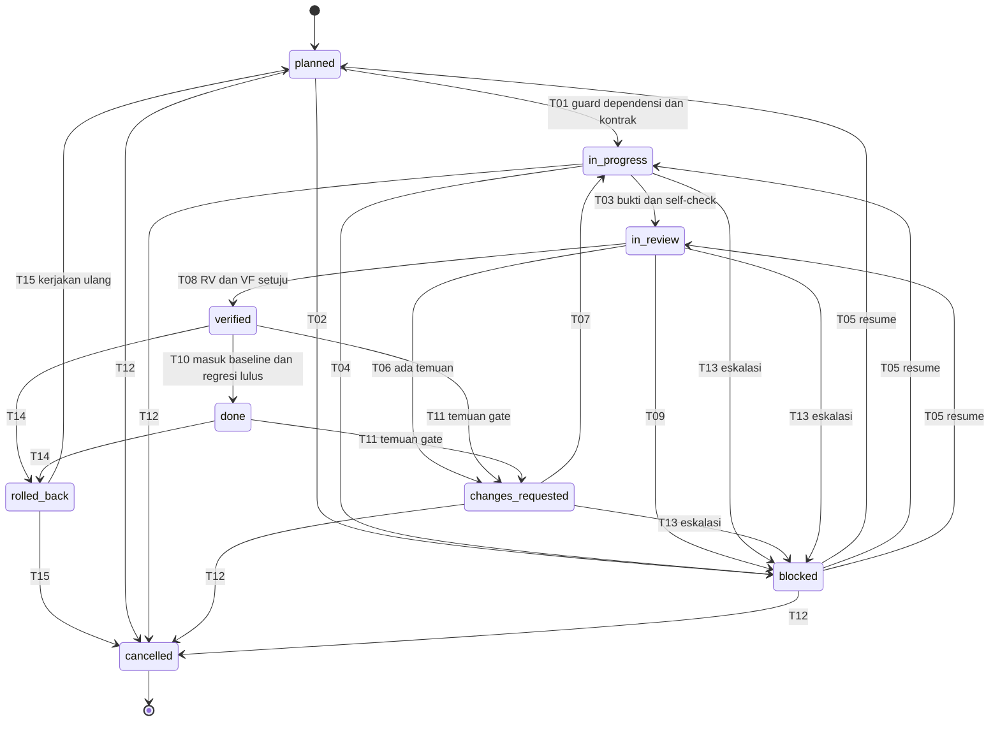
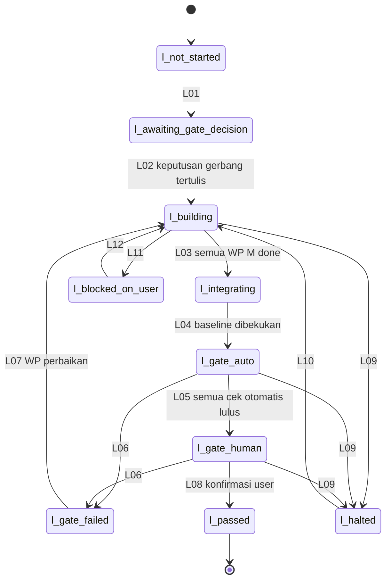
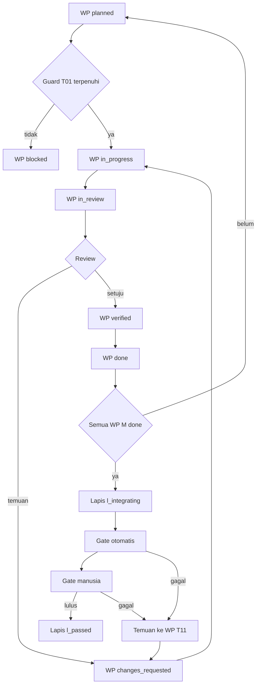
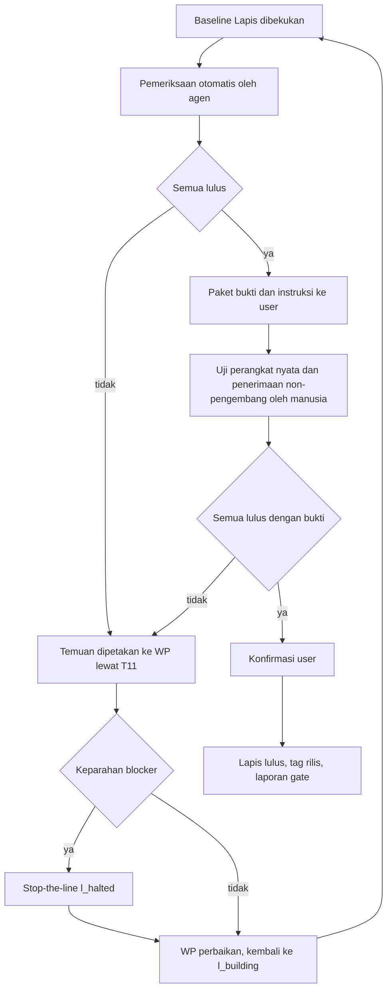
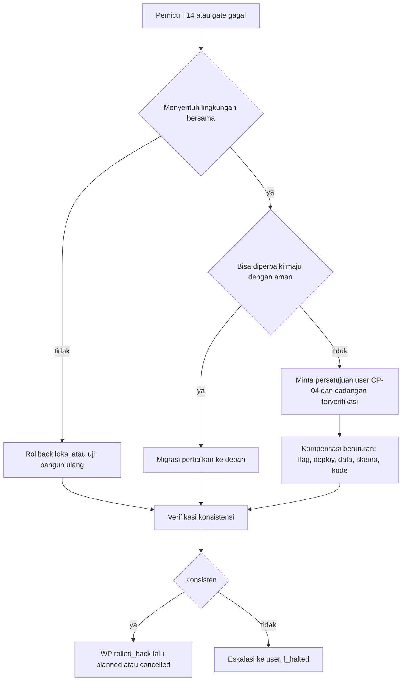

# Spesifikasi Alur Kerja Build: VASTA (Field Service & Work Order)

| Item | Keterangan |
|---|---|
| Versi | 0.1 (draf untuk disetujui user) |
| Tanggal | 2026-10-11 |
| Jenis dokumen | Spesifikasi alur kerja dan state machine proses build. Bukan kode aplikasi |
| Dokumen yang dirujuk | `../01_PRD.md` (Bagian 7, 11.5, 12), `../02_business_analysis_technical_logic.md` (Bagian 1.3, 3, 4), `../03_api_design.md`, `../openapi.yaml`, `../05_rls_and_security.md` (Bagian 7 dan 10) |
| Dokumen saudara (ditulis paralel) | `01_team_and_task_plan.md` (peran dan work package), `03_coordination_conventions.md` (konvensi komunikasi dan state bersama) |

Penanda mengikuti PRD: **[D]** dari dokumen, **[A]** asumsi, **[U]** usulan yang perlu persetujuan, **[P]** parameter yang nilainya belum ditetapkan.

## 0. Cakupan, Batas, dan Celah

**Dicakup:** state machine siklus kerja satu work package (WP) dan satu Lapis, tabel transisi, quality gate per Lapis, penanganan error dan eskalasi, kompensasi dan rollback, checkpoint human-in-the-loop (HITL), diagram.

**Tidak dicakup (dirujuk, tidak diduplikasi):**

- Daftar peran, kepemilikan, dan isi tiap WP: lihat `01_team_and_task_plan.md`. Dokumen ini memakai istilah generik (pelaksana, reviewer, verifier, orchestrator, user) dan **memetakannya ke nama peran di `01_team_and_task_plan.md` harus dilakukan di sana**.
- Tempat penyimpanan state, format pesan antaragen, penguncian berkas, dan aturan serah-terima: lihat `03_coordination_conventions.md`. Dokumen ini hanya mendefinisikan **bentuk** record state (Bagian 7) dan **kapan** record berubah.

**Beda dengan state machine Work Order.** `02_business_analysis_technical_logic.md` Bagian 4 mendefinisikan status WO aplikasi (objek bisnis). Dokumen ini mendefinisikan status **pekerjaan membangun** aplikasi. Keduanya tidak boleh dicampur: nama status WP di sini (`planned`, `in_review`, dan seterusnya) tidak ada hubungannya dengan status WO di database.

**Tidak ada angka waktu.** Tidak ada durasi, tenggat jam, atau estimasi minggu di dokumen ini. PRD Bagian 12 menyatakan durasi sumber hanya indikatif dan tidak boleh dikutip sebagai komitmen. Batas yang perlu angka ditulis sebagai parameter **[P]**.

**Batas kemampuan agen [A].** Agen berbasis teks tidak memegang perangkat fisik. Pemeriksaan "perangkat nyata" (Android, iPhone) dan "uji penerimaan oleh orang di luar pengembangan" hanya bisa dilakukan manusia (user atau penguji yang ditunjuk). Agen menyiapkan skrip uji, menerima bukti, dan memeriksa kelengkapan bukti, tetapi tidak boleh menyatakan pemeriksaan itu lulus tanpa bukti dari manusia.

### Celah yang harus ditutup user atau penulis dokumen saudara

| No | Celah | Dampak | Siapa |
|---|---|---|---|
| C1 | Nama peran dan kepemilikan WP belum terlihat saat dokumen ini ditulis (`01_team_and_task_plan.md` belum ada) | Kolom "pelaku" memakai istilah generik | Penulis 01 memetakan |
| C2 | Lokasi dan format penyimpanan state bersama belum terlihat (`03_coordination_conventions.md` belum ada) | Skema Bagian 7 perlu diselaraskan | Penulis 03 menyelaraskan |
| C3 | Nilai parameter **[P]**: batas iterasi review, jumlah percobaan ulang, ambang keparahan temuan keamanan | Tanpa nilai, guard tidak dapat dievaluasi mesin | User |
| C4 | Open Questions PRD Bagian 14 yang menjadi prasyarat gate (Q1, Q3, Q6, Q7, Q9, Q10, Q11, Q15, Q16, Q18, Q20, Q21 untuk G0) | Lapis tidak bisa mulai (Bagian 3) | User |
| C5 | Apakah ada lingkungan Supabase bersama (staging) terpisah dari proyek produksi/demo | Menentukan strategi migrasi Bagian 6.1 | User |
| C6 | Siapa penguji manusia untuk uji perangkat nyata dan uji penerimaan | Gate tidak bisa lulus tanpa orangnya | User |

---

## 1. Prinsip Desain

1. **Satu sumber kebenaran status.** Status WP dan Lapis hanya berubah lewat transisi yang tercantum di dokumen ini; setiap perubahan dicatat dengan pelaku, waktu, dan bukti (Bagian 7).
2. **Pemisahan peran.** Pelaksana sebuah WP tidak boleh menjadi reviewer atau verifier WP yang sama **[U]**. Alasannya: PRD Bagian 7.1 mensyaratkan penerimaan oleh pihak yang tidak terlibat pengembangan; prinsip yang sama diterapkan pada tingkat WP.
3. **Bukti, bukan klaim.** Setiap guard yang bernilai "lulus" harus menunjuk ke bukti (keluaran uji, tangkapan layar, berkas laporan). Guard tanpa bukti dianggap gagal.
4. **Keamanan dan isolasi lebih dulu.** Mengikuti saran SP-10 (`02_business_analysis_technical_logic.md`): bekukan state machine WO dan matriks akses, bangun lapisan RLS dan tes isolasi sebelum fitur. Urutan ini menjadi guard pada transisi `planned -> in_progress` (T01).
5. **Gagal berhenti, bukan gagal diam.** Temuan yang menyentuh isolasi data pelanggan, kehilangan data offline, atau kebocoran rahasia menghentikan alur (stop-the-line, Bagian 5.4). PRD Bagian 7.4: tidak ada rilis dengan temuan kebocoran data yang belum ditutup.
6. **Maju-perbaiki sebelum mundur.** Untuk basis data yang sudah diterapkan di lingkungan bersama, utamakan migrasi perbaikan ke depan; mundur hanya bila aman (Bagian 6.1).
7. **Lapis tidak dipecah diam-diam.** Memindahkan fitur M antar-Lapis memerlukan keputusan tertulis user (PRD Bagian 12, catatan terakhir).

---

## 2. State Machine Work Package (WP)

### 2.1 Definisi State

| State | Arti | Terminal? |
|---|---|---|
| `planned` | WP terdefinisi (tujuan, kriteria penerimaan, dependensi, berkas yang dimiliki) tetapi belum dikerjakan | Tidak |
| `in_progress` | Pelaksana mengerjakan WP | Tidak |
| `in_review` | Hasil diserahkan; menunggu reviewer dan verifier | Tidak |
| `changes_requested` | Review menemukan perbaikan wajib; menunggu pelaksana | Tidak |
| `blocked` | Tidak bisa maju karena penyebab di luar kendali pelaksana. Wajib punya `blocked_reason` dan `resume_state` | Tidak |
| `verified` | Reviewer menyetujui dan pemeriksaan tingkat WP lulus pada kandidat integrasi | Tidak |
| `done` | Verified, sudah masuk baseline integrasi Lapis, bukti tersimpan, rencana rollback tercatat | Tidak (bisa dibuka lagi oleh temuan gate, T11) |
| `rolled_back` | Perubahan WP sudah ditarik dengan kompensasi (Bagian 6) dan lingkungan konsisten | Tidak (kembali ke `planned` atau ke `cancelled`) |
| `cancelled` | Dibatalkan dengan alasan tercatat | Ya |

Nilai `blocked_reason`: `dependency` (WP lain belum selesai), `decision_user` (butuh keputusan user, Bagian 8), `environment` (lingkungan atau layanan eksternal tidak tersedia), `external_input` (menunggu bukti dari manusia, misal hasil uji perangkat), `escalation` (batas iterasi atau percobaan ulang terlampaui, Bagian 5).

### 2.2 Tabel Transisi WP

Kolom pelaku memakai peran generik: **PL** pelaksana WP, **RV** reviewer, **VF** verifier (boleh peran yang sama dengan RV selama bukan PL), **OR** orchestrator, **US** user.

| ID | Dari | Ke | Pelaku | Guard (semua harus benar) | Efek samping |
|---|---|---|---|---|---|
| T01 | `planned` | `in_progress` | PL (ditugaskan OR) | (a) Semua WP dependensi berstatus `done`, atau `verified` bila OR mengizinkan secara tercatat. (b) Lapis induk berstatus `l_building` (Bagian 3). (c) Kriteria penerimaan tertulis dan menunjuk ID story/FR di `01_PRD.md` atau `02_business_analysis_technical_logic.md`. (d) Kontrak yang dipakai (`openapi.yaml`, `04_database_schema.sql`) sudah dibekukan atau WP mencantumkan perubahan kontraknya secara eksplisit. (e) Tidak ada WP lain yang memegang kunci atas berkas yang sama (aturan kunci: `03_coordination_conventions.md`). (f) Bila WP menyentuh fitur baru: pekerjaan RLS dan tes isolasi untuk tabel/view/RPC terkait sudah ada atau menjadi bagian WP ini. | Kunci kepemilikan diambil; `started_at` dicatat; cabang kerja dibuat; entri log state |
| T02 | `planned` | `blocked` | OR atau PL | Dependensi belum terpenuhi saat dijadwalkan, atau keputusan user yang menjadi prasyarat belum ada | `blocked_reason` dan `resume_state=planned` dicatat; item masuk antrean keputusan bila `decision_user` |
| T03 | `in_progress` | `in_review` | PL | (a) Semua kriteria penerimaan WP dicentang dengan bukti. (b) Uji unit/integrasi WP lulus. (c) Pemeriksaan statis (lint, tipe) lulus. (d) Secret scan pada diff bersih. (e) Setiap migrasi punya pasangan pembatalan atau catatan maju-saja yang beralasan (Bagian 6.1) dan lulus pada basis data kosong. (f) Tabel/view/RPC/bucket baru punya uji isolasi (`05_rls_and_security.md` Bagian 7.1: tanpa uji isolasi, build gagal). (g) Fitur setengah jadi berada di balik feature flag default mati (Bagian 6.3). (h) Catatan serah-terima ditulis (apa yang berubah, cara uji, risiko). | Reviewer ditunjuk OR (bukan PL); kunci berkas dilepas ke mode baca; log state |
| T04 | `in_progress` | `blocked` | PL | Penyebab di luar kendali PL (dependensi, keputusan, lingkungan) dan sudah dicatat dengan bukti | `resume_state=in_progress`; OR diberi tahu |
| T05 | `blocked` | `resume_state` | OR (atau US bila `decision_user`) | Penyebab terselesaikan dan ada bukti penyelesaian (WP dependensi `done`, keputusan user tertulis, lingkungan pulih, bukti manusia diterima) | `blocked_reason` dihapus; durasi blokir tercatat sebagai kejadian, tanpa target waktu |
| T06 | `in_review` | `changes_requested` | RV | Minimal satu temuan, masing-masing dengan keparahan (`blocker`, `major`, `minor`), lokasi (`path:line` atau ID uji), dan kriteria yang dilanggar | Daftar temuan terlampir; penghitung iterasi review +1 |
| T07 | `changes_requested` | `in_progress` | PL | PL mengakui setiap temuan (diperbaiki, atau ditolak dengan alasan yang ditinjau RV) | Kunci berkas diambil lagi |
| T08 | `in_review` | `verified` | RV dan VF | (a) Tidak ada temuan `blocker` atau `major` terbuka. (b) Kriteria penerimaan terverifikasi ulang oleh VF, bukan hanya oleh PL. (c) Pemeriksaan tingkat WP lulus pada kandidat integrasi (bukan hanya pada cabang PL). (d) Bila WP menyentuh akses data: uji isolasi relevan lulus dan RV memeriksa bahwa `service_role` tidak masuk jalur klien (NFR-S4) | Persetujuan dicatat dengan identitas RV/VF dan bukti |
| T09 | `in_review` | `blocked` | RV atau VF | Tidak bisa memutuskan karena kekurangan di luar WP (lingkungan uji, keputusan user, bukti perangkat nyata) | `resume_state=in_review` |
| T10 | `verified` | `done` | OR | (a) Perubahan sudah digabung ke baseline integrasi Lapis. (b) Regresi uji Lapis yang berlaku lulus pada baseline setelah penggabungan. (c) Bukti tersimpan. (d) Rencana rollback WP tercatat dan, bila ada migrasi, sudah diuji sekali (naik dan, bila ada, turun) pada basis data uji. (e) Dokumen terkait (`openapi.yaml`, `03_api_design.md`, catatan perubahan) diperbarui bila kontrak berubah | Kunci dilepas; WP dependen dibuka (OR mengevaluasi T01 mereka); entri catatan perubahan |
| T11 | `verified` atau `done` | `changes_requested` | OR | Ada temuan dari gate Lapis (ID pemeriksaan gate disebut) atau regresi yang menunjuk WP ini | Penghitung "pembukaan ulang" +1; temuan asal gate terlampir |
| T12 | `in_progress`, `changes_requested`, `blocked`, `planned` | `cancelled` | OR; wajib persetujuan US bila WP memuat fitur M | Alasan tertulis; kompensasi sudah dijalankan bila ada perubahan sebagian (Bagian 6) | Kunci dilepas; dependen ditandai `blocked` (`dependency`); fitur M yang dibatalkan memicu keputusan US (CP-09) |
| T13 | `changes_requested`, `in_review`, `in_progress` | `blocked` (`escalation`) | OR otomatis | Penghitung iterasi review mencapai batas **[P]**, atau percobaan ulang gagal mencapai batas (Bagian 5.2) | Eskalasi ke US (Bagian 5.3) |
| T14 | `verified` atau `done` | `rolled_back` | OR (US menyetujui bila menyentuh lingkungan bersama/produksi) | Ada alasan (gate gagal tanpa perbaikan maju yang aman, deploy gagal, atau pembatalan) dan rencana kompensasi WP ada | Urutan kompensasi Bagian 6 dijalankan; hasil dicatat |
| T15 | `rolled_back` | `planned` atau `cancelled` | OR | Lingkungan terverifikasi konsisten (Bagian 6.5). Pilihan `planned` bila WP akan dikerjakan ulang, `cancelled` bila tidak | Kunci dilepas |

Transisi yang tidak tercantum **dilarang**. Contoh yang sengaja dilarang: `in_progress -> verified` (melompati review), `changes_requested -> in_review` (harus lewat `in_progress`), `done -> in_progress` (harus lewat T11).

### 2.3 Diagram State WP



---

## 3. State Machine Lapis

Satu Lapis (L1, L2, L3) berjalan dari persiapan sampai quality gate lulus. Rilis berikutnya hanya dimulai setelah demo dan quality gate Lapis sebelumnya lulus (PRD Bagian 12).

### 3.1 Definisi State

| State | Arti |
|---|---|
| `l_not_started` | Lapis belum dimulai |
| `l_awaiting_gate_decision` | Menunggu keputusan gerbang PRD Bagian 11.5 (G0 untuk L1, G1 untuk L2, G2 untuk L3) |
| `l_building` | WP Lapis dikerjakan sesuai Bagian 2 |
| `l_integrating` | Semua WP berprioritas M berstatus `done` (WP S/C sesuai keputusan); baseline integrasi dibekukan untuk gate |
| `l_gate_auto` | Pemeriksaan gate otomatis dijalankan agen (Bagian 4) |
| `l_gate_human` | Pemeriksaan yang memerlukan manusia: perangkat nyata, penerimaan non-pengembang, keputusan retensi |
| `l_gate_failed` | Satu atau lebih pemeriksaan gate gagal; temuan dipetakan ke WP (T11) atau WP baru |
| `l_halted` | Stop-the-line: temuan isolasi, kehilangan data, atau kebocoran rahasia terbuka |
| `l_blocked_on_user` | Menunggu keputusan atau sumber daya dari user (Bagian 8) |
| `l_passed` | Seluruh pemeriksaan gate lulus, user mengonfirmasi, laporan gate tersimpan |

### 3.2 Tabel Transisi Lapis

| ID | Dari | Ke | Pelaku | Guard | Efek samping |
|---|---|---|---|---|---|
| L01 | `l_not_started` | `l_awaiting_gate_decision` | OR | Lapis sebelumnya `l_passed` (kecuali L1) | Daftar Open Questions yang menjadi prasyarat gerbang disusun untuk US |
| L02 | `l_awaiting_gate_decision` | `l_building` | US (OR mencatat) | Keputusan gerbang tertulis. G0 untuk L1: wawancara minimal dilakukan; D1 (model registrasi) dan D3 (matriks perangkat) diputuskan; ada calon design partner atau keputusan tertulis memakai data fiktif saja (PRD 11.5). G1 untuk L2: definisi SLA dan jam kerja kontrak (D2) disetujui; alur persetujuan biaya diuji lewat prototipe. G2 untuk L3: format CSV target (D12) dipilih; kebutuhan data biaya untuk profit per kontrak jelas (R18) | WP Lapis dari `01_team_and_task_plan.md` masuk `planned`; urutan dasar: skema, RLS, tes isolasi, lalu fitur (SP-10) |
| L03 | `l_building` | `l_integrating` | OR | Semua WP M `done`; tidak ada WP M `blocked`/`rolled_back`; WP S/C yang belum selesai ditandai dijadwalkan ulang atau dibuang secara tercatat (bukan dikerjakan setengah dan dibiarkan, Bagian 6.3) | Baseline integrasi dibekukan (tag); perubahan baru ke baseline ditolak sampai gate selesai kecuali perbaikan temuan |
| L04 | `l_integrating` | `l_gate_auto` | OR | Baseline dapat dibangun dan diterapkan ke lingkungan uji bersih; migrasi dari nol dan dari keadaan Lapis sebelumnya sama-sama berhasil | Lingkungan uji disiapkan; data fiktif dimuat (NFR-D8) |
| L05 | `l_gate_auto` | `l_gate_human` | OR | Semua pemeriksaan otomatis lulus (Bagian 4) | Paket bukti otomatis disusun; instruksi uji manusia dikirim ke US |
| L06 | `l_gate_auto` atau `l_gate_human` | `l_gate_failed` | OR | Minimal satu pemeriksaan gagal dengan bukti | Temuan dipetakan ke WP pemilik (T11) atau WP baru; keparahan ditentukan |
| L07 | `l_gate_failed` | `l_building` | OR | Setiap temuan sudah punya WP perbaikan | Baseline dibuka hanya untuk WP perbaikan |
| L08 | `l_gate_human` | `l_passed` | US | Semua pemeriksaan manusia lulus dengan bukti; laporan gate lengkap; tidak ada pengecualian (waiver) pada pemeriksaan yang tidak boleh dikecualikan (Bagian 4.5); tidak ada temuan keamanan/isolasi terbuka | Laporan gate disimpan; tag rilis; Lapis berikutnya boleh L01 |
| L09 | status mana pun kecuali `l_passed` | `l_halted` | OR (otomatis) | Pemicu stop-the-line (Bagian 5.4) | Semua T01 baru ditahan; US diberi tahu seketika |
| L10 | `l_halted` | `l_building` | OR + US | Akar masalah diketahui, WP perbaikan dibuat, dan pemeriksaan yang menemukan masalah diulang sampai lulus pada WP itu | Insiden dicatat |
| L11 | status mana pun | `l_blocked_on_user` | OR | Keputusan HITL diperlukan (Bagian 8) dan tidak ada pekerjaan lain yang bisa jalan tanpa itu | `resume_state` dicatat; WP tak terdampak boleh lanjut |
| L12 | `l_blocked_on_user` | `resume_state` | US | Keputusan atau sumber daya tersedia secara tertulis | Keputusan dicatat dengan identitas dan referensi |

### 3.3 Diagram State Lapis



### 3.4 Hubungan WP dan Lapis



---

## 4. Quality Gate per Lapis

Sumber utama: `../01_PRD.md` Bagian 7. Rincian uji isolasi: `../05_rls_and_security.md` Bagian 7. Rincian NFR: `../02_business_analysis_technical_logic.md` Bagian 3.

### 4.1 Aturan Umum Gate

- **Lulus** hanya bila **semua** pemeriksaan Lapis berstatus lulus dengan bukti. Tidak ada "lulus sebagian".
- **Gagal** bila satu pemeriksaan gagal, atau bukti tidak ada, atau pemeriksaan tidak dijalankan.
- **Jenis pelaku:** `A` dijalankan agen (VF), `M` hanya manusia (user atau penguji ditunjuk), `A+M` agen menyiapkan dan memeriksa bukti, manusia menjalankan.
- **Hasil lokal tidak menggantikan hasil lingkungan nyata.** `05_rls_and_security.md` Bagian 10 mencatat 171 pemeriksaan lulus pada PostgreSQL lokal, tetapi menyatakan belum teruji: proyek Supabase nyata (Auth Hook, Storage, signed URL, Realtime, PostgREST), `pg_cron`, `pg_trgm`, zona waktu bernama `Asia/Jakarta`, pgTAP, uji beban. Hasil lokal itu bukan bukti untuk gate; hal-hal tersebut harus dijalankan pada proyek Supabase nyata sebelum pemeriksaan terkait dinyatakan lulus.
- **Keparahan temuan** (untuk Bagian 5): `blocker` (stop-the-line, tidak bisa dikecualikan), `major` (harus ditutup sebelum lulus), `minor` (dicatat; boleh ditutup setelah gate dengan persetujuan US).

### 4.2 Gate Lapis 1 (Inti)

Sumber: PRD 7.1.

| ID | Pemeriksaan | Cara | Kriteria lulus | Gagal bila | Pelaku |
|---|---|---|---|---|---|
| G1-01 | Semua user story M lulus uji | Peta story ke kasus uji (uji manual dan otomatis untuk alur inti). Catatan: baris M bertanda [U]/[D-tersirat] bergantung pada keputusan Q6, Q7, Q9, Q11 | Setiap story M punya minimal satu kasus uji yang lulus; semua kasus lulus | Ada story M tanpa kasus uji, atau ada kasus gagal | A (otomatis), M (manual) |
| G1-02 | Uji isolasi data pelanggan | Seluruh kasus minimum `05_rls_and_security.md` 7.2 (tabel, tebakan ID, tulis lintas, view, RPC, Storage, teknisi, staf, `anon`, penonaktifan, append-only, struktur, fungsi `SECURITY DEFINER`); E2E dua sesi pelanggan dan pemindaian rute API pemakai `service_role` (7.4); `app.tables_without_rls()` kosong; dijalankan pada proyek Supabase nyata termasuk Storage dan Realtime (Bagian 10 dokumen 05) | 100% kasus uji lulus; G1 (guardrail PRD) = 0 temuan | Satu temuan lintas pelanggan pun; tabel tanpa RLS; bagian yang "dilewati otomatis" karena schema/ekstensi tidak ada dihitung gagal | A |
| G1-03 | Uji offline di perangkat nyata | Skenario: teknisi membuka tugas, mengisi checklist dan foto tanpa sinyal (sesi mode pesawat), lalu sinkron. Minimal satu Android dan satu iPhone **[A]**, sesuai matriks D3 | G2 = 0 kasus kehilangan data; indikator "belum terkirim" benar; item antrean hanya dihapus setelah konfirmasi server (NFR-O3); kebijakan konflik Q21 diperagakan bila sudah diputuskan | Ada data hilang, indikator salah, atau perangkat bukan dari matriks | M dengan A+M (agen menyiapkan skrip dan memeriksa bukti) |
| G1-04 | Uji unggahan foto | Jenis dan ukuran tidak valid ditolak (tipe MIME dan magic bytes, NFR-S7); foto dikompres di perangkat dan foto asli tidak dikirim (NFR-P1); EXIF ditangani (NFR-D4) | Semua kasus tolak/terima sesuai; hasil kompresi mengikuti parameter yang ditetapkan **[P]** | Berkas tidak valid lolos, atau foto asli terkirim | A+M |
| G1-05 | Uji pembatasan laju pemesanan | Kirim permintaan melebihi batas **[P]** dari satu identitas | Permintaan berlebih ditolak; pesanan sah tetap bisa | Tidak ada pembatasan | A |
| G1-06 | Uji kontrol akses per peran | Setiap endpoint di `openapi.yaml` dan setiap halaman diuji untuk peran yang boleh dan yang tidak, terhadap matriks `02_business_analysis_technical_logic.md` 1.3; galat seragam tanpa membocorkan keberadaan data (NFR-S10) | 100% endpoint dan halaman terdaftar punya uji boleh dan tolak yang lulus | Endpoint/halaman tanpa uji, atau peran terlarang berhasil | A |
| G1-07 | Pemindaian keamanan dasar | Pemeriksaan dependensi; secret scan pada kode dan riwayat; tinjauan kode keamanan dasar (verifikasi sesi di setiap Route Handler sebelum memakai `service_role`, `service_role` tidak ada di bundel klien, header keamanan, NFR-S4, NFR-S9) | Tidak ada rahasia; tidak ada temuan dependensi di atas ambang **[P]** yang belum ditutup atau diterima tertulis oleh US; tinjauan tanpa temuan `blocker`/`major` terbuka | Rahasia ditemukan (selalu `blocker`); temuan di atas ambang terbuka | A (US menetapkan ambang dan menerima risiko) |
| G1-08 | Pemeriksaan data pribadi | Inventaris data pribadi (nama, telepon, email, alamat, foto lokasi, tanda tangan, koordinat check-in; NFR-D1), alasan pengumpulan, draf kebijakan retensi, pencatatan persetujuan registrasi (NFR-D2), lingkungan demo hanya data fiktif (NFR-D8). Interpretasi UU PDP di 02 Bagian 3.3 bukan nasihat hukum | Dokumen inventaris, alasan pengumpulan, dan draf retensi ada dan konsisten dengan skema; tidak ada data pribadi sungguhan di repo, log, atau lingkungan demo | Dokumen tidak ada, atau data pribadi nyata ditemukan. Nilai retensi tetap keputusan US (Q15) | A+M |
| G1-09 | Matriks perangkat dan browser | Matriks tertulis (D3, Q10); pengujian dilakukan pada perangkat di matriks | Matriks ada, dan G1-03/G1-10 memakai perangkat di dalamnya | Matriks tidak ada atau uji memakai perangkat di luar matriks | M |
| G1-10 | Uji penerimaan non-pengembang | Orang yang tidak terlibat pengembangan menjalankan seluruh alur demo satu kali tanpa bantuan pengembang **[U]** | Alur selesai tanpa intervensi pengembang | Pengembang harus membantu, atau alur tidak selesai | M |
| G1-11 | Demo-ready | Skenario naskah tertulis dan dapat diulang: pesan lewat PWA, validasi admin, WO dibuat, penugasan, kerja teknisi termasuk mode pesawat, tanda tangan dan tutup WO, PDF terbit dan terakses pelanggan; status WO sama di web internal dan PWA pelanggan; kasus tepi WO dibatalkan dan ditugaskan ulang setelah ditolak; data fiktif per jenis layanan demo (Q3) | Skrip dijalankan ulang utuh pada baseline gate dan setiap langkah berhasil | Langkah gagal atau skrip belum dijalankan ulang | A+M |
| G1-12 | Higiene rilis (PRD 7.4) | Catatan perubahan, skrip demo yang dijalankan ulang, laporan hasil uji; tidak ada temuan kebocoran terbuka | Ketiga berkas ada; nol temuan kebocoran terbuka | Berkas kurang atau ada temuan kebocoran terbuka | A |

### 4.3 Gate Lapis 2 (Proses dan Kontrol)

Sumber: PRD 7.2.

| ID | Pemeriksaan | Cara | Kriteria lulus | Gagal bila | Pelaku |
|---|---|---|---|---|---|
| G2-01 | Regresi seluruh uji Lapis 1 | Jalankan ulang G1-01 sampai G1-06 pada baseline Lapis 2 | Semua lulus | Satu regresi pun | A |
| G2-02 | Aturan penutupan WO | WO tidak dapat ditutup tanpa checklist, foto, dan tanda tangan/persetujuan, kecuali dengan alasan tercatat | Semua kombinasi kurang-lengkap ditolak; jalur pengecualian mencatat alasan dan pelaku | Penutupan lolos tanpa syarat dan tanpa alasan | A |
| G2-03 | Idempotensi WO berkala | Job pembuat WO berkala dijalankan dua kali, termasuk paralel | Tepat satu WO per jadwal; hasil tidak berubah pada eksekusi kedua. `pg_cron` diverifikasi pada Supabase nyata (belum teruji lokal) | WO ganda | A |
| G2-04 | Persetujuan biaya tambahan | Teknisi tidak bisa melanjutkan sebelum persetujuan; persetujuan menyimpan hash snapshot (NFR-A5) | Tidak ada pekerjaan lanjutan tanpa persetujuan tercatat | Ada jalur lanjut tanpa persetujuan | A |
| G2-05 | Log audit | Setiap perubahan penting (BR-070) tercatat dengan pengguna dan waktu; append-only (NFR-A2) | Semua kasus perubahan penting menghasilkan baris audit lengkap; UPDATE/DELETE ditolak | Perubahan penting tanpa audit | A |
| G2-06 | Notifikasi | Kegagalan kirim tercatat dan dapat dicoba ulang; kanal aktif menerima notifikasi (email; WhatsApp bila disetujui, Q5) | Kegagalan terekam, pengulangan berhasil, tidak ada pengiriman ganda yang tak dikehendaki | Kegagalan hilang diam-diam | A |
| G2-07 | Perhitungan SLA | Kasus tepi: lintas hari, hari libur terkonfigurasi, jeda; zona `Asia/Jakarta` dengan tzdata penuh (belum teruji lokal) | Semua kasus tepi sesuai definisi SLA yang disetujui di G1 (keputusan D2) | Selisih dengan definisi | A |
| G2-08 | Pemindaian keamanan diulang | Ulangi G1-07 untuk fitur baru; uji isolasi untuk tabel/view/RPC/bucket baru (suku cadang, persetujuan, notifikasi) | Sama dengan G1-02 dan G1-07 | Sama dengan G1-02 dan G1-07 | A |
| G2-09 | Uji ulang perangkat nyata | Alur persetujuan biaya dan tanda tangan di Android dan iPhone | Alur selesai tanpa kehilangan data | Gagal di salah satu perangkat | M |
| G2-10 | Demo-ready Lapis 2 | Semua demo L1 dengan regresi lulus; SLA dengan waktu uji yang bisa dimajukan; berkala tanpa duplikat; persetujuan biaya; review supervisor (kembalikan dengan catatan, teknisi melihat); suku cadang (permintaan, penyerahan, pemakaian, selisih); notifikasi pelanggan | Skrip dijalankan ulang utuh | Langkah gagal | A+M |
| G2-11 | Higiene rilis | Sama dengan G1-12 | Sama | Sama | A |

### 4.4 Gate Lapis 3 (Penyempurnaan)

Sumber: PRD 7.3.

| ID | Pemeriksaan | Cara | Kriteria lulus | Gagal bila | Pelaku |
|---|---|---|---|---|---|
| G3-01 | Regresi L1 dan L2 | Ulang G1-01 sampai G1-06 dan G2-02 sampai G2-07 | Semua lulus | Satu regresi pun | A |
| G3-02 | Rekonsiliasi dashboard | Angka dashboard dicocokkan dengan kueri mentah pada sampel | Selisih nol | Selisih apa pun | A |
| G3-03 | Format CSV | Uji terhadap contoh format impor target yang disepakati (D12, Q13) | Berkas diterima oleh contoh format; kolom dan penomoran sesuai | Format target belum dipilih (gate tidak dapat dijalankan, bukan lulus), atau tidak sesuai | A+M |
| G3-04 | Impor Excel | Validasi tipe, duplikat, dan referensi | Baris salah tidak masuk diam-diam; dilaporkan dengan alasan | Baris salah masuk atau hilang tanpa laporan | A |
| G3-05 | Performa dashboard | Kumpulan data fiktif besar | Memenuhi ambang **[T]** yang ditetapkan US. Tanpa ambang, pemeriksaan tidak bisa lulus | Di atas ambang atau ambang belum ditetapkan | A |
| G3-06 | Tinjauan data pribadi akhir dan retensi | Ulangi G1-08 untuk seluruh fitur; periksa penerapan retensi/anonimisasi (NFR-D5) sesuai keputusan Q15 | Konsisten dengan skema dan kebijakan yang diputuskan | Ketidaksesuaian atau keputusan Q15 belum ada | A+M |
| G3-07 | Dokumentasi | Dokumentasi pengguna dan panduan admin | Keduanya ada dan sesuai fitur rilis | Tidak ada | A+M |
| G3-08 | Keamanan dan isolasi diulang | G1-02 dan G1-07 untuk fitur baru (invoice, dashboard, impor); termasuk pastikan dashboard dan view finance tidak menembus isolasi pelanggan | Sama dengan G1-02 dan G1-07 | Sama | A |
| G3-09 | Demo-ready dan higiene rilis | Invoice dari WO fiktif lalu ekspor CSV; angka dashboard konsisten; impor satu berkas dengan baris bermasalah; G1-12 | Skrip dijalankan ulang utuh | Langkah gagal | A+M |

### 4.5 Pengecualian (Waiver)

- Hanya US yang boleh mengecualikan pemeriksaan, secara tertulis, dengan alasan, ruang lingkup, dan tanggal peninjauan ulang.
- **Tidak boleh dikecualikan [U]:** G1-02 (isolasi, juga di G2-08/G3-08), G1-03 (kehilangan data offline), temuan rahasia terbuka di G1-07, dan inventaris data pribadi G1-08. Alasan: PRD menetapkan G1 dan G2 guardrail bernilai 0 sebagai persyaratan kualitas (PRD 5.2) dan PRD 7.4 melarang rilis dengan temuan kebocoran terbuka.
- Pemeriksaan yang tidak bisa dijalankan karena prasyarat belum ada (misal G3-03 tanpa format target) berstatus `tidak_dapat_dijalankan` dan dihitung gagal, bukan lulus.

### 4.6 Diagram Alur Gate



---

## 5. Penanganan Error, Retry, dan Eskalasi

### 5.1 Klasifikasi Kegagalan

| Kelas | Contoh | Retry otomatis? | Tindakan |
|---|---|---|---|
| Transien infrastruktur | Layanan uji tidak merespons, instalasi dependensi gagal karena jaringan, proyek Supabase uji tak terjangkau sesaat | Ya, dengan backoff eksponensial, batas **[P]** | Bila batas habis: `blocked` (`environment`), lalu eskalasi (5.3) |
| Uji tidak stabil (flaky) | Hasil uji berbeda pada eksekusi ulang tanpa perubahan kode | Ulang untuk **diagnosis**, bukan untuk "melulukan" | Satu hasil lulus setelah gagal tidak cukup. Pelaksana mencatat akar masalah; uji flaky yang belum diperbaiki dihitung gagal di gate |
| Deterministik | Uji gagal konsisten, temuan review, lint | Tidak | Perbaikan kode lewat `changes_requested` |
| Kontrak/spesifikasi | `openapi.yaml`, skema, dan implementasi bertentangan; kebutuhan ambigu | Tidak | `blocked` (`decision_user` atau perbaikan dokumen); jangan memilih perilaku sendiri |
| Konflik kepemilikan | Dua WP mengubah berkas yang sama | Tidak | Aturan kunci dan penyelesaian di `03_coordination_conventions.md`; bila tak terselesaikan, OR memutuskan urutan |
| Keamanan/isolasi/data | Kebocoran lintas pelanggan, rahasia di repo, data offline hilang | Tidak | Stop-the-line (5.4) |
| Migrasi gagal | Migrasi gagal di tengah, atau berhasil di basis kosong tetapi gagal di basis berisi | Tidak otomatis | Bagian 6.1 |
| Deploy gagal | Build gagal, pemeriksaan kesehatan gagal pasca-deploy | Percobaan ulang terbatas hanya untuk kegagalan transien | Bagian 6.2 |
| Kegagalan agen | Agen berhenti, keluaran tidak sesuai skema, melampaui wewenang | Satu penugasan ulang ke agen lain **[U]** | Kerja sebagian diperiksa dulu; bila meragukan, dikompensasi (Bagian 6.3) |

### 5.2 Kebijakan Retry

Parameter **[P]** (nilai ditetapkan user atau OR di `03_coordination_conventions.md`):

```yaml
retry_policy:
  transient:
    max_attempts: "[P]"          # jumlah percobaan ulang; bukan angka waktu
    backoff: exponential         # jeda bertambah di antara percobaan
    jitter: true
    on_exhausted: blocked(environment) -> escalate_user
  flaky_test:
    rerun_for_diagnosis_only: true
    pass_after_fail_counts_as_pass: false
  deterministic:
    auto_retry: false
  review_loop:
    max_review_iterations: "[P]"  # per WP; terlampaui -> T13
```

Alasan: percobaan ulang buta pada kegagalan deterministik menyembunyikan cacat dan menghabiskan konteks agen; retry hanya masuk akal untuk kegagalan yang secara wajar bisa pulih sendiri.

### 5.3 Eskalasi ke User

Tiga tingkat:

1. **Tingkat 0, pelaksana:** memperbaiki sendiri dalam batas kebijakan.
2. **Tingkat 1, orchestrator:** menata ulang urutan, menugaskan ulang, memecah WP, atau memperbaiki dokumen. OR tidak boleh mengubah keputusan produk atau lingkup.
3. **Tingkat 2, user:** wajib bila (a) keputusan HITL di Bagian 8, (b) `blocked` dengan `escalation`, (c) stop-the-line, (d) kegagalan berulang pada pemeriksaan gate yang sama setelah perbaikan, (e) permintaan waiver.

Format pesan eskalasi (isi minimum): ringkasan satu kalimat, state saat ini (WP/Lapis), apa yang sudah dicoba beserta bukti, opsi yang tersedia dengan konsekuensi masing-masing, rekomendasi OR, dan keputusan yang diminta. Pengiriman dan pencatatan mengikuti `03_coordination_conventions.md`.

### 5.4 Pemicu Stop-the-Line

Memicu L09 (`l_halted`) dan menahan semua T01 baru:

- Temuan akses lintas pelanggan pada uji isolasi mana pun, termasuk Storage dan Realtime.
- Kehilangan data pada uji offline.
- Rahasia atau kunci `service_role` ditemukan di repo, log, atau bundel klien. Tindakan tambahan: rahasia dianggap bocor dan perlu dirotasi oleh user (CP-06).
- Tabel baru di schema publik tanpa RLS.
- Data pribadi nyata di lingkungan demo atau repo (melanggar NFR-D8).
- Migrasi yang merusak data atau tidak bisa dipulihkan pada lingkungan bersama.

---

## 6. Kompensasi dan Rollback

Prinsip: setiap langkah maju yang bisa membuat keadaan tidak konsisten punya langkah kompensasi yang tertulis sebelum langkah maju dijalankan (gaya saga). Urutan rollback adalah kebalikan dari urutan maju.

### 6.1 Migrasi Database

Dasar: `04_database_schema.sql` dan `05_rls_and_security.md`. Catatan keras dari desain: tabel `audit_logs`, `wo_status_history`, `stock_movements` bersifat append-only (kode `IMM01`) dan UPDATE/DELETE dicabut dari semua peran aplikasi. Jadi rollback tidak boleh menghapus baris riwayat; pembetulan dilakukan lewat baris kompensasi.

Aturan:

1. **Sebelum diterapkan:** migrasi lulus dari basis kosong dan dari keadaan Lapis sebelumnya; bila ada pasangan pembatalan, diuji naik-turun-naik pada basis uji (guard T03e dan T10d).
2. **Pola ekspansi lalu kontraksi:** perubahan merusak (hapus/ubah nama kolom, ubah tipe) dibagi menjadi: tambah struktur baru, jalankan keduanya berdampingan, pindahkan pembaca, baru hapus struktur lama pada migrasi terpisah yang disetujui US (CP-04).
3. **Lingkungan lokal/uji sekali pakai:** boleh dibangun ulang dari nol.
4. **Lingkungan bersama (staging, demo, produksi):** utamakan **migrasi perbaikan ke depan**. Migrasi pembatalan dipakai hanya bila tidak menghapus data pengguna dan disetujui OR; bila menyentuh data pada lingkungan demo/produksi, wajib persetujuan US dan cadangan terverifikasi (CP-04).
5. **Pemulihan dari cadangan** adalah jalan terakhir dan keputusan US. Ketersediaan dan mekanisme cadangan pada Supabase yang dipakai belum diketahui (celah C5); jangan mengandalkannya sebelum dikonfirmasi.
6. **Fungsi dan kebijakan RLS** dimigrasikan bersama tabelnya; rollback tabel tanpa rollback kebijakan tidak boleh meninggalkan tabel tanpa RLS (pemeriksaan `app.tables_without_rls()` = 0 setelah rollback).
7. **Migrasi yang gagal di tengah:** hentikan penerapan berikutnya, catat keadaan (versi terakhir yang berhasil), pastikan migrasi dibungkus transaksi bila didukung; pernyataan yang tidak bisa dalam transaksi harus idempoten agar aman dijalankan ulang.

### 6.2 Deploy

- Setiap deploy menyimpan referensi artefak sebelumnya yang diketahui baik.
- Pemeriksaan kesehatan pasca-deploy yang minimal: aplikasi memuat, autentikasi berfungsi, satu alur baca per peran, satu alur tulis uji. Bila gagal: kembalikan ke artefak sebelumnya (kompensasi deploy), lalu perlakukan sebagai insiden WP.
- **Kompatibilitas mundur data dan klien:** PWA teknisi menyimpan antrean offline di IndexedDB (02 Bagian 6) dan service worker membuat versi lama bisa bertahan di perangkat. Maka (a) API harus tetap menerima payload antrean dari versi klien sebelumnya selama satu rilis, (b) antrean memiliki versi skema, (c) rollback aplikasi tidak boleh membuat antrean lama tidak terbaca, karena itu melanggar NFR-O3 dan G2 = 0. Verifikasi kasus ini adalah bagian review WP offline.
- Deploy ke lingkungan bersama setelah Lapis lulus gate memerlukan konfirmasi US (CP-05).

### 6.3 Fitur Setengah Jadi

- Kode fitur yang belum selesai hanya boleh masuk baseline bila berada di balik feature flag **default mati** dan tidak mengubah perilaku lingkup yang sudah lulus (guard T03g).
- Sebelum L03, setiap WP S/C yang belum `done` diputuskan: diselesaikan, dijadwalkan ulang ke daftar tunggu, atau dibuang. Dibuang berarti: flag dan kodenya dihapus, migrasinya dikompensasi (6.1), dan catatan masuk catatan perubahan. Tidak boleh ada kode yatim di baseline.
- Fitur M yang tidak selesai tidak boleh dipotong diam-diam; ini memerlukan keputusan US (CP-09).

### 6.4 Tabel Kompensasi per Langkah

| Langkah maju | Kompensasi | Catatan |
|---|---|---|
| Menerapkan migrasi skema | Migrasi pembatalan (lokal/uji) atau migrasi perbaikan ke depan (bersama) | Aturan 6.1; data riwayat append-only tidak dihapus |
| Membuat tabel + kebijakan RLS | Hapus tabel dan kebijakan bersama-sama, hanya bila tabel belum berisi data nyata | Kalau sudah berisi, deprecate lewat ekspansi-kontraksi |
| Mengubah fungsi/RPC (`wo_transition` dan lainnya) | Pulihkan definisi versi sebelumnya dari kontrol versi | Kode galat `WO001`, `WO002`, `WO005` harus tetap sama untuk klien lama |
| Membuat bucket/kebijakan Storage | Hapus kebijakan dan bucket jika kosong; bila berisi objek, jangan hapus; pindahkan lewat WP terpisah | Menyentuh data pelanggan, perlu CP-04 |
| Memuat data fiktif (seed) | Skrip pembersih yang menghapus hanya data bertanda seed | Jangan menyentuh data non-seed |
| Mengaktifkan job terjadwal (`pg_cron`) | Nonaktifkan jadwal; periksa WO berkala yang sudah terbentuk dengan kunci idempotensi sebelum membuat ulang | Hindari ganda saat diaktifkan ulang |
| Mengirim notifikasi ke kanal eksternal | Tidak dapat ditarik. Mitigasi: lingkungan non-produksi memakai penerima uji atau kanal tersumbat; kegagalan dicatat | Pengiriman nyata hanya dari lingkungan yang disetujui US (CP-08) |
| Menerbitkan invoice/CSV (L3) | Pembatalan dokumen lewat status batal, bukan hapus; penomoran tidak dipakai ulang | Aturan penomoran menunggu Q14 |
| Deploy aplikasi | Kembalikan ke artefak sebelumnya | 6.2 |
| Mengaktifkan feature flag | Matikan flag | Data yang sudah terbentuk oleh fitur dinilai terpisah |
| Penggabungan WP ke baseline | Revert commit penggabungan, lalu migrasi kompensasi | Urutan: aplikasi dulu, lalu skema (kebalikan dari maju) |

### 6.5 Urutan Rollback WP dan Verifikasi Konsistensi

Urutan (kebalikan dari maju): matikan flag; kembalikan deploy aplikasi; kompensasi data/seed; kompensasi skema dan RLS; revert kode dari baseline.

Verifikasi konsistensi sebelum T15:

1. Build baseline lulus; migrasi dari nol dan dari Lapis sebelumnya berhasil.
2. `app.tables_without_rls()` kosong; uji isolasi G1-02 untuk bagian yang terkena lulus.
3. Tidak ada flag yang menunjuk kode yang sudah dihapus; tidak ada WP dependen yang masih `done` bergantung pada perubahan yang ditarik (OR menandainya `blocked` atau memicu T11).



---

## 7. Skema Record State (Contoh)

Hanya bentuk data. Lokasi, penguncian, dan konvensi penamaan berkas ada di `03_coordination_conventions.md`; mohon diselaraskan (celah C2).

```yaml
work_package:
  id: "WP-<kode dari 01_team_and_task_plan.md>"
  lapis: L1            # L1 | L2 | L3
  state: in_review     # planned|in_progress|in_review|changes_requested|blocked|verified|done|rolled_back|cancelled
  blocked:
    reason: null       # dependency|decision_user|environment|external_input|escalation
    resume_state: null
  owner: "<pelaksana>"
  reviewer: "<reviewer, bukan owner>"
  refs: ["L1-T07", "NFR-O3"]     # story/FR/NFR di PRD dan dokumen 02
  depends_on: ["WP-..."]
  feature_flag: "<nama atau null>"
  migrations: ["<id migrasi>"]
  rollback_plan: "<ringkas, mengacu ke Bagian 6.4>"
  counters: { review_iterations: 0, reopened: 0 }
  evidence: ["<path atau tautan bukti>"]
  history:
    - { at: "<waktu sistem>", transition: "T03", by: "<pelaku>", from: in_progress, to: in_review, note: "" }

lapis_run:
  lapis: L1
  state: l_gate_auto
  gate_decision: { id: G0, decided_by: "user", ref: "<catatan keputusan>" }
  baseline_tag: "<tag>"
  gate_results:
    - { check: G1-02, status: pass, evidence: ["<path>"], run_by: "<agen>", environment: "supabase_nyata" }
    - { check: G1-03, status: not_runnable, reason: "perangkat belum tersedia", counts_as: fail }
  waivers: []          # hanya dari user, lihat 4.5
```

---

## 8. Checkpoint Human-in-the-Loop

Keputusan yang hanya boleh diambil user. Agen menyiapkan opsi, konsekuensi, dan rekomendasi; agen tidak boleh memilih sendiri dan tidak boleh menganggap diam sebagai persetujuan.

| ID | Checkpoint | Kapan | Keputusan yang diminta | Dasar |
|---|---|---|---|---|
| CP-01 | Gerbang G0 | Sebelum L02 untuk L1 | Wawancara minimal selesai; D1 (Q1) dan D3 (Q10); calon design partner atau keputusan data fiktif saja (Q20); keputusan lingkup L1 yang bersyarat: Q3, Q6, Q7, Q9, Q11, Q16, Q18, Q21 | PRD 11.5, R12 |
| CP-02 | Gerbang G1 | Sebelum L02 untuk L2 | Definisi SLA dan jam kerja kontrak (Q4/D2); prototipe persetujuan biaya diuji (Q17); kanal WhatsApp (Q5); multi-pengguna pelanggan (Q8); Impor Excel lebih awal (Q12) | PRD 11.5 |
| CP-03 | Gerbang G2 | Sebelum L02 untuk L3 | Format CSV target (Q13/D12); PPN, penomoran, template laporan (Q14/D13); sumber data biaya profit kontrak (Q19/R18) | PRD 11.5 |
| CP-04 | Migrasi pada lingkungan bersama atau destruktif | Sebelum menerapkan | Setujui rencana dan cadangan; setujui kontraksi (hapus kolom/tabel) | Bagian 6.1 |
| CP-05 | Deploy ke lingkungan bersama/demo | Setelah gate lulus, atau pemulihan | Setujui deploy dan, bila perlu, rollback deploy | Bagian 6.2 |
| CP-06 | Rotasi rahasia / insiden | Setelah temuan rahasia atau kebocoran | Rotasi kunci dilakukan user (agen tidak memegang akses penyedia); keputusan pemberitahuan sesuai NFR-D6 | Bagian 5.4 |
| CP-07 | Pengujian manusia | Pada `l_gate_human` | Sediakan perangkat nyata (D4) dan penguji; jalankan G1-03, G1-10, G2-09; serahkan bukti. Agen tidak boleh menandai lulus | PRD 7.1, 7.2 |
| CP-08 | Layanan berbiaya atau eksternal | Sebelum dipakai | Pilih penyedia email/WhatsApp/penyimpanan dengan estimasi biaya (R15); izin mengirim ke penerima nyata | PRD R15, D5, D6 |
| CP-09 | Perubahan lingkup | Saat WP M dibatalkan atau fitur M dipindah Lapis | Keputusan tertulis | PRD 12 |
| CP-10 | Ambang dan parameter | Sebelum gate pertama yang memakainya | Ambang keparahan keamanan, ambang performa dashboard [T], batas iterasi review, jumlah retry [P], ukuran maksimum dan kompresi foto [P] | Celah C3 |
| CP-11 | Retensi dan kebijakan data pribadi | Sebelum pilot dan sebelum G1-08/G3-06 dinyatakan lulus penuh | Masa retensi dan lokasi penyimpanan (Q15); verifikasi hukum atas interpretasi UU PDP di 02 Bagian 3.3 | PRD D14 |
| CP-12 | Waiver gate | Saat diminta | Terima atau tolak pengecualian (4.5) | Bagian 4.5 |
| CP-13 | Konfirmasi lulus Lapis | L08 | Konfirmasi akhir `l_passed` | Bagian 3.2 |
| CP-14 | Klaim hasil bisnis | Sebelum memuat angka hasil di studi kasus | Klaim hanya dari data pilot nyata; metrik data fiktif diberi label simulasi (R16) | PRD 5.1, R16 |

Aturan antrean keputusan: setiap keputusan yang tertunda menjadi satu item dengan ID, WP/Lapis terdampak, opsi, dan rekomendasi. WP yang tidak terdampak tetap berjalan. Mekanisme penyampaian: `03_coordination_conventions.md`.

---

## 9. Ringkasan Rationale Non-Obvious

- **Gate dibagi `l_gate_auto` lalu `l_gate_human`:** agar waktu manusia (perangkat nyata, penguji eksternal) hanya dipakai setelah semua yang bisa diotomatisasi lulus.
- **Dibuka-kembali lewat T11, bukan membuat WP baru untuk setiap temuan:** menjaga keterlacakan antara temuan gate dan WP penyebab; WP baru hanya bila temuan tidak berasal dari WP yang ada.
- **Hasil uji lokal tidak diterima sebagai bukti gate:** `05_rls_and_security.md` Bagian 10 sendiri menyatakan bagian Supabase nyata belum teruji.
- **Rollback maju-perbaiki di lingkungan bersama:** tabel riwayat append-only dan data pelanggan membuat penghapusan berisiko; koreksi lewat baris baru menjaga jejak audit.
- **Waiver tidak berlaku untuk isolasi dan kehilangan data:** keduanya persyaratan kualitas bernilai nol, bukan preferensi.
